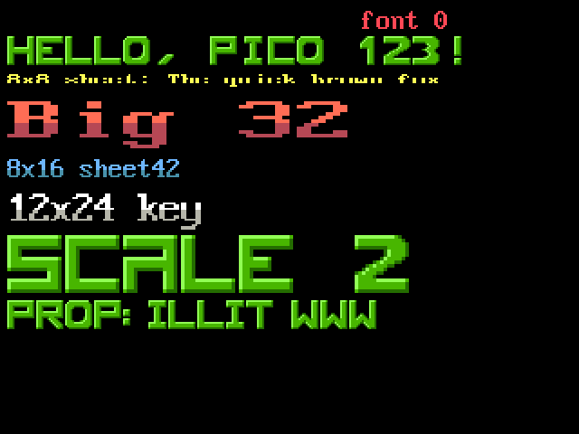
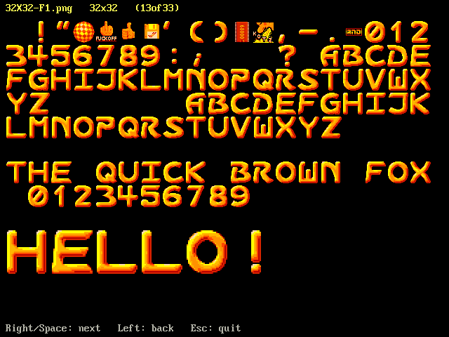
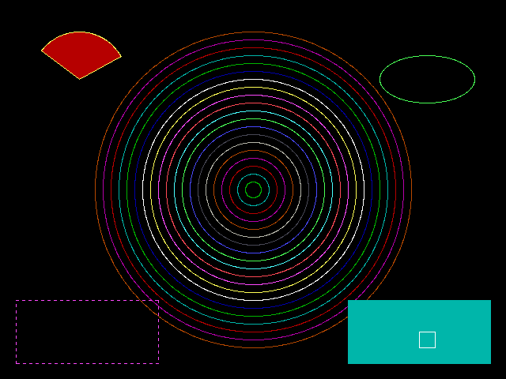

# Pico BASIC User's Manual

Pico BASIC is a GW-BASIC style interpreter built into the Pico 2 mini OS. It
runs on the HDMI console (80 columns by 30 rows), loads and saves programs on
the USB flash drive, draws graphics, and can drive the board's GPIO pins.

## 1. Getting started

From the shell:

    basic                    start BASIC with an empty program
    basic EXAMPLES/GUESS.BAS load a program and run it

BASIC prints a banner and how much memory is free, then the `Ok` prompt.
`SYSTEM` (or `BYE`) returns to the shell.

Lines that start with a number are stored as the program, and anything else
runs straight away:

    10 PRINT "HELLO"
    20 GOTO 10
    RUN

- Typing a line number with nothing after it deletes that line.
- Retyping a line number replaces the line.
- At the prompt, Backspace deletes; arrow keys are ignored. Use `EDIT` to
  change a program in the full-screen editor.
- **Ctrl-C** stops a running program with `Break in <line>`. `CONT` carries
  on from there.

## 2. Program and direct commands

| Command | What it does |
|---|---|
| `RUN` | Runs the program from the start (clears variables first). |
| `RUN line` | Runs from that line. |
| `RUN "file"` | Loads `file` and runs it. |
| `LIST [range]` | Lists the program, pausing every screen (any key goes on, Q stops). A range is `n`, `n-`, `-n` or `n-m`. |
| `NEW` | Deletes the program and its variables. |
| `CLEAR` | Clears variables (any arguments are ignored). |
| `LOAD "file"[,R]` | Loads a program, and with `,R` runs it. Reads plain text and GW-BASIC tokenised files. |
| `SAVE "file"` | Saves as plain text. `.BAS` is added if the name has no extension. |
| `FILES ["pattern"]` | Lists files in the current folder, e.g. `FILES "*.BAS"`. |
| `KILL "file"` | Deletes a file. |
| `DELETE range` | Deletes program lines. |
| `RENUM [new][,[old][,step]]` | Renumbers lines, and the GOTO/GOSUB/THEN/ELSE targets with them (default 10,first,10). |
| `AUTO [start][,step]` | Numbers new lines for you (default 10,10). A `*` after the number means that line exists: Enter keeps it. An empty line where none exists, or Ctrl-C, stops. |
| `EDIT` | Opens the program in the full-screen text editor; it is reloaded when you leave the editor. |
| `EDIT n` (or `EDIT .`) | Puts line `n` (`.`: the last line typed or that failed) on the input line to edit; Enter stores it. |
| `MERGE "file"` | Adds the lines of a plain-text program to the one in memory (lines with the same number are replaced). |
| `CHAIN [MERGE] "file"[, [line][, ALL][, DELETE range]]` | Runs another program from a program, keeping open files. Only the variables named in `COMMON` statements are passed on, or all of them with `ALL`. `CHAIN MERGE` adds the file's lines to the program (after deleting `range`) and keeps all variables. With `ALL`, DEF FN functions work again whenever their own program is loaded back (as they happen to in GW-BASIC); elsewhere calling one is Undefined user function. |
| `LLIST` | Same as LIST (there's no printer). |
| `CONT` | Continues after Ctrl-C or STOP. |
| `TRON` / `TROFF` | Turns line-number tracing on/off. |
| `SYSTEM` / `BYE` | Leaves BASIC. |

File names are relative to the shell's current folder and may include a
folder: `LOAD "EXAMPLES/LISSA"`.

**Editing at the Ok prompt and in INPUT:** Left/Right, Home/End, Backspace
and Delete edit the line; Ins switches between inserting and overwriting;
Esc clears it. At the `Ok` prompt Up/Down bring back the last 8 lines
typed. The function keys F1-F10 type their soft-key text (`KEY LIST`
shows it: F1 is `LIST `, F2 `RUN` and Enter, and so on, as in GW-BASIC).

## 3. Language

### Numbers, strings and variables

- Single-precision (`!`, and plain names) variables keep 7 digits, as in
  GW-BASIC: a value stored in one is rounded to single precision, and such
  values print with 7 digits. `#` variables and calculations use double
  precision (about 15 digits; printed with up to 9). Integer (`%`) variables hold whole numbers from -32768 to
  32767: a value stored in one is rounded (2.5 becomes 3), and one out of
  range gives Overflow. Hex `&HFF` and octal `&O17` constants are accepted.
- Strings are up to 255 characters and may hold any byte, including
  CHR$(0).
- Names are up to 40 characters: letters, digits and `.`, starting with a
  letter, and may end in a type: `$` string, `%` integer, `!` single, `#`
  double. As in GW-BASIC, `A$`, `A%`, `A!` and `A#` are four different
  variables, and `A` without a type is `A!`, unless changed by
  `DEFINT`/`DEFSNG`/`DEFDBL`/`DEFSTR` (after `DEFINT A-Z`, `A` is `A%`).
- An array and a plain variable may share a name: `A` and `A(3)` are
  separate.
- Keywords are recognised without spaces (GW-BASIC style), so a variable
  name must not start with a keyword: `PRINTER` would read as `PRINT ER`.

### Arrays

- `DIM A(20), B$(5,5)`: indices start at 0, up to 8 dimensions.
- Using an array without DIM gives it 0-10 in each dimension.
- `OPTION BASE 1` makes subscripts start at 1.

### Operators, highest priority first

| Operators | Meaning |
|---|---|
| `^` | power |
| `-` | negation |
| `*` `/` | multiply, divide |
| `\` | integer division |
| `MOD` | remainder |
| `+` `-` | add, subtract (`+` also joins strings) |
| `=` `<>` `<` `>` `<=` `>=` | comparisons, giving -1 for true and 0 for false |
| `NOT` | |
| `AND` | |
| `OR` `XOR` | |
| `EQV` `IMP` | |

The logical operators work bit by bit on integers, as in GW-BASIC.

### Statements

| Statement | Notes |
|---|---|
| `LET var = expr` | `LET` is optional. |
| `PRINT` or `?` | `;` keeps the cursor on the line, `,` jumps to the next 14-column zone; `TAB(n)` and `SPC(n)`. |
| `PRINT USING fmt$; values` | Formatted output (below). Also `PRINT #n, USING`, and after other items: `PRINT "X ="; USING "##.#"; X`. |
| `LPRINT`, `LPRINT USING` | Same as PRINT (there's no printer). |
| `INPUT ["prompt";] var[, var...]` | With `,` instead of `;` after the prompt, no `? ` is shown. Asks again if the input doesn't fit. |
| `LINE INPUT ["prompt";] var$` | Reads a whole line, commas included. |
| `IF cond THEN statements [ELSE statements]` | `THEN 100` and `ELSE 200` jump to lines; `IF cond GOTO 100` also works. |
| `GOTO line`, `GOSUB line`, `RETURN` | RETURN ends the FOR and WHILE loops the subroutine started; a FOR in a subroutine doesn't disturb the caller's loop on the same variable. |
| `ON n GOTO l1, l2, ...` / `ON n GOSUB ...` | |
| `FOR v = a TO b [STEP s]` ... `NEXT [v]` | |
| `EXIT FOR` | Leaves the innermost FOR loop (from QuickBASIC). |
| `ON ERROR GOTO line` | Sends errors in a running program to that line (`ON ERROR GOTO 0` turns it off; inside the handler it reports the error and stops). `ERR` and `ERL` give the error code and line. |
| `RESUME`, `RESUME NEXT`, `RESUME line` | Ends an error handler: retries the statement that failed, goes on after it, or goes to the line. |
| `ERROR n` | Raises error `n` (1-255): a test, or a program's own error codes. |
| `ON KEY(n) GOSUB line`, `KEY(n) ON` / `OFF` / `STOP` | Runs the subroutine when key `n` is pressed: 1-10 are F1-F10, 11 Up, 12 Left, 13 Right, 14 Down. |
| `ON TIMER(s) GOSUB line`, `TIMER ON` / `OFF` / `STOP` | Every `s` seconds (1-86400). |
| `MUSIC "file"[, loop]` | Plays a MOD song (`.MOD`, 4/6/8 channels) or an XM song (FastTracker 2, up to 32 channels) in the background while the program runs, mixed with PLAY, SOUND and BEEP, in any SCREEN mode. It starts over at the end unless `loop` is 0. Music a program starts stops when the program ends (END, an error, Ctrl-C); started at the Ok prompt it plays on until `MUSIC STOP`, NEW, RUN or SYSTEM. |
| `MUSIC STOP`, `MUSIC PAUSE`, `MUSIC RESUME` (or `MUSIC ON`) | Stop it, hold it, carry on. |
| `MUSIC VOL n` | Volume, 0-100 (100 at first). |
| `MUSIC POS order[, row]` | Jump to a song position (and row). |
| `MOUSE ON` / `MOUSE OFF` | Shows or hides the mouse pointer (a cell in reversed colours) on the text screen. Graphics modes hide it: draw your own there, at `MOUSEX`, `MOUSEY`. |
| `ON PLAY(n) GOSUB line`, `PLAY ON` / `OFF` / `STOP` | When the background music queue drops below `n` notes. |
| `ON COM(1) GOSUB line`, `COM(1) ON` / `OFF` / `STOP` | When something arrives on the open COM1. |
| `WHILE cond` ... `WEND` | |
| `DEFINT`, `DEFSNG`, `DEFDBL`, `DEFSTR letters` | The type of names without one, by first letter: `DEFINT A-Z`, `DEFSTR S, T`. RUN, NEW and CLEAR reset them. |
| `END`, `STOP` | STOP can be continued with CONT. |
| `REM text` or `' text` | |
| `DATA`, `READ`, `RESTORE [line]` | |
| `DEF FNname(args) = expr` | e.g. `DEF FNSQ(X) = X*X`, then `PRINT FNSQ(3)`. |
| `RANDOMIZE [seed]` | Without a seed it uses the clock. |
| `SWAP a, b` | |
| `MID$(v$, start[, n]) = x$` | Replaces characters of `v$` in place (its length never changes). |
| `OPTION BASE 0` or `1` | The lowest array subscript; before any array is used. |
| `ERASE a, b$` | Deletes arrays, so they can be dimensioned again. |
| `DATE$ = "mm-dd-yyyy"`, `TIME$ = "hh:mm:ss"` | Sets the clock (UTC; `-` or `/` and two-digit years are accepted). |
| `CHDIR`, `MKDIR`, `RMDIR "path"` | Change, make or remove a folder on the drive. |
| `KEY n, x$`, `KEY LIST`, `KEY ON` / `OFF` | Sets or lists the soft keys F1-F10. `KEY ON` shows their labels on text row 25, as on a PC (text above it then scrolls on its own); `KEY OFF` removes them. `KEY 15`-`KEY 20` (user trap keys) are accepted but never trigger. |
| `PLAY "string"` | Music (below). |
| `ENVIRON "NAME=value"` | Sets a string `ENVIRON$` returns (there's no DOS environment). |
| `SHELL "command"` | Runs a shell command, e.g. `SHELL "ls"`, then carries on. |
| `RESET` | Closes all files. |
| `DEF SEG`, `POKE`, `BSAVE`, `BLOAD` | See "Memory" below. |
| `CLS [n]` | Clears the screen; in graphics modes `CLS 1` clears only the graphics, and with a hidden active page (SCREEN pages) CLS clears that page. |
| `PRINT CHR$(n)` | The screen uses the IBM PC character set (code page 437): CHR$(219) is a solid block, CHR$(176)-CHR$(178) are shades, and control codes show their pictures too (CHR$(1) is a smiley), except 7 (beep), 8, 9, 10, 12 (clear screen), 13 and 27; 11 moves the cursor home and 28-31 move it right, left, up and down. |
| `LOCATE row, col[, cursor]` | Rows 1-30, columns 1-80; cursor 0 hides it, 1 shows it. |
| `COLOR fg[, bg]` | PC colours 0-15 (fg 16-31 is treated as 0-15) in text mode; see graphics for graphics modes. |
| `BEEP` | |
| `SOUND freq, ticks` | freq 37-32767 Hz (32767 is silence); 18.2 ticks make a second. After `PLAY "MB"` it goes to the background music queue; ticks 0 stops the sound playing. |
| `PAUSE ms` | Waits (an extension); Ctrl-C still works. |
| `WIDTH`, `LOCK`, `UNLOCK`, `MOTOR`, `STRIG`, `PEN` | Accepted for old programs; they do nothing (the screen stays 80 columns). |
| `OUT`, `WAIT`, `CALL`, `IOCTL`, `DEF USR` | Illegal function call: there are no PC I/O ports and no machine code. |

Several statements can share a line, separated by `:`.

### Functions

| Kind | Functions |
|---|---|
| Maths | `ABS(x)` `INT(x)` (rounds down) `FIX(x)` (cuts off the fraction) `SGN(x)` `SQR(x)` `SIN(x)` `COS(x)` `TAN(x)` `ATN(x)` `EXP(x)` `LOG(x)` `CINT(x)` `CSNG(x)` `CDBL(x)` |
| Random | `RND` or `RND(1)` gives the next number (0 to 1); `RND(0)` repeats the last one; `RND(-n)` reseeds. RUN always starts the same sequence: use `RANDOMIZE` for a different one. |
| Strings | `LEN(s$)` `LEFT$(s$,n)` `RIGHT$(s$,n)` `MID$(s$,start[,n])` `CHR$(n)` `ASC(s$)` `STR$(x)` `VAL(s$)` `INSTR([start,] s$, find$)` `STRING$(n, c or c$)` `SPACE$(n)` `HEX$(n)` `OCT$(n)` `UCASE$(s$)` `LCASE$(s$)` |
| System | `INKEY$` (the key waiting, or ""; function and cursor keys give CHR$(0) and the PC scan code, e.g. F1 is CHR$(0)+CHR$(59), Up CHR$(0)+CHR$(72)), `TIMER` (seconds since start-up), `FRE(0)` (free memory), `POS(0)` (cursor column), `CSRLIN` (cursor row), `DATE$`, `TIME$` (the clock, UTC), `ENVIRON$("name")` or `ENVIRON$(n)`, `SCREEN(row, col[, 1])` (the character on the screen there, or with 1 its colours), `PEEK(offset)` |
| Music | `MUSIC(0)` -1 while music plays (0 when stopped, paused or finished), `MUSIC(1)` the song position, `MUSIC(2)` the row (0-63), `MUSIC(3)` the pattern: for keeping a program in time with the song |
| Sprites | `SPRITEHIT(n[, first, last])`, `SPRITEX(n)`, `SPRITEY(n)`, `SPRITEON(n)` (see Sprites) |
| Keyboard | `KEYDOWN(n)` (an extension): -1 while the key with PC scan code `n` is held down on the USB keyboard, else 0, for games that move while a key is held (INKEY$ only sees presses and auto-repeat). Codes as INKEY$ gives for cursor keys: 72 Up, 75 Left, 77 Right, 80 Down; also 57 Space, 28 Enter, 1 Esc, 29 Ctrl, 42/54 Shift, 56 Alt, letters by their place on the keyboard (16-25 Q-P, 30-38 A-L, 44-50 Z-M), 2-11 the digits 1-0, 59-68 F1-F10. `KEYDOWN(0)` is -1 if a USB keyboard is plugged in (keys typed on the serial console can't be seen held) |
| Mouse | `MOUSEX`, `MOUSEY` (where the pointer is: in SCREEN 0 the column 1-80 and row 1-30, as LOCATE takes them; in graphics modes the pixel, as PSET takes it), `MOUSEB` (buttons held: 1 left, 2 right, 4 middle), `MOUSEW` (wheel clicks since it was last read, + up). All 0 without a mouse |
| Errors | `ERR`, `ERL` (see ON ERROR), `ERDEV`, `ERDEV$`, `EXTERR(n)` (always 0 / "") |
| Sound | `PLAY(0)`: notes still waiting in the background queue |
| Graphics | `POINT(x,y)`; `POINT(n)`: the graphics cursor (0, 1 in pixels; 2, 3 in WINDOW units); `PMAP(v, n)`; `RGB(r,g,b)` |
| Not there | `LPOS`, `STICK`, `STRIG`, `PEN` give 0; `INP`, `USR`, `VARPTR`, `VARPTR$`, `IOCTL$` are an Illegal function call |
| GPIO | `PIN(pin)`, `ADC(pin)`, `TEMP()` |
| Files | `EOF(n)`, `LOF(n)`, `LOC(n)`, `INPUT$(count[, #n])`, `FREEFILE`, `MKI$` `MKS$` `MKD$` `CVI` `CVS` `CVD` |

### PRINT USING

`PRINT USING fmt$; a, b, ...` prints the values in the fields of `fmt$`
(used again from the start if there are more values; other characters are
printed as they are):

| Field | Meaning |
|---|---|
| `#` | A digit position. `##.##` prints `3.5` as ` 3.50`. |
| `.` | The decimal point. |
| `,` before the point | Commas between thousands (it also counts as a digit). |
| `+` first or last | Always show the sign there. |
| `-` last | A minus after negative numbers. |
| `**` | Fill the space before the number with `*`. |
| `$$` | A `$` just before the number. `**$` does both. |
| `^^^^` (or `^^^^^`) | Exponent form: `##.##^^^^` prints ` 2.35E+02`. |
| `!` | The first character of a string. |
| `\  \` | The first n + 2 characters of a string (n spaces between). |
| `&` | The whole string. |
| `_` | Prints the next character as it is. |

A number too big for its field is printed in full after a `%`.

### Error trapping

    10 ON ERROR GOTO 100
    20 OPEN "DATA.TXT" FOR INPUT AS #1
    30 PRINT "opened": END
    100 IF ERR = 53 THEN PRINT "no file": RESUME 30
    110 ON ERROR GOTO 0

A program that reaches its end while handling an error stops with `No
RESUME`. Ctrl-C can't be trapped.

### Music: PLAY

`PLAY "string"` plays notes on the HDMI audio, in GW-BASIC's music language:

| Command | Meaning |
|---|---|
| `A`-`G` [`#`, `+` or `-`] [length] [`.`] | A note (sharp or flat), optionally with its own length; each dot adds half again. |
| `N n` | Note number n (1-84; 0 is a rest). |
| `O n`, `>`, `<` | Octave 0-6 (default 4; octave 3 starts at middle C), up one, down one. |
| `L n` | Length for following notes: 1 whole, 4 quarter (default), up to 64. |
| `P n` | A pause, length as for L. |
| `T n` | Tempo, 32-255 quarter notes a minute (default 120). |
| `MN` `ML` `MS` | Normal (7/8 of each note sounds), legato (all), staccato (3/4). |
| `MF` `MB` | Foreground (PLAY waits until the music ends; the default) or background (up to 32 notes queue up and the program goes on; `PLAY(0)` counts them). |

The settings last from one PLAY to the next; RUN resets them. `X` and `=`
(substrings and variables through VARPTR$) aren't supported.

### Events

ON KEY, ON TIMER, ON PLAY and ON COM jump to a subroutine when something
happens, checked between statements. `ON`, `OFF` and `STOP` switch an event:
an event while it is STOPped (or while its own subroutine runs) is
remembered and handled once it is back ON. RETURN from the subroutine
continues the program where it was.

    10 ON TIMER(1) GOSUB 100: TIMER ON
    20 ON KEY(1) GOSUB 200: KEY(1) ON
    30 GOTO 30
    100 PRINT TIME$: RETURN
    200 PRINT "F1 pressed": RETURN

### Memory: PEEK and POKE

There's no PC memory, so `DEF SEG = segment` with `PEEK(offset)`, `POKE
offset, byte`, `BSAVE "file", offset, length` and `BLOAD "file"[, offset]`
reach a few emulated places; anything else is an Illegal function call:

- `&HB800` (and `&HB000`): the text screen, two bytes per character, the
  character and then its colours (foreground + 16 x background), 80 to a
  row, 30 rows. In SCREEN 1 and 2 it is the graphics instead, laid out as
  on a CGA: even lines in the first 8 KB, odd ones from `&H2000`, 80 bytes a
  line (4 pixels a byte in SCREEN 1, 8 in SCREEN 2). So pictures saved with
  `BSAVE` on a PC load with `BLOAD`.
- `&HA000` in SCREEN 13: the pixels, one byte each, 320 to a row.
- `DEF SEG = 0` (or `&H40`): BIOS bytes: video mode (&H449), columns
  (&H44A), rows - 1 (&H484) and the timer tick count (&H46C-&H46E, 18.2 a
  second, from midnight UTC). The rest read 0, and POKEs there do nothing.

BSAVE files have GW-BASIC's 7-byte header.

## 4. Data files

Programs can read and write files on the drive, GW-BASIC style. Up to 4
files can be open at once, numbered #1 to #4. File names are relative to the
shell's current folder, as for LOAD; no extension is added. Each open file
uses about 0.8 KB of memory (plus its record buffer for random files) while
it is open.

| Statement / function | What it does |
|---|---|
| `OPEN "file" FOR INPUT \| OUTPUT \| APPEND \| RANDOM AS [#]n [LEN=size]` | Opens a file. OUTPUT creates or empties it, APPEND adds to the end, RANDOM (also the default when FOR is left out) reads and writes fixed-size records (LEN 1-1024, default 128). |
| `OPEN "I" \| "O" \| "A" \| "R", [#]n, "file"[, size]` | The older short form. |
| `CLOSE [[#]n[, [#]n...]]` | Closes the given files, or all of them. |
| `PRINT #n, items` | Like PRINT, but into the file. Lines end in CR LF, and there is no 80-column wrap. |
| `WRITE [#n,] items` | Writes items separated by commas, with strings in quotes, so INPUT # reads them back exactly. Without `#n` it writes to the screen. |
| `INPUT #n, var[, var...]` | Reads items: a quoted string, or text up to a comma or the end of the line (numbers also stop at a space). |
| `LINE INPUT #n, var$` | Reads a whole line. |
| `INPUT$(count[, [#]n])` | Reads count characters from a file, or from the keyboard (without showing them) when no file is given. |
| `EOF(n)` | -1 when there is nothing more to read (for a random file: the last GET was past the end). |
| `LOF(n)` | The file's length in bytes. |
| `LOC(n)` | For a random file, the last record read or written; otherwise the position in 128-byte blocks. |
| `FREEFILE` | The lowest free file number. |
| `FIELD #n, width AS var$[, width AS var$...]` | Divides a random file's record buffer into string fields (at most 16, and no more than the record length). |
| `LSET var$ = s$` / `RSET var$ = s$` | Puts a string into a field, padded with spaces to the field's width and aligned left or right. Use these, not LET, for field variables. |
| `PUT [#]n[, record]` | Writes the record buffer as record number `record` (from 1; default: the one after the last). |
| `GET [#]n[, record]` | Reads a record into the buffer and its FIELD variables. |
| `NAME "old" AS "new"` | Renames a file. |
| `KILL "file"`, `FILES` | Delete and list files (section 2). |
| `MKI$(n)` / `CVI(s$)` | A whole number -32768 to 32767 as a 2-byte string (low byte first), and back. |
| `MKS$(x)` / `CVS(s$)` | A number as a 4-byte single-precision string, and back (about 7 digits). |
| `MKD$(x)` / `CVD(s$)` | A number as an 8-byte double-precision string, and back. |

When files are closed:

- Files stay open across lines and statements until CLOSE.
- RUN, NEW, CLEAR, END, the program finishing, an error that stops the
  program, and leaving BASIC all close every file.
- Ctrl-C does not close files, so CONT can carry on.

Example:

    10 OPEN "SCORES.TXT" FOR OUTPUT AS #1
    20 WRITE #1, "Ann", 120
    30 CLOSE #1
    40 OPEN "SCORES.TXT" FOR INPUT AS #1
    50 WHILE NOT EOF(1): INPUT #1, N$, S: PRINT N$, S: WEND
    60 CLOSE #1

MKS$ and MKD$ use GW-BASIC's own number format (Microsoft Binary Format), so
random files written by GW-BASIC on a PC read correctly here, and the other
way round. CVI, CVS and CVD need at least 2, 4 and 8 bytes (otherwise
Illegal function call); MKI$ of a number out of range, or MKS$/MKD$ of one
too large for the format, gives Overflow.

Random-access example (a 22-byte record: a 20-character name and a 2-byte
number):

    10 OPEN "PEOPLE.DAT" FOR RANDOM AS #1 LEN = 22
    20 FIELD #1, 20 AS NM$, 2 AS AGE$
    30 LSET NM$ = "Grace": LSET AGE$ = MKI$(85): PUT #1, 1
    40 GET #1, 1: PRINT NM$; CVI(AGE$)
    50 CLOSE #1

Differences from GW-BASIC:

- A file can be open for INPUT under several numbers, but not written while
  it is open elsewhere.
- Ctrl-Z (byte 26) ends a file for INPUT # and INPUT$, as in GW-BASIC, so
  binary files are best read with random access (GET).

### Serial port (COM1)

The serial port works like a file: open it with a "COM1:" name, then use
PRINT #, WRITE #, INPUT #, LINE INPUT # and INPUT$ on it.

    OPEN "COM1:[speed][,parity][,data][,stop][,options]" AS #n

- **Settings:** speed 75-921600 baud; parity N, E or O; data bits 5-8; stop
  bits 1 or 2. As in GW-BASIC, anything left out defaults to 300 baud, even
  parity, 7 data bits and 1 stop bit, so usually you give them all, e.g.
  `OPEN "COM1:9600,N,8,1" AS #1`.
- **Pins:** COM1 is the RP2350's UART1, on GP4 (TX) and GP5 (RX) unless
  `TXn` / `RXn` options choose others: TX on GP4, 8, 20 or 24 and RX on GP5,
  9, 21 or 25. While it is open, those pins are refused to PINMODE/PIN/PWM,
  and it won't open on pins a program is using as GPIO.
- **Levels:** 3.3 V logic. Use a level shifter or USB-serial adapter for
  RS-232 or 5 V devices, and connect GND too.
- **Options:** `LF` sends an LF after each CR. `RS`, `CS`, `DS`, `CD`,
  `PE`, `BIN` and `ASC` are accepted and do nothing (there are no handshake
  lines).
- **Sending:** PRINT # ends lines with CR (CR LF with the LF option). TX
  waits while the UART is busy.
- **Receiving:** bytes are received in the background into a 4 KB buffer,
  so none are lost while the program is busy (if it fills, new bytes are
  dropped). `LOC(n)` is how many bytes are waiting, `EOF(n)` is -1 when none
  are, and `LOF(n)` is the room left. INPUT #, LINE INPUT # and INPUT$ wait
  for data, and Ctrl-C stops the wait. A line ends at CR (an LF after it is
  skipped).
- **Limits:** only one COM port can be open, and GET/PUT/FIELD don't apply
  to it. COM0 (UART0) is the system's debug console and can't be opened.

Example: `examples/SERIAL.BAS` is a small terminal. Wire GP4 to GP5 and
what you type comes straight back.

## 5. Graphics

### Screen modes

| Mode | Size | Colours |
|---|---|---|
| `SCREEN 0` | text | 16 |
| `SCREEN 1` | 320x200 | 4 |
| `SCREEN 2` | 640x200 | 2 |
| `SCREEN 7` | 320x200 | 16, 8 pages |
| `SCREEN 8` | 640x200 | 16, 4 pages |
| `SCREEN 9` | 640x350 | 16, 2 pages |
| `SCREEN 10` | 640x350 | 4 shades of grey, 2 pages |
| `SCREEN 11` | 640x480 | 2 |
| `SCREEN 12` | 640x480 | 16 |
| `SCREEN 13` | 320x200 | 256 (an approximation of the VGA palette) |

The low-resolution modes are scaled up. The 200-line ones (1, 2, 7, 8,
13) sit at the top of the screen so that their 25 text rows line up with the
graphics as on a PC; the others are centred. `WIDTH 80` in SCREEN 1 switches
to SCREEN 2 and `WIDTH 40` in SCREEN 2 back, as in GW-BASIC.

`SCREEN [mode] [, [colour] [, [apage] [, vpage]]]` picks the page drawn on
(apage) and the page shown (vpage) in modes 7-10, for flicker-free animation:
draw the next frame on the hidden page, then show it. Repeating the current
mode with pages only flips pages and keeps the pictures. Hidden pages live
in PSRAM, and showing another page copies it to the screen.
Text (PRINT) always goes to the page on show. `CLS 1` clears
just the graphics of the active page.
PRINT and LOCATE text stays 80 columns and is drawn over the graphics.
Leaving BASIC returns to text mode.

### Drawing statements

| Statement | What it does |
|---|---|
| `PSET (x,y)[, colour]` | Plots a point. |
| `PRESET (x,y)[, colour]` | Plots a point, in the background colour unless a colour is given. |
| `LINE [(x1,y1)]-(x2,y2)[, colour][, B or BF][, style]` | Draws a line, a box (`B`) or a filled box (`BF`). `style` is a 16-bit dash pattern. |
| `CIRCLE (x,y), r[, colour[, start, end[, aspect]]]` | Angles are in radians; a negative angle draws the radius line too, for pie slices. |
| `PAINT (x,y)[, colour[, border]]` | Flood-fills up to the border colour. |
| `DRAW "string"` | Turtle graphics (below). Numbers can be `=variable;`, e.g. `DRAW "M=X;,=Y;"` (PLAY takes them too). |
| `PALETTE [attr, colour]` | Changes what a colour number draws; `PALETTE` alone resets. |
| `COLOR [fg][, bg]` | Sets the drawing and background colours in graphics modes. |
| `VIEW [[SCREEN] (x1,y1)-(x2,y2)[, [fill][, border]]]` | Limits drawing to a rectangle (the viewport), optionally filling it and framing it. Coordinates then count from its corner (with SCREEN, from the screen's). `VIEW` alone goes back to the whole screen. CLS clears just the viewport. |
| `WINDOW [[SCREEN] (x1,y1)-(x2,y2)]` | Your own coordinates for the viewport: (x1,y1) is the bottom left and y goes up (with SCREEN: top left, y down). `PMAP` converts. `WINDOW` alone turns it off. DRAW still works in pixels. |
| `VIEW PRINT [top TO bottom]` | Text scrolls only in rows top-bottom. |
| `GET (x1,y1)-(x2,y2), a` | Copies a rectangle into numeric array `a` (or from `a(i)` on). It needs 1 + (width x height x bits per pixel) / 32 elements: 2 bits a pixel in SCREEN 1, 1 in 2 and 11, 4 in the 16-colour modes, 8 in 13. |
| `PUT (x,y), a[, PSET | PRESET | XOR | OR | AND]` | Draws it back; XOR (the default) twice restores what was there. |
| `PCOPY from, to` | Copies one screen page over another. |

- `STEP(dx,dy)` makes any coordinate relative to the last point drawn; in `LINE (x1,y1)-STEP(dx,dy)` the second point is relative to the first, as in GW-BASIC.
- `RGB(r,g,b)` (r, g, b 0-255) returns 256 plus an RGB332 colour; every
  drawing statement accepts that as an exact colour, in any mode.
- `POINT(x,y)` returns the colour number at a pixel.

### Sprites (an extension)

Up to 64 sprites move over the graphics in any SCREEN mode without
disturbing them: each is drawn with its see-through pixels left alone, and
what was behind it is put back when it moves. Pictures come from GET, or
from .SPR files made with the sprite editor (`sprite`, see the *Sprite
Editor* manual).

| Statement / function | What it does |
|---|---|
| `SPRITE SHAPE s, a[(i)]` | Keeps the picture in array `a` (made by GET) as shape `s` (0-63). Colour 0 is see-through. The array can be used again afterwards. |
| `SPRITE LOAD "file"[, s]` | Keeps the frames of a .SPR file (from the sprite editor) as shapes `s`, `s`+1, ... (`s` is 0 if left out), in their own RGB332 colours whatever the mode or PALETTE; their see-through pixels stay see-through. |
| `SPRITE n, x, y[, s[, dx, dy]]` | Puts sprite `n` (0-63) at (x,y), in the mode's pixels (it may hang off the screen), with shape `s` (the one it had if left out) and a speed in pixels per update it keeps. |
| `SPRITE n OFF`, `SPRITE CLEAR` | Hides one sprite, or all of them. |
| `SPRITE UPDATE [f]` | Shows the changes: puts back what was behind every sprite, moves each by its speed times `f` (default 1; one that moves wholly off the screen turns off), and draws them all again, higher numbers on top. Call it once a frame, after drawing. |
| `SPRITEHIT(n[, first, last])` | The lowest-numbered sprite (from `first` to `last`, default all) that is on and has a pixel where sprite `n` has one, or -1. |
| `SPRITEX(n)`, `SPRITEY(n)`, `SPRITEON(n)` | Where sprite `n` is, and -1 if it is on (0 if not). |

Nothing appears until `SPRITE UPDATE`, so a frame's changes show at once. Drawing
the program does over a sprite between updates stays (it isn't overwritten
when the sprite moves on). CLS forgets what was behind the sprites; SCREEN,
RUN, NEW and CLEAR remove the sprites and shapes. `examples/NOVA.BAS` uses
them for everything that moves.

    10 SCREEN 13: DIM A(40): CIRCLE (5,5),5,14: PAINT (5,5),12,14
    20 GET (0,0)-(10,10),A: CLS: SPRITE SHAPE 0, A
    30 FOR I=0 TO 199 STEP 8: LINE (0,I)-(319,I),2: NEXT
    40 SPRITE 0, 0, 90, 0, 2, 0
    50 SPRITE UPDATE: PAUSE 20: IF SPRITEON(0) THEN 50

### Font sheets (an extension)





A font sheet is a picture (BMP, PNG or JPEG) of characters laid out in a
grid of equal cells, from 8x8 up to 32x32 pixels (they needn't be square:
8x16, 12x24...), starting with the space, CHR$(32), and going on in ASCII
order. `GPRINT` draws text with one anywhere on a graphics screen, in the
sheet's own colours. Up to 8 sheets can be loaded; font 0 is the console's
8x16 font, so `GPRINT` works without one. `examples/FONTDEMO.BAS` uses the
sheet `EXAMPLES/FONTS/16X16-F2.PNG`.

| Statement / function | What it does |
|---|---|
| `FONT LOAD n, "file"[, w, h[, first[, perrow]]]` | Loads a sheet as font `n` (1-8). Without `w, h` the cell size comes from the file's name if it has one (`16X16-F2.PNG`, `font8x16.bmp`), else from the picture's size (the usual 96, 80, 64 or 60 characters, 16, 20 or 32 a row; a few spare rows of pixels at the bottom are allowed); in direct mode it says what it chose. `first` is the first cell's character (32), `perrow` the cells in a row (the picture's width / `w`). The colour of the top-left pixel is see-through. |
| `FONT n` | Chooses the font `GPRINT` uses (0, the console font, at first). |
| `GPRINT [x, y,] item[; item...][, scale[, colour]]` | Draws strings and numbers (as `STR$` without its space) with the top-left corner at (x, y), in the mode's coordinates (VIEW and WINDOW apply; drawing is clipped to the viewport). Without x, y it goes on where the last `GPRINT` ended. `scale` (1-16) makes each pixel of the font that many; `colour` draws every pixel of the characters in one colour (font 0 uses the drawing colour unless one is given); -2 draws the sheet's exact colours even in the 16-colour modes. |
| `FONT PROP n, ON|OFF[, gap]` | Proportional spacing: each character takes only its own width plus `gap` pixels (1); a space is half a cell. |
| `FONT KEY n, colour` | Which colour of the sheet is see-through (`RGB(r,g,b)`, a colour number, or -1 for none: every pixel is drawn). |
| `FONT CLEAR [n]` | Forgets one font or all of them. RUN, NEW and CLEAR forget them too. |
| `GWIDTH(a$)` | How wide `a$` is in the current font, in pixels at scale 1 (for centring: `GPRINT (320 - GWIDTH(A$)) \ 2, 10, A$`). |
| `FONTW(n)`, `FONTH(n)` | Font `n`'s cell width and height (0 if nothing is loaded there). |
| `DIR$(pattern$[, n])` | The `n`th name (1 first) in a folder matching the pattern, e.g. `DIR$("/BFONTS/*.PNG", 3)`; "" after the last. For going through a folder's files. |

- A character the sheet lacks is skipped (it still takes a cell); lower case
  falls back on upper case when the sheet has none, as with this one.
- In the modes of 16 colours or fewer the sheet's colours become the nearest
  in the palette (so `PALETTE` and `POINT` work on them); SCREEN 13 shows
  them as they are. Give a colour to draw a sheet in one colour instead.
- Characters are drawn into the screen like LINE and PSET, so scrolling text
  needs its old place cleared first (`LINE ..., 0, BF`).

    10 SCREEN 13: FONT LOAD 1, "/EXAMPLES/FONTS/16X16-F2.PNG": FONT 1
    20 GPRINT 10, 20, "HELLO", 2: GPRINT 10, 60, "SCORE "; 1200
    30 FONT PROP 1, ON: GPRINT 10, 90, "Proportional", 1, 14

### DRAW commands

| Command | Meaning |
|---|---|
| `U n` `D n` `L n` `R n` | up, down, left, right |
| `E n` `F n` `G n` `H n` | diagonals |
| `M x,y` / `M +dx,-dy` | move to, or move by |
| `B` prefix | move without drawing |
| `N` prefix | draw, then return to the start |
| `C n` | colour |
| `S n` | scale (4 = 1:1) |
| `A n` / `TA angle` | rotate |
| `P fill,border` | paint |
| `=variable;` | use a variable's value |

### Pictures

| Statement | What it does |
|---|---|
| `IMAGE "file"` | Draws a BMP, PNG or JPEG picture as large as fits on the screen (or the graphics area of the SCREEN mode), keeping its shape. |
| `IMAGE "file", x, y` | Draws it at its own size with its top-left corner at (x, y): one picture pixel per pixel of the mode, so it looks twice as big in SCREEN 13. |
| `IMAGE "file", x, y, w, h[, fit]` | Stretches it to the w x h box; with `fit` non-zero, makes it as large as fits in the box without stretching, centred. |
| `SAVEIMAGE "file"` | Saves the whole screen as an 8-bit BMP (`.BMP` is added if the name has no extension). |

- **Formats:** BMP with 1, 4, 8, 16, 24 or 32 bits per pixel
  (uncompressed), PNG (any colour type, interlaced too), and baseline JPEG.
  Progressive JPEGs give an error.
- **Colours:** pictures are drawn in the screen's 256 RGB332 colours with
  ordered dithering, whatever the SCREEN mode or PALETTE. Coordinates are
  the mode's own, and drawing is clipped to the mode's area. In SCREEN 0 the
  coordinates are screen pixels and the picture is drawn over the text.
- **Size and speed:** big JPEGs are decoded at 1/2, 1/4 or 1/8 size when that
  is still enough for the space, so a 12-megapixel photo is fine. Pictures
  are decoded into the 8 MB PSRAM, and can be up to about 2.6 million pixels
  after that reduction. A full-screen JPEG or PNG of 30-40 KB takes about 2
  seconds (decoding about 1, reading the file most of the rest, and drawing
  0.3). Files are read from the drive at about 60 KB/s, so a big
  uncompressed BMP (900 KB) takes some 15 seconds: prefer PNG or JPEG.
- **Errors:** a missing file gives `File not found`; a file that isn't a
  picture this can read gives `Illegal function call`, after a line saying
  why.

The shell can show and save pictures too: `view file` shows one full screen
until a key is pressed, and `screenshot [file]` saves the screen as a BMP.

### Differences from GW-BASIC

- PALETTE changes what later drawing uses, not pixels already on screen.
- DRAW works in pixels even with a WINDOW set.
- With screen pages, PRINT always draws on the page being shown.

## 6. GPIO (Pico extensions)

Pins are given by their GP number. The word `LED` can be used for the
board's LED (GP25).

| Statement / function | What it does |
|---|---|
| `PINMODE pin, INPUT \| OUTPUT \| PULLUP \| PULLDOWN` | Sets a pin up (or modes 0-3). |
| `PIN pin, level` | Drives a pin 0 or 1, making it an output first if needed. |
| `PIN(pin)` | Reads a pin, making an unused pin an input. |
| `PWM pin, freq[, duty]` | Runs PWM at 8 Hz-10 MHz with a duty of 0-100 % (default 50). `PWM pin, 0` stops it. |
| `SERVO pin, angle` | Drives a hobby servo, 0-180 degrees (0.5-2.5 ms pulses at 50 Hz). |
| `ADC(pin)` | Reads an analog input on GP40-GP46, 0-4095 for 0-3.3 V. |
| `TEMP()` | The chip's temperature in °C (see the notes below). |
| `PINS` | Lists all 48 pins and what each is doing. |

Notes:

- PWM pins come in pairs that share one frequency (GP0/1, GP2/3 and so on).
  Changing the frequency of one prints a warning naming its partner.
- Pins the system needs are refused, for example `GP13 is used by HDMI`
  followed by `Illegal function call`:
  - GP0-1: debug serial
  - GP12-19: HDMI
  - GP32-36: WiFi breakout
  - GP47: PSRAM
- `RUN`, `NEW` and leaving BASIC set every pin BASIC used back to an input
  and stop PWM. `END`, errors and Ctrl-C leave pins as they are, so they
  can be checked in direct mode.
- `PIN`, `ADC` and `TEMP` followed by `(` are functions, so arrays can't
  use those names.

### I2C and SPI

The chip's own I2C and SPI controllers, for sensors, displays, memory chips
and the like. The pins choose the controller: I2C wants SDA on an even pin
and SCL on the next one (I2C0 or I2C1 by the pin numbers); SPI wants SCK,
MOSI and MISO from one group of four (MISO, CS, SCK, MOSI: GP8-11 is SPI1,
GP20-23 SPI0 ...). While open, those pins are refused to PIN, PWM and COM1
(and `PINS` shows them). RUN, NEW and leaving BASIC close them.

| Statement / function | What it does |
|---|---|
| `I2C OPEN [sda, scl[, khz]]` | Starts I2C, by default on **GP2 (SDA) and GP3 (SCL)**, I2C1, at 100 kHz (10-1000). Turns on the pins' weak pull-ups; devices should have their own. |
| `I2C WRITE addr, item[, item...][, NOSTOP]` | Sends bytes to the device at `addr` (0-127): numbers 0-255 and strings (their bytes). With `NOSTOP` the bus is kept for a read that follows. |
| `I2CREAD$(addr, n[, reg])` | Reads `n` bytes (1-255); with `reg`, first writes that register number (without a stop). |
| `I2CREAD(addr[, reg])` | Reads one byte. |
| `I2C SCAN` | Prints the addresses that answer (8-119). |
| `I2C CLOSE` | Stops it and frees the pins. |
| `SPI OPEN [sck, mosi, miso[, khz[, mode]]]` | Starts SPI, by default on **GP10 (SCK), GP11 (MOSI), GP8 (MISO)**, SPI1, at 1000 kHz (1-50000), mode 0 (0-3: clock polarity and phase); 8-bit words, most significant bit first. Chip select is any pin you drive with `PIN` (**GP9** is free for it). |
| `SPI WRITE item[, item...]` | Sends bytes (numbers 0-255 and strings), ignoring what comes back. |
| `SPI$(out$)` | Sends `out$` and returns the bytes that came back meanwhile (as many): `SPI$(STRING$(4, 0))` reads 4. |
| `SPI CLOSE` | Stops it and frees the pins. |

- A device that doesn't answer gives `Device I/O error` (57); using I2C or
  SPI before OPEN gives `Device unavailable` (68). Both can be caught with
  ON ERROR.
- Other pins: any SDA/SCL pair the controllers have (GP6/7, GP20/21, GP26/27
  ...), avoiding GP0-1 (debug serial), GP4-5 (COM1's usual pins), GP12-19
  (HDMI), GP32-36 (WiFi) and GP47 (PSRAM).

    10 I2C OPEN: I2C SCAN
    20 T = I2CREAD(&H48, 0): PRINT "LM75 at &H48:"; T
    30 PIN 9, 1: SPI OPEN: PIN 9, 0: SPI WRITE &H9F
    40 ID$ = SPI$(STRING$(3, 0)): PIN 9, 1: PRINT LEN(ID$); "bytes"

## 7. Errors

Errors print as `<message> in <line>` (or just the message in direct mode).
The messages are:

- NEXT without FOR
- Syntax error
- RETURN without GOSUB
- Out of DATA
- Illegal function call
- Overflow
- Out of memory
- Undefined line number
- Subscript out of range
- Duplicate Definition
- Division by zero
- Illegal direct
- Type mismatch
- String too long
- Can't continue
- Undefined user function
- FOR without NEXT
- WHILE without WEND
- WEND without WHILE
- Bad file name
- File not found
- Bad file mode
- Device I/O error
- File already exists
- Disk full
- Permission denied
- Disk not ready
- Protected file
- FIELD overflow
- Bad file number
- File already open
- Input past end
- Bad record number
- Too many files
- Device unavailable
- No RESUME
- RESUME without error
- Path/File Access Error
- Path not found

and GW-BASIC's other messages for `ERROR n` (Out of string space, Missing
operand, Device Timeout and so on). Unknown codes print `Unprintable
error`.

## 8. Limits

- **Memory:**
  - The program, variables, strings and arrays get about 8 MB: the PSRAM
    plus spare SRAM (the banner and `FRE(0)` show it). Blocks of 512 bytes
    or more (arrays, mostly) go in PSRAM and small ones (strings, program
    lines, variables) in the faster SRAM, until SRAM runs low.
  - A program line is refused if it would leave less than 16 KB for data.
  - Any allocation is refused if it would leave less than 4 KB free.
- **Lines and strings:** program lines are up to 255 characters, and so are
  strings.
- **Nesting:** FOR, GOSUB and WHILE can each be nested up to 32 deep.
  Expressions can nest deeply; if one runs out of stack it gives
  `Out of memory` rather than crashing.

## 9. Not included

- Machine code and PC hardware: `CALL`, `USR`, `DEF USR`, `VARPTR`,
  `VARPTR$`, `INP`, `OUT`, `WAIT`, `IOCTL` (Illegal function call), and
  PEEK/POKE outside the emulated places above.
- `PLAY` substrings (`X`), which need VARPTR$.
- 40-column text (`WIDTH 40` in text mode).
- Joystick and light pen (`STICK`, `STRIG`, `PEN` and their events), the
  printer (LPRINT and LLIST go to the screen), and COM ports other than COM1.
- GW-BASIC's full-screen editing of any line on the screen; lines are
  edited on the input line instead (`EDIT n`).

## 10. Known problems

- `TEMP()` is uncalibrated, so within a few degrees, and varies a little
  between readings.

## 11. Example programs (EXAMPLES folder on the drive)

No songs come with the source. The examples that play music look for
`/EXAMPLES/DEMO.MOD` (MUSIC.BAS, FONTDEMO.BAS) and `NOVA.MOD` (NOVA.BAS):
make them with `python3 tools/make_demo_mod.py` and `python3
tools/make_nova_mod.py` (they write to `examples/`), or use MOD or XM songs
of your own. Without them, MUSIC.BAS says so, and FONTDEMO.BAS and NOVA.BAS
run without music.

- `MUSIC.BAS`: a ball bounces while `/EXAMPLES/DEMO.MOD` plays, its colour following the song's rows (needs DEMO.MOD from the source's examples folder in /EXAMPLES).

| Program | What it does |
|---|---|
| PRIMES.BAS | prints the primes below 1000 |
| GUESS.BAS | guess-the-number game |
| BOXES.BAS | coloured text boxes with shading characters |
| LISSA.BAS | Lissajous curves (SCREEN 12) |
| CHART.BAS | all 256 colours of SCREEN 13 |
| HOUSE.BAS | a house and sun drawn with LINE, CIRCLE and PAINT |
| SHAPES.BAS | circles, arcs, ellipses, styled boxes, PAINT and POINT |
| BLINK.BAS | flashes the LED |
| FADE.BAS | fades the LED with PWM |
| ANALOG.BAS | shows the ADC inputs and the chip temperature |
| FILES.BAS | writes, appends and reads back a text file, and stores and reads records (with MKI$/CVI) in a random-access file |
| SERIAL.BAS | a small terminal on COM1 (GP4 TX, GP5 RX) |
| SLIDES.BAS | a slide show of the pictures in the IMAGES folder, sprites and a picture in a box, then SAVEIMAGE |
| I2CSCAN.BAS | lists the I2C devices on GP2/GP3 and reads the first one's registers 0-7 |
| SPIFLASH.BAS | reads an SPI flash chip's JEDEC ID and first 16 bytes (SPI1 on GP8-11) |
| FONTVIEW.BAS | shows every font sheet in /BFONTS (or /NET/bfonts) one at a time with the size FONT LOAD found: all the characters, a sentence and a big HELLO; arrows, Space or Backspace to go through them, Esc to quit |
| FONTDEMO.BAS | text drawn with a font sheet (EXAMPLES/FONTS/16X16-F2.PNG, which must be there too): a big title, proportional spacing, the console font in colours, a scrolling message, and MUSIC in the background |
| COINS.BAS | sixteen spinning coins bouncing over a sky: the eight frames of COIN.SPR (drawn in the sprite editor, next to it or in /EXAMPLES) loaded with SPRITE LOAD; any key quits |
| NOVA.BAS | NOVA STRIKE, a space shooter: SCREEN 13 with SPRITE, waves of enemies, a mothership every fifth wave, power-ups, sound effects with SOUND after `PLAY "MB"`, its soundtrack NOVA.MOD through MUSIC, titles in the font sheet FONTS/16X16-F7.PNG the score display in FONTS/16X16-FA.PNG and the title screen's scrolling help in FONTS/16X16-FG.PNG (FONT LOAD, GPRINT), and a rendered ringed planet and moon on the title screen (NOVAPLAN.PNG, NOVAMOON.PNG, drawn with IMAGE; copy them all to /EXAMPLES too, or it falls back to /NET/bfonts and the console font). arrows or WASD move the ship while held (with KEYDOWN), the mouse steers too, Space/Z/click fire, F toggles auto-fire, B or right-click bombs, P pauses, Esc quits; it plays itself on the title screen after 20 seconds |

Run one with `basic EXAMPLES/NAME.BAS`, or `RUN "EXAMPLES/NAME"` from inside
BASIC. Graphics demos wait for a key, then return to text.

### Gallery

**HOUSE.BAS**: DRAW outlines, then PAINT fills them (SCREEN 12).


```
10 REM A house drawn with DRAW, then coloured in with PAINT
20 REM PAINT fills up to one border colour, so every outline is white (15)
30 SCREEN 12
40 PSET (220, 380), 15
50 DRAW "C15 R200 U160 L200 D160"
60 DRAW "BU160 E100 F100"
70 DRAW "BM240,380 U70 R40 D70"
80 DRAW "BM340,280 R40 U40 L40 D40"
90 PAINT (400, 300), 6, 15
100 PAINT (320, 180), 4, 15
110 PAINT (360, 260), 9, 15
120 PAINT (260, 350), 14, 15
130 CIRCLE (520, 90), 40, 14
140 PAINT (520, 90), 14
150 FOR A = 0 TO 7
160   DRAW "BM520,90 TA" + STR$(A * 45) + " BU50 C14 U25"
170 NEXT A
180 LINE (0, 381)-(639, 479), 2, BF
190 WHILE INKEY$ = "": WEND
200 SCREEN 0
```

**LISSA.BAS**: Lissajous figures with `LINE -(x, y)` (SCREEN 12).


```
10 REM Lissajous figures in 16 colours
20 SCREEN 12
30 FOR K = 1 TO 6
40   COLOR K + 8
50   PSET (320, 240 + 200 * SIN(K))
60   FOR T = 0 TO 6.3 STEP .01
70     LINE -(320 + 200 * SIN(K * T), 240 + 200 * SIN((K + 1) * T + K))
80   NEXT T
90 NEXT K
100 LOCATE 29, 1: PRINT "Press a key";
110 WHILE INKEY$ = "": WEND
120 SCREEN 0
```

**SHAPES.BAS**: circles, an arc filled as a pie slice, an ellipse, a dashed box and a filled one.



**CHART.BAS**: the 256 colours of SCREEN 13 (the last eight are black in the default palette).


```
10 REM The 256 colours of SCREEN 13, in 16 x 16 filled boxes
20 SCREEN 13
30 FOR C = 0 TO 255
40   X = (C MOD 16) * 20: Y = (C \ 16) * 12
50   LINE (X, Y)-(X + 18, Y + 10), C, BF
60 NEXT C
70 LINE (0, 194)-(319, 199), RGB(255, 128, 0), BF
80 WHILE INKEY$ = "": WEND
90 SCREEN 0
```

**SLIDES.BAS**: pictures from the IMAGES folder with IMAGE (BMP, PNG, JPEG).


**FONTDEMO.BAS**: font sheets with FONT LOAD and GPRINT, with music playing.


```
10 REM FONTDEMO.BAS: text drawn with font sheets (FONT and GPRINT).
20 REM The sheet is EXAMPLES/FONTS/16X16-F2.PNG; any key ends it.
30 SCREEN 13: CLS
40 FONT LOAD 1, "/EXAMPLES/FONTS/16X16-F2.PNG"
50 MUSIC "/EXAMPLES/DEMO.MOD"
60 FONT 1: T$ = "FONTS"
70 GPRINT (320 - GWIDTH(T$) * 3) \ 2, 4, T$, 3
80 FONT PROP 1, ON: S$ = "IN PICO BASIC"
90 GPRINT (320 - GWIDTH(S$)) \ 2, 54, S$
100 FONT 0: L$ = "8x8 to 32x32 cells, any colours"
110 GPRINT (320 - GWIDTH(L$)) \ 2, 74, L$, 1, 11
120 FONT 1: FONT PROP 1, OFF
130 M$ = "HELLO FROM THE PICO 2... TYPE ANY KEY TO STOP.   "
140 X = 320: W = GWIDTH(M$)
150 WHILE INKEY$ = ""
160   LINE (0, 150)-(319, 167), 0, BF
170   GPRINT X, 150, M$
180   X = X - 2: IF X < -W THEN X = 320
190   C = 32 + (MUSIC(2) MOD 24)
200   LINE (160, 110)-(199, 125), 0, BF: FONT 0: GPRINT 120, 110, "row", 1, 15
205   GPRINT 160, 110, MUSIC(2), 1, C: FONT 1
210   PAUSE 20
220 WEND
230 MUSIC STOP: FONT CLEAR
240 SCREEN 0
```

**NOVA.BAS**: a whole game: sprites, font sheets, sound effects and a MOD soundtrack (here in its demo mode, on the board).


