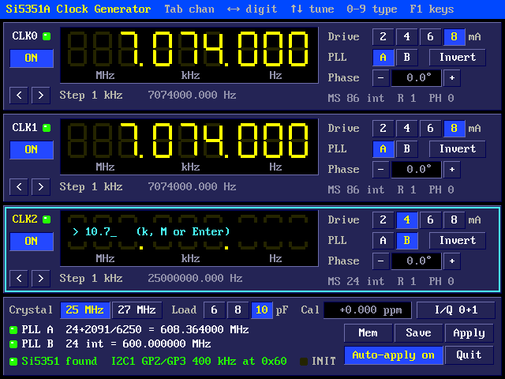
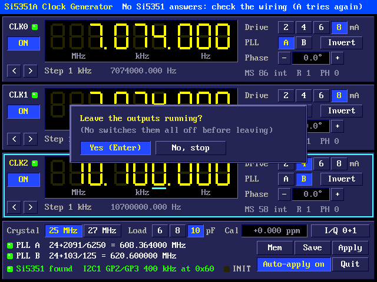
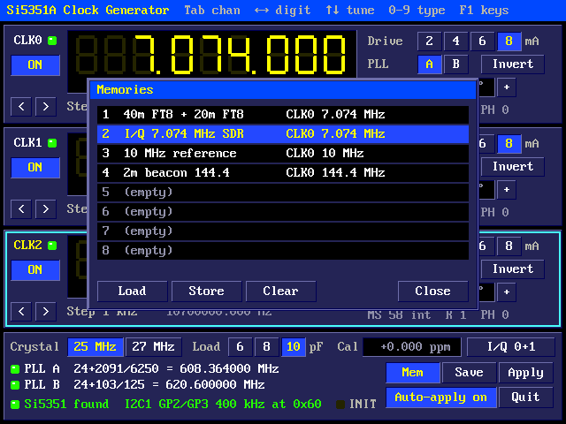
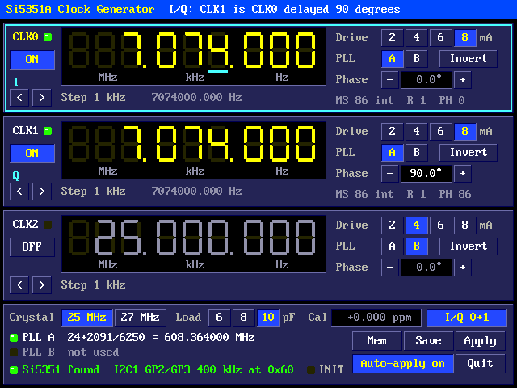
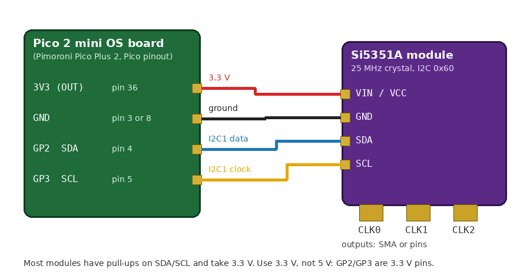
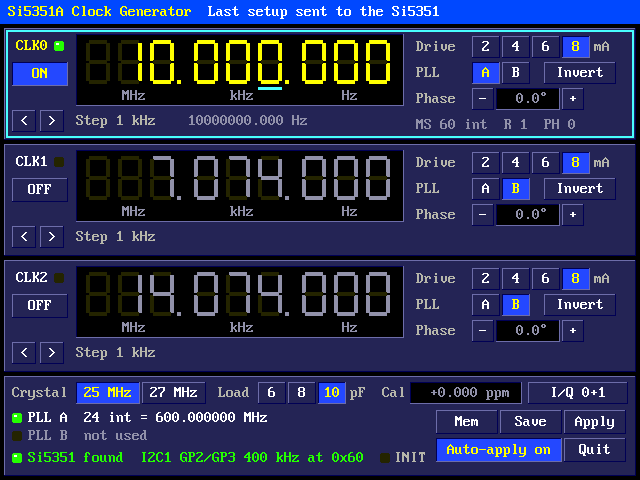
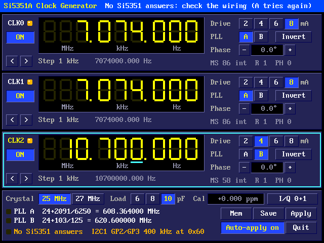

# Pico 2 mini OS Clock Generator

A Si5351A clock generator on the board's I2C: three outputs from 2.5 kHz to 200 MHz, set from a graphical panel or from the shell, with 1 Hz steps, quadrature (I/Q) outputs, phase offsets and named memories.

## The panel


`si5351` (or `clockgen`) opens the panel. Each output, CLK0 to CLK2, has a
card:

- **The readout:** the frequency in 7-segment digits, from 100 MHz down to
  1 Hz. The digit underlined in cyan is the one being tuned, and its weight
  is the step (shown under the readout). Point at a digit with the mouse
  (it gets a grey underline) and turn the wheel to tune it; click a digit
  to make it the one the keys tune; right-click it to step down once.
- **Typing a frequency:** start typing digits (and a point) and the readout
  becomes a field: finish with **k** (kHz), **M** (MHz) or Enter (Hz). For
  example `7.074M`, `14074k`, `10000000` Enter. Esc gives up.
- **ON/OFF**, and an LED beside the name: green when the output is running,
  orange when it is set on but no chip answers.
- **Drive** 2, 4, 6 or 8 mA; **Invert**; **PLL** A or B; **Phase** in
  degrees (the field takes typed degrees; - and + step by 90).
- Under the readout, the frequency really made (to a thousandth of a Hz),
  and on the right the dividers the chip uses: `MS 86 int` is an integer
  multisynth divider of 86, `MS 24+2091/6250` a fractional one, `R` the
  output divider, `PH` the phase offset register.

The bottom panel has the crystal (25 or 27 MHz), its load capacitance
(6, 8 or 10 pF), the calibration in ppm (click it and type, e.g. `-1.25`),
the I/Q switch, the two PLLs (their multipliers and VCO frequencies, with a
lock LED each), and the chip: green **Si5351 found** with its I2C bus,
pins, speed and address, or **No Si5351 answers**.

The **Mem**, **Save**, **Apply** and **Quit** buttons do what their keys do.
**Auto-apply** says whether the last setup is sent to the chip when the
panel opens (on), or only shown (off: Apply sends it).

### Keys

| Key | Does |
|---|---|
| Tab, PgDn / PgUp | the next / previous output |
| Left / Right | a more / less significant digit (a bigger / smaller step) |
| Up / Down, the wheel | tune the digit up / down |
| 0-9 and . | type a frequency; then k, M or Enter |
| O or Space | the output on / off |
| D | drive: 2, 4, 6, 8 mA in turn |
| I | invert |
| P | PLL A / B |
| H | type a phase in degrees |
| Q | I/Q on CLK0 and CLK1 |
| X | crystal 25 / 27 MHz |
| L | load capacitance 6, 8, 10 pF in turn |
| C | type the calibration in ppm |
| M or F2 | the memories |
| S | save to /SI5351.INI |
| A | look for the chip again and send it everything |
| F1 | the keys, in the title strip |
| Esc | leave (asks first) |

### Typing a frequency



### Leaving



Esc asks whether to leave the outputs running. **Yes** (Enter, the default)
leaves the chip as it is: it keeps making the frequencies after the panel
closes, and on into other programs, until it loses power. **No, stop**
switches every output off first, and saves them as off, so nothing
starts them again by itself. Either way the setup is saved in
/SI5351.INI.

## Memories



M (or F2, or the Mem button) shows 8 memories, each a whole setup: the
three outputs, the crystal, calibration and I/Q. Choose one with the arrows,
1-8 or the mouse, then:

- **Load** (Enter, L, or a double-click) sets everything from it;
- **Store** (S) asks for a name and keeps the present setup in it;
- **Clear** (Del or C) empties it;
- **Close** (Esc).

From the shell, `si5351 recall 3` loads memory 3.

## Quadrature (I/Q)



Q (or the I/Q button) makes CLK1 follow CLK0: the same frequency from the
same PLL, 90 degrees behind it (the I and Q outputs of a quadrature
sampling detector or mixer). Both get the same even integer divider and
CLK1's phase offset equals it (the Si5351 counts phase in quarter periods
of the VCO). That needs a divider of 126 or less, so I/Q works from 4.8 MHz
to 112.5 MHz. The cards show I and Q, CLK1's frequency follows CLK0's, and
its phase shows 90 degrees. CLK2 stays free.

Changing the frequency resets the PLL when the divider changes, which lines
the phases up again; tuning within the same divider moves only the PLL, so
the phase holds.

## From the shell

The same settings from the command line, for scripts and /AUTORUN. Each
command loads the setup from /SI5351.INI, changes it, sends the chip what
differs (outputs already running keep going) and saves it again.

```
si5351 set 0 10M              CLK0 to 10 MHz (and on)
si5351 set 1 7074k
si5351 set 2 32768            Hz without a unit
si5351 on 2 | off 2 | off all
si5351 drive 0 8              2, 4, 6 or 8 mA
si5351 pll 2 A                PLL A or B
si5351 invert 1 on
si5351 phase 1 90             degrees
si5351 xtal 27                25 or 27 (MHz)
si5351 load 8                 6, 8 or 10 (pF)
si5351 cal -1.25              ppm
si5351 iq on
si5351 recall 2               memory 2
si5351 apply                  send everything again (after a power cut)
si5351 status                 the setup, the PLLs and the chip's status
si5351 i2c 2 3 400 0x60       SDA, SCL, kHz, address
```

`si5351 status` prints, for example:

```
Si5351 at 0x60: running, PLLs locked
Crystal 25 MHz, 10 pF, +0.000 ppm
PLL A: 24 + 2407/3125 = 619.256000 MHz
PLL B: 24 + 2091/6250 = 608.364000 MHz
CLK0: on   14.074 MHz     8 mA, PLL A
CLK1: on   7.074 MHz      6 mA, PLL B
CLK2: off  14.074 MHz     8 mA, PLL B
```

## Wiring



| Board | Pico pin | Si5351A module |
|---|---|---|
| 3V3 (OUT) | 36 | VIN / VCC |
| GND | 3 (or any GND) | GND |
| GP2, I2C1 SDA | 4 | SDA |
| GP3, I2C1 SCL | 5 | SCL |

Most Si5351A breakouts (Adafruit, Etherkit and the many clones) have a 25
MHz crystal, a 3.3 V regulator and pull-ups on SDA and SCL. The outputs come
out on SMA sockets or pins, at 3.3 V CMOS levels; a 50-ohm load wants 8 mA
drive.

The I2C bus, its pins and the address can be changed with `si5351 i2c` (or
in /SI5351.INI): SDA on an even pin and SCL on the next one, I2C0 or I2C1
following from the pin. The pins are taken while the panel or a command
runs, as BASIC's `I2C OPEN` takes them, and let go afterwards; the chip
keeps running.

On the board with a module attached, CLK0 at 10 MHz from PLL A (locked):





With no chip answering, the panel still opens and works (the settings are
kept for when one is connected), the bottom panel says **No Si5351
answers**, and A (or the chip turning up) sends it the setup.

## How it works

The Si5351 makes each output in three steps (Silicon Labs AN619):

1. a PLL multiplies the crystal up to 600-900 MHz: fVCO = fXTAL x (a + b/c);
2. a multisynth divides that down by 8 to 2048 (fractional), or by exactly
   4 or 6;
3. an R divider (1 to 128) divides again, for outputs below 500 kHz.

Two PLLs feed three outputs. An output with a PLL to itself gets an even
integer divider (the least jitter) and the PLL is set to whatever ratio
makes the frequency exact: the fraction b/c is the best rational
approximation with c up to 1,048,575 (continued fractions). An output
sharing a PLL takes the VCO the lower numbered output set, through a
fractional divider. Above 150 MHz the divider is 4 (DIVBY4); between 112.5
and 150 MHz, 6. Below 500 kHz the R divider comes in, down to 2.5 kHz.

The frequency made is within 0.003 Hz of the one asked for
across the whole range, with either crystal and any calibration (the tests
in `tools/si5351test` sweep it). The calibration scales the crystal: if a
counter reads 10,000,012 Hz for a setting of 10 MHz, the crystal runs
+1.2 ppm fast: set the calibration to +1.2.

Only registers that change are written. Tuning an output that has a PLL to
itself changes only the PLL's fraction, which moves the frequency smoothly
without a glitch; a new divider, phase or output setting resets the PLLs it
concerns. When the panel or a command starts, it reads the chip's registers
first, so outputs already running are left alone unless their settings
differ.

The crystal load capacitance must match the crystal: 10 pF suits most
modules; a wrong value pulls the frequency a few ppm (calibration covers
it).

Spread spectrum isn't offered: it works only on PLL A, its settings depend
on that PLL's, and a clock for radio work wants a clean carrier.

**Files:** /SI5351.INI keeps the I2C settings (`i2c=sda,scl,kHz,address`),
auto-apply (`apply=1`), the last setup (`last=`) and the memories
(`mem1=` to `mem8=`), as lines that can be edited:

```
i2c=2,3,400,0x60
apply=1
last=|25000000|10|0|0|14074000,1,3,0,0,0|7074000,1,2,0,1,0|25000000,1,1,0,1,0
mem1=40m FT8|25000000|10|0|0|7074000,1,3,0,0,0|...
```

A setup is `name|crystal Hz|load pF|calibration ppb|I/Q|` and then for each
output `Hz,on,drive 0-3,invert,PLL 0/1,phase`.

**Memory:** the panel's state and its off-screen picture are in PSRAM while
it runs; it keeps nothing in SRAM afterwards. The code is in src/si5351:
si5351.c (the frequency planning and registers, plain C), si5351_pico.c (the
I2C bus) and si5351_ui.c (the panel and the command).
