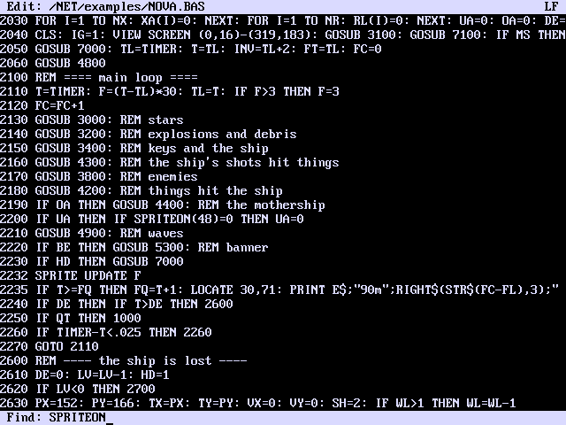
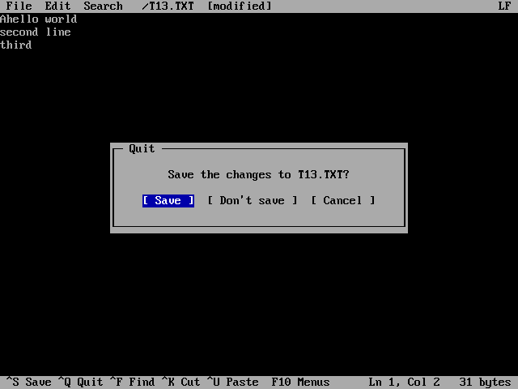
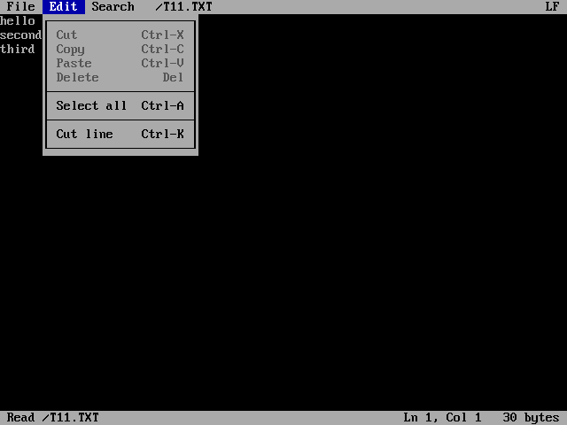
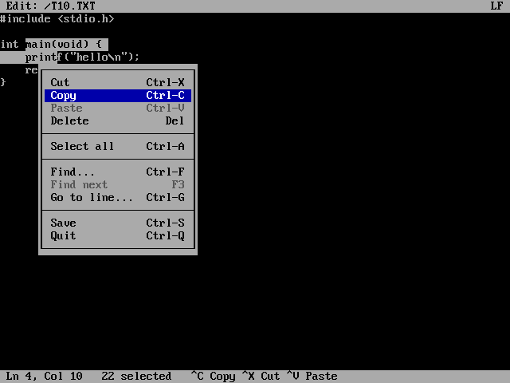

# Pico 2 mini OS Text Editor

The full-screen text editor: `edit [file]` (or `ed`). It edits plain text files on the USB drive or a network share, such as programs, scripts and /AUTORUN.

## The editor

`edit file` opens a file; a name that doesn't exist yet starts a new file.

The screen has a title row (the menu bar and the file's name), 28 text rows
and a status row. The status row shows messages or the main keys on the
left, and on the right the cursor's line and column and the file's size in
bytes, as it would be saved. The title row's right end says whether the
file uses CRLF or LF line endings; the editor keeps whichever the file had.

Above: `edit /NET/examples/NOVA.BAS`, a BASIC game from the examples
(opened over a network share), after Ctrl-G 150. The bottom row lists the
main keys.

| Key | Action |
|---|---|
| Arrows, PgUp / PgDn, Home / End | Move |
| Backspace / Delete | Delete |
| Enter | New line, indented like the line above |
| Tab | Insert a tab (shown 8 columns wide) |
| Ctrl-S | Save |
| Ctrl-Q | Quit; with unsaved changes a box asks: Save, Don't save or Cancel |
| Ctrl-F | Find |
| F3 | Find next |
| Ctrl-G | Go to a line number |
| Ctrl-K | Cut the line (repeat to cut several); with a selection, cut it |
| Ctrl-U | Paste the cut lines |
| Ctrl-A | Select all |
| Ctrl-X / Ctrl-C | Cut / copy the selection |
| Ctrl-V | Paste (the same as Ctrl-U) |
| Esc | Drop the selection |
| Ctrl-L | Redraw the screen |
| F10, Alt-F / E / S | Open the menu bar |

**Finding:** Ctrl-F asks for the text on the bottom row; Enter goes to
the next place it appears, and F3 finds the one after.

**Quitting with changes:** the title row says `[modified]` once the text
has changed, and Ctrl-Q asks in a box in the middle of the screen whether
to save: **Save** saves and quits, **Don't save** quits without saving,
**Cancel** goes back to editing. Click a button, press its first letter
(`y` and `n` work too), or move with Left / Right / Tab and press Enter;
Esc is Cancel.

## The menu bar

The title row is a menu bar: **File** (Save, Redraw screen, Quit),
**Edit** (Cut, Copy, Paste, Delete, Select all, Cut line) and **Search**
(Find, Find next, Go to line), followed by the file's name. Click a title,
or press F10 (File) or Alt and a title's first letter (Alt-F, Alt-E,
Alt-S). Left / Right go to the next menu (or move the pointer onto its
title), Up / Down and Enter choose, Esc closes. With the mouse you can also
press on a title, move onto an item and let go. Each item shows its key.

## The mouse

With a USB mouse plugged in, the cell under the pointer shows in reversed
colours.

| Mouse | Action |
|---|---|
| Click | Put the cursor there |
| Drag | Select text; past the top or bottom row (or the left or right edge) the text scrolls on while you hold still |
| Double-click | Select a word |
| Wheel | Scroll the view (the cursor stays put; a key brings it back) |
| Right button | A menu: Cut, Copy, Paste, Delete, Select all, Find, Find next, Go to line, Save, Quit |

The selection shows reversed, a selected line end as a reversed space, and
the status row counts the characters selected. Typing, Enter or Tab
replace it; Backspace or Delete remove it; a key that moves the cursor drops
it.

The menu opens below the pointer. Click an item, or hold the right button,
move onto an item and let go. Items that can't be used now (Cut with
nothing selected, Paste with nothing cut) are grey. Up / Down and Enter
work too; Esc or a click outside closes it. A right-click outside the
selection moves the cursor there first.

Cut and Copy put the text in the same cut buffer that Ctrl-K uses, so
Ctrl-U and Ctrl-V paste either.

Limits: files up to 1 MB, cut buffer 256 KB.
