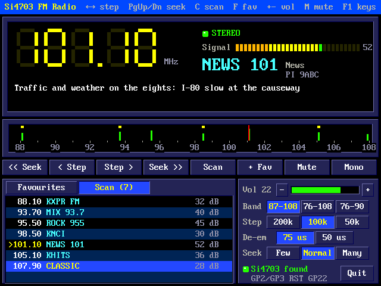
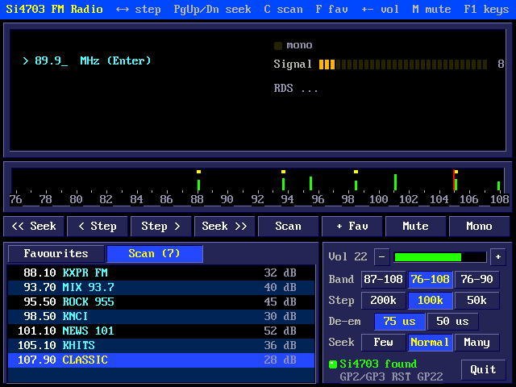
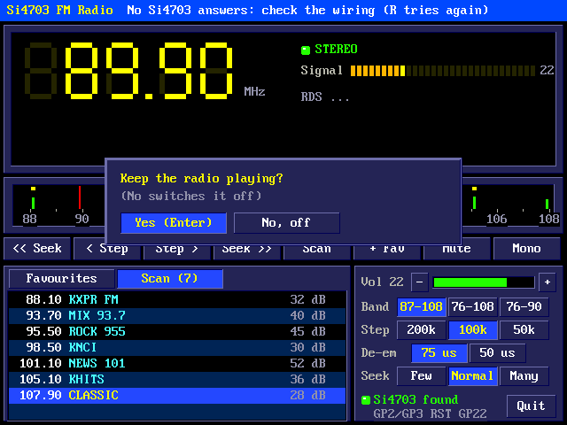
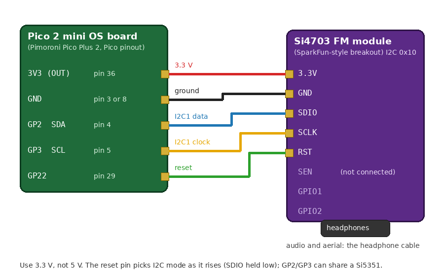
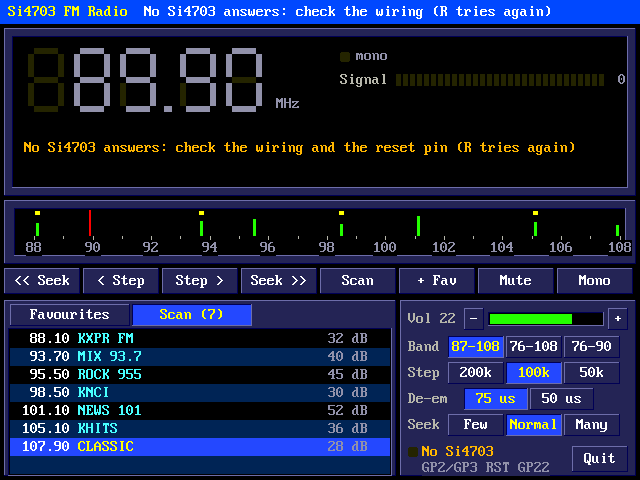

# Pico 2 mini OS FM Radio

An FM radio from a Si4703 module on the board's I2C: the whole band (87.5-108 MHz, or 76-108 and 76-90 MHz for Japan), seek and scan, RDS station names and radio text, and favourites, from a graphical panel or the shell.

## The panel


`fm` (or `fmradio`) opens the panel. The radio plays through the module's
own headphone socket: its sound doesn't pass through the board, and the
headphone cable is the aerial.

- **The display:** the frequency in 7-segment digits; STEREO when the
  station's pilot is there; the signal in dBuV (0-75); and RDS, if the
  station sends it: its name (in large letters), its programme type and
  PI code, and its radio text underneath.
- **The dial:** the whole band, with a red needle where the radio is
  tuned, green bars where the last scan found stations (as tall as their
  signal) and yellow marks at the favourites. Click anywhere on it to tune
  there.
- **The buttons:** Seek down and up (to the next station strong enough),
  Step down and up (one channel), Scan, + Fav, Mute and Mono.
- **The lists:** Favourites, and the stations the last Scan found with
  their names and signals. Click a station to tune to it (right-click a
  favourite deletes it); the wheel scrolls.
- **The settings:** the volume (a slider, 0-30, and - and +), the band,
  the channel step (200, 100 or 50 kHz), the de-emphasis (75 us in the
  Americas, 50 us elsewhere) and the seek sensitivity (Few: strong stations
  only; Normal; Many: weak ones too). At the bottom, whether the module was
  found, and its pins.

### Keys

| Key | Does |
|---|---|
| Left / Right, the wheel | a channel down / up |
| PgDn / PgUp | seek down / up |
| 0-9 and . | type a frequency in MHz, then Enter (e.g. `101.1`) |
| Up / Down, Enter | choose in the list, and tune to it |
| Tab | Favourites / Scan |
| C | scan the band (C or Esc again stops it) |
| F | add the station to the favourites (named by RDS); again: type a name |
| Del | delete the favourite chosen |
| + / - | volume |
| M | mute |
| S | mono / stereo |
| R | find the module again (reset it) |
| F1 | the keys, in the title strip |
| Esc | stop a seek, or leave (asks first) |

### Scanning



Scan (C) seeks through the band from the bottom and lists every station
it stops on, with its signal, listening up to a second and a half on each
for its RDS name. The list is kept in /FMRADIO.INI, and the dial shows the
stations as green bars. Afterwards the radio goes back to the station it
was on. How many stations a scan (or seek) stops on depends on the seek
sensitivity.

### Typing a frequency



### Leaving



Esc asks whether to keep the radio playing. **Yes** (Enter) leaves it on:
it plays on at the shell prompt and in other programs, and `fm` opens the
panel on it again. **No, off** switches it off. The settings, favourites
and the last station are saved either way.

## From the shell

```
fm on [MHz]          play (the last station, or that one)
fm off               switch it off
fm tune 101.1        tune
fm seek up | down    the next station
fm vol 0-30          volume (unmutes)
fm mute [on|off]     alone: toggles
fm mono [on|off]
fm fav               list the favourites
fm fav 3             play favourite 3
fm scan              every station in the band, with names
fm status            what is playing, with RDS
fm band eu | wide | jp     87.5-108 / 76-108 / 76-90 MHz
fm step 200 | 100 | 50     kHz
fm deemph 75 | 50          us
fm i2c 2 3 400 22    SDA, SCL, kHz, reset pin
```

`fm status` listens a moment for RDS, then prints, for example:

```
FM 95.50 MHz, signal 45 dBuV, stereo, volume 22
  ROCK 955  Rock
  Now playing: Led Zeppelin - Kashmir (Physical Graffiti, 1975)
```

In /AUTORUN, `fm on` plays the last station at start-up.

## Wiring



| Board | Pico pin | Si4703 module |
|---|---|---|
| 3V3 (OUT) | 36 | 3.3V |
| GND | 3 (or any GND) | GND |
| GP2, I2C1 SDA | 4 | SDIO |
| GP3, I2C1 SCL | 5 | SCLK |
| GP22 | 29 | RST |

SEN, GPIO1 and GPIO2 stay unconnected (SparkFun's breakout pulls SEN up).
Plug headphones (or a cable) into the module's socket: they carry the
sound and are the aerial.

The Si4703 chooses I2C as RST rises with SDIO held low, so the reset pin
matters: `fm` pulls SDIO low, raises RST, then gives SDIO back to I2C. The
reset pin stays driven high while the radio plays (so it keeps playing
after the panel closes); `fm off` takes it low, holding the chip off, and
lets it go. The I2C pins are taken only while `fm` runs, as BASIC's `I2C
OPEN` takes them.

The module can share GP2/GP3 with other I2C devices (the Si5351 clock
generator is at 0x60, the Si4703 at 0x10). Other pins: `fm i2c SDA SCL kHz
RST`, or the `i2c=` line in /FMRADIO.INI.



With no module answering, the panel opens all the same and says so; R
tries again.

## How it works

The Si4703 is an FM receiver on a chip with its own audio output: the
board only tells it what to do. Its 16 registers are read as one block
(from register 0x0A round to 0x09) and written from register 2 on.

- **Power-up** (AN230): the crystal oscillator first (half a second to
  settle), then the receiver, with RDS on.
- **Tuning:** a channel number (from the band's bottom in steps of the
  spacing) and the TUNE bit, then waiting for the chip's "seek/tune
  complete" flag.
- **Seeking and scanning:** the chip's own seek, stopping at the band's
  end, with AN230's threshold settings for each sensitivity. A scan tunes
  to the bottom and seeks up until the end.
- **Volume:** 0-30 maps onto the chip's 15 steps and its extended range
  (VOLEXT) 30 dB below them.
- **RDS** is read every 20 ms (a group lasts about 87 ms). Groups whose
  blocks the chip couldn't correct are dropped; a group read twice counts
  once. The station's name (group 0) takes each pair of characters once it
  has arrived the same twice; the radio text (group 2A or 2B) shows once
  its segments up to the end (a carriage return, or all 64 characters)
  have arrived, and starts again when the station flips its A/B flag. The
  programme types are RDS's names with 50 us de-emphasis and North
  America's RBDS names with 75 us.

**Files:** /FMRADIO.INI keeps the pins (`i2c=sda,scl,kHz,reset`), the last
station (`freq=` in kHz), the volume and settings, the favourites
(`fav=kHz|signal|name`) and the last scan (`scan=` lines), and can be
edited.

**Memory:** the panel's state and its off-screen picture are in PSRAM
while it runs; it keeps nothing in SRAM afterwards. The code is in
src/fmradio: si4703.c (the chip, plain C: tested on a PC against a
simulated Si4703 in tools/si4703test), si4703_pico.c (the I2C bus and the
reset pin) and fm_ui.c (the panel and the command).
