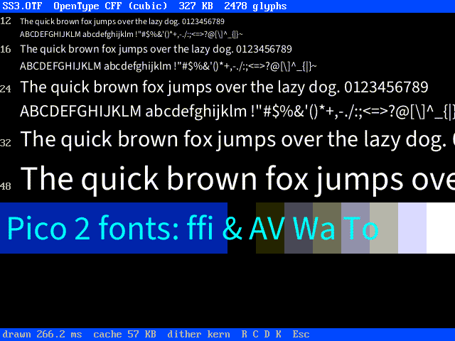
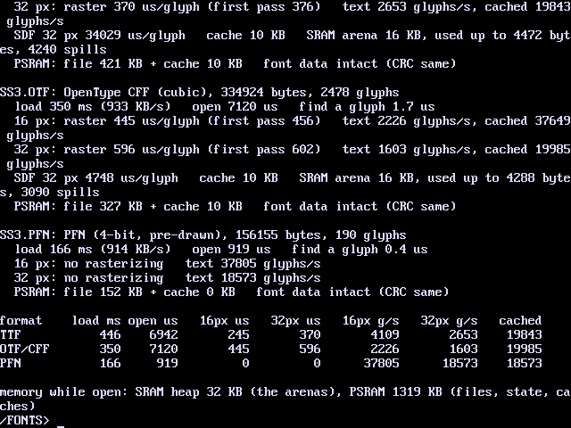

# Pico 2 mini OS Font Viewer

`font` (also `ttf`) shows a font file from the drive, smoothly drawn
(anti-aliased) on the HDMI screen, and times it. It reads three kinds of
font:

- **TrueType** (`.ttf`): outlines made of quadratic curves.
- **OpenType with CFF outlines** (`.otf`): cubic curves, as in
  PostScript fonts.
- **PFN** (`.pfn`): Pico 2 mini OS's own format. The letters are drawn
  ahead of time on a PC, at fixed sizes, with 16 shades of grey.

## The viewer



`font SS3.OTF` shows the font at 12, 16, 24, 32 and 48 pixels (a PFN file
at the sizes it has). Below that it shows `Pico 2 fonts: ffi & AV Wa To`
in cyan, over a blue band and a grey ramp, to show how the edges blend into
what is behind them. `font SS3.TTF 64 "Hello there"` shows your own text at
the size you give, in yellow.

The title line gives the file's name, its kind, its size and how many
glyphs (letters and signs) it has. The status line says how long the page
took to draw and how much the glyph cache holds.

| Key | Does |
|---|---|
| `R` | draws the page again from the glyph cache |
| `C` | empties the cache and draws every glyph from its outline again |
| `D` | dithering on or off |
| `K` | kerning on or off |
| Esc (or any other key) | back to the shell |

Sizes are pixels per em, from 1 to 200, as a PC sets a font's size. Text
can be UTF-8; characters the font lacks are left out (PFN: drawn as `?`).

## The benchmark



`font bench SS3.TTF SS3.OTF SS3.PFN` times up to four fonts and prints
the results on the screen and the debug UART:

- **load**: reading the file from the flash drive into PSRAM.
- **open**: checking its tables, plus setting up the glyph cache.
- **find a glyph**: finding a character's glyph (the font's `cmap`).
- **raster**: drawing one glyph from its outline at 16 and 32 pixels.
  This is averaged over ASCII 33-126, five passes, after a first pass
  that is shown separately.
- **text**: glyphs per second when drawing lines of text on the screen,
  each glyph drawn from its outline every time. **cached** is the same
  text from the glyph cache.
- **SDF**: a signed distance field glyph at 32 pixels, for comparison.
- The SRAM arena used, the PSRAM taken, and whether the font's bytes in
  PSRAM were still the same at the end (a CRC check).

While it times a font, `font bench` draws the text on the screen, then
puts the screen back.

### Results on the board

Source Sans 3 Regular, at 378 MHz:

| | TTF (431 KB) | OTF/CFF (327 KB) | PFN (152 KB, 5 sizes) |
|---|---|---|---|
| load from the drive | 446 ms | 350 ms | 166 ms |
| draw a glyph, 16 px | 245 us | 445 us | none: pre-drawn |
| draw a glyph, 32 px | 370 us | 596 us | none |
| text, no cache, 16 px | 4,100 glyphs/s | 2,200 glyphs/s | 37,800 glyphs/s |
| text, no cache, 32 px | 2,650 glyphs/s | 1,600 glyphs/s | 18,600 glyphs/s |
| text from the cache, 32 px | 19,800 glyphs/s | 20,000 glyphs/s | 18,600 glyphs/s |

- **TrueType draws glyphs about 1.6 to 1.8 times faster than CFF.** Its
  quadratic curves are cheaper to flatten than CFF's cubic curves.
- Once a glyph is in the cache, all three formats draw text at the same
  speed. The time then goes into blending the pixels into the screen.
- **PFN is fastest overall:** it is quick from the first glyph, needs no
  rasterizer working memory, and is the smallest file. The catch is that
  it only has the sizes it was made at, while TTF and OTF draw any size.
  Choose PFN for fixed user-interface text, and TTF for text that must
  scale.

## Making PFN files

On a PC with Python 3 and Pillow:

```
tools/fonttest/mkpfn.py SourceSans3-Regular.ttf SS3.PFN 12 16 24 32 48
```

This draws ASCII and the Latin-1 letters the font has, using FreeType
(with hinting), at each size given, and keeps the font's kerning pairs.
The format is described at the top of `src/font/fnt.c`.

## Fonts to try

Source Sans 3 is under the SIL Open Font License. It comes as both TTF
and OTF from github.com/adobe-fonts/source-sans (`TTF/` and `OTF/` in the
release branch). Put the files in `/FONTS` on the drive. Font files are
not in this repository.

## Memory

Everything is freed when `font` ends:

- **PSRAM:** the font file, a 40 KB glyph table, the glyphs in the cache
  (emptied when it passes 1 MB) and the saved screen.
- **SRAM:** a 16 KB working area for each open TTF or OTF font, from the
  heap. Bigger working buffers (very large glyphs, distance fields) come
  from PSRAM.
