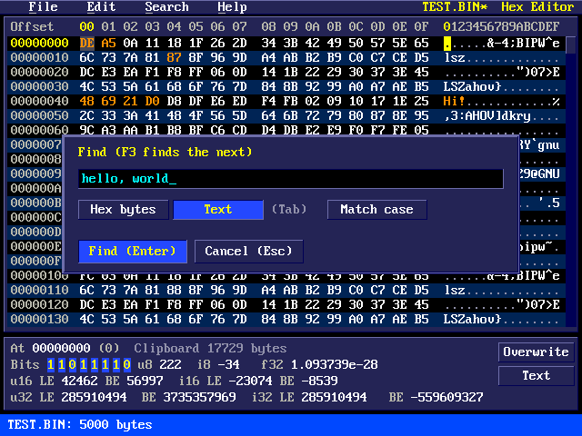
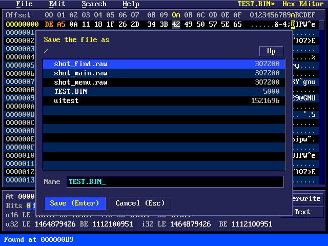
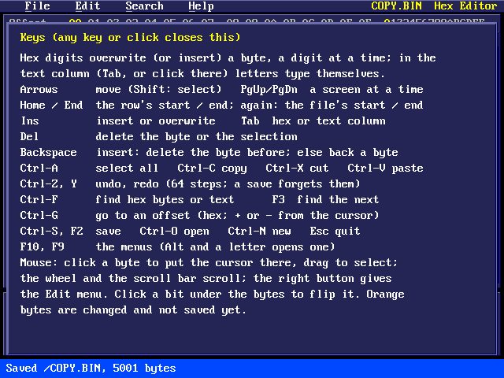
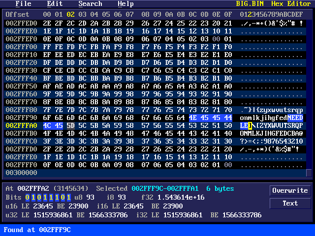

# Pico 2 mini OS Hex Editor

A hex editor for any file on the drive: its bytes in hex and as text,
overwritten, inserted, deleted, cut, copied and pasted with the keys or
the mouse, with Find, Go to, undo and a panel that reads the bytes at the
cursor as bits and numbers. Files of any size up to 4 GB open at once:
the file stays on the drive and is read as it is shown.

## The editor

`hex` (or `hexedit`) opens the editor on an empty, untitled file; `hex
GAME.BIN` opens that file (or starts a new one by that name). It works
with the keyboard alone; a USB mouse helps.

- **The menu bar** at the top: File, Edit, Search and Help, as in the
  tracker. Click a title, or press F10 (or F9), or Alt and the title's
  first letter. In a menu, Up and Down choose, Left and Right go to the
  next menu, Enter or the underlined letter runs an item, Esc closes it.
  Items that can't be used now are grey. The file's name is on the right,
  with `*` when it has changes not saved.
- **The bytes**, 16 a row: the offset of the row (hex), the bytes in hex
  (a wider gap after the eighth) and the same bytes as text (`.` for those
  that aren't letters, digits or signs). Zero bytes are dim; bytes changed
  since the file was opened or saved are **orange**. The cursor is yellow
  on the digit or character being typed, and grey in the other column; its
  row's offset and its column's number are yellow too. The selection is
  blue. Rows go one past the end, so that bytes can be added there.
- **The scroll bar** on the right: drag the thumb, or click above or below
  it for a screen up or down. The wheel scrolls three rows.
- **The panel under the bytes:** where the cursor is (hex, and decimal),
  the selection (its first and last byte and its length) or, with none,
  the clipboard's length; the byte at the cursor as **bits** (click one to
  flip it) and as an unsigned and a signed 8-bit number; the four bytes
  from the cursor as a 32-bit float (little-endian); and the bytes from the
  cursor as 16- and 32-bit numbers, unsigned and signed, little-endian (LE,
  the low byte first, as the Pico, a PC and most files keep them) and
  big-endian (BE). A `-` means the file ends first. **Overwrite/Insert**
  and **Hex/Text** on the right switch the typing mode and the column.
- **The status line** at the bottom: the size and the modes, or a message
  for a few seconds.

### Typing

In the hex column, the hex digits 0-9 and A-F type a byte: the first
digit is its top half, the second its bottom half, then the cursor moves
on. In **overwrite** mode (the start) they change the byte at the cursor;
in **insert** mode (Ins) the first digit puts a new byte in (its bottom
half 0 until the second digit). A click on a byte's second digit changes
just that half. At the end of the file typing adds bytes in either mode.

Tab (or a click there) moves to the text column, where letters, digits
and signs type themselves as bytes, overwriting or inserting the same way.

Typing over a selection deletes it first. Del deletes the byte at the
cursor, or the selection; Backspace deletes the byte before the cursor in
insert mode, and only moves back in overwrite mode.

### Selecting, cutting and pasting

Shift with the arrows (or Home, End, PgUp, PgDn) selects from where the
cursor was; dragging with the mouse selects from the byte pressed on to
the one under the pointer (past the top or bottom the rows scroll);
Ctrl-A selects the whole file. Shift and a click select up to that byte.

Cut (Ctrl-X) and Copy (Ctrl-C) put the selection on the clipboard; Paste
(Ctrl-V) puts it in place of the selection, or at the cursor: over the
bytes there in overwrite mode, in front of them in insert mode. A cut or
paste of any size is quick, as nothing is copied (see *How it works*).
The clipboard stays while the editor runs, from one file to another;
Save, Open and New keep it if it is up to 256 KB, and empty it if it is
bigger.

The right button on the bytes opens the Edit menu there.

### Find and Go to

**Find** (Ctrl-F, in the Search menu) looks for **hex bytes** (pairs of
digits, spaces between them or not: `DE AD BE EF`) or **text** (Tab
switches; *Match case* makes upper and lower case differ, which they
don't at first). It looks from just after the cursor to the end, then
from the start; what it finds is selected. With a short selection, Find
starts with its bytes in it. **Find next** (F3) looks again. A search
through a big file shows how far it has got; Esc stops it.

**Go to offset** (Ctrl-G) moves the cursor: an offset in hex (`1F4`,
`0x1F4`, `$1F4` or `&H1F4`) or, after Tab, in decimal; `+` or `-` in front
counts from the cursor. Home and End go to the row's start and end, and
pressed again to the file's start and end.

### Checksums and CRCs

**Checksums and CRCs** (Ctrl-K, in the Search menu) works them out for
the selection, or for the whole file with nothing selected, in hex and
decimal: the bytes added up (8, 16 and 32 bits), XORed, and the 8-bit
two's complement of their sum (the checksum of an Intel HEX record);
CRC-8/SMBUS, CRC-16/CCITT-FALSE, CRC-16/XMODEM, CRC-16/ARC,
CRC-16/MODBUS and CRC-32 (the one zip and PNG use), with their usual
names from the CRC catalogue; and Adler-32 and Fletcher-16. For a big
file it shows how far it has got; Esc stops it. Any key closes the box.

### Undo

Ctrl-Z undoes and Ctrl-Y redoes up to 64 steps: typing in one place is
one step; a delete, cut, paste or bit flip is one each. Saving forgets
them (the file they come from is replaced).

### Files

| Menu item | Key | Does |
|---|---|---|
| New | Ctrl-N | an empty, untitled file |
| Open... | Ctrl-O | the file box: any file |
| Save | Ctrl-S, F2 | writes the file (asks for a name if it has none) |
| Save as... | | under another name (asks before replacing a file) |
| Quit | Esc | leaves |

New, Open and Quit ask first if there are changes not saved. The file box
lists the folders and files with their sizes; Up (or Backspace with no
name typed) goes to the folder above.

### Keys

Help, Keys (F1) shows them in the editor too.

| Key | Does |
|---|---|
| Arrows | move a byte or a row (Shift: select) |
| PgUp, PgDn | a screen up or down |
| Home, End | the row's start or end; again: the file's start or end |
| 0-9, A-F | type in the hex column |
| Tab | the hex or the text column |
| Ins | insert or overwrite |
| Del, Backspace | delete (see *Typing*) |
| Ctrl-A, C, X, V | select all, copy, cut, paste |
| Ctrl-Z, Ctrl-Y | undo, redo |
| Ctrl-F, F3, Ctrl-G | find, find next, go to |
| Ctrl-K | checksums and CRCs |
| Ctrl-S or F2, Ctrl-O, Ctrl-N | save, open, new |
| F10, F9, Alt-letter | the menus |
| F1 | the keys |
| Esc | quit |

## How it works

The file stays on the drive: the editor reads it 512 bytes at a time
through a cache of eight such pages, and reads more at once when it saves
or searches. The changes are kept apart in a *piece table*: the file as
it is now is a list of pieces, each a run of bytes either from the file or
from the bytes typed (kept in a buffer that only grows). Typing adds
bytes to that buffer; a delete, cut or paste only changes the list, which
is why they are quick for any size, and the clipboard is pieces too. An
undo step keeps the pieces it replaced.

The pieces, the bytes typed, the undo steps and the clipboard are in
PSRAM, taken when the editor starts and given back when it quits (the OS
keeps no memory for it otherwise); only the editor's own few kilobytes of
state are in SRAM. There is room for about 65,000 pieces and up to 1 MB
typed between saves; when it runs short the oldest undo steps make way,
and if that isn't enough the editor says so: save, and it goes on from
there.

This board's PSRAM can lose a bit when it holds data for minutes, so, as
in the text and WAV editors, every 4 KB of it is read and written back
every 10 seconds and its checksum compared. If a block has changed by
itself the status line turns red with **MEMORY ERROR**: the edits may be
damaged, so Save won't write over the file and asks for a new name;
check the new file before using it.

**Save** writes the whole file anew, to `HEXEDIT.TMP` in the same folder,
then deletes the old file and renames the new one to its name, so a save
that fails (a full drive, or Esc during a long one) leaves the file as it
was. Saving a big file takes as long as copying it.

## Notes

- Bytes the drive can't read show as `00`, with a message; Save then
  stops rather than write them.
- Files of 4 GB and more (possible on exFAT) don't open.
- The PC test (`tools/hextest/uitest.sh [folder]`) runs the editor on a
  PC with thousands of random edits checked against a plain copy, undo and
  redo all the way back and forth, saves, Find, Go to, the menus and the
  mouse, and writes the screenshots in this manual.
