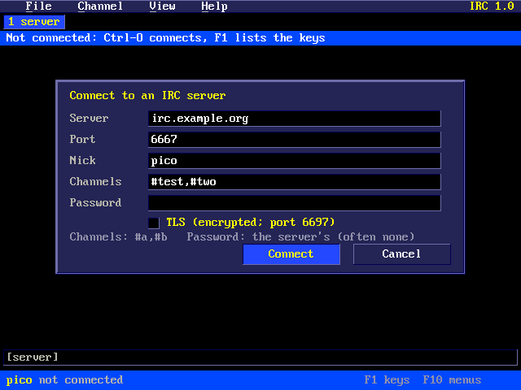
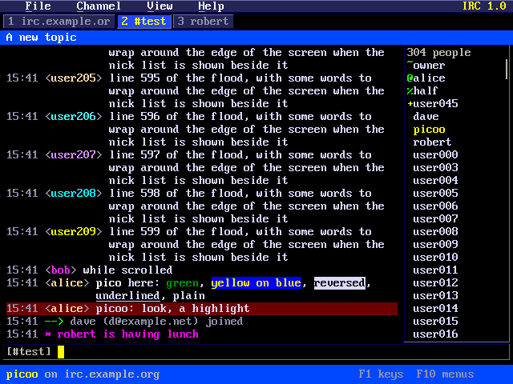
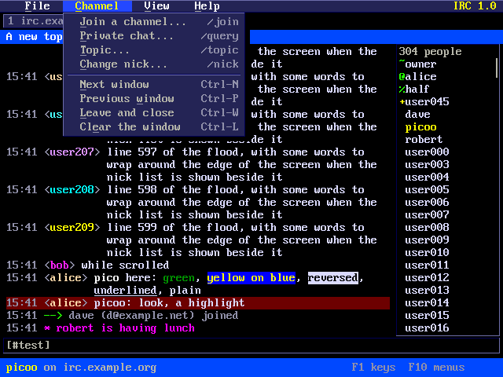

# Pico 2 mini OS IRC Client

`irc` chats on IRC (Internet Relay Chat) over WiFi: a window for the
server, one for each channel and one for each private chat, the nick list
beside a channel, times, coloured nicks and mIRC's colours. It connects
with TLS (port 6697, the usual one) or without (6667).

## Starting



`irc` alone opens the connect box, filled in from `/IRC.CFG` (the last
server, port, nick and channels): Tab and Up and Down move between the
fields, Space ticks TLS, Enter connects, Esc closes it. The channels are
joined once the server lets you in (separate them with commas; a missing
`#` is added). The password is the server's own, which most servers don't
have; for a registered nick use `/msg NickServ IDENTIFY password` once
connected.

`irc server [port|+port] [nick] [#channel...]` connects at once, e.g.
`irc irc.libera.chat +6697 kenpico #raspberrypi`. A `+` before the port
(or the port 6697) means TLS. What you give is kept in `/IRC.CFG` for
next time.

WiFi must be up (`wifi`). With TLS, the server's certificate is checked
against `/CACERT.PEM` on the drive, as `wget` and `www` do; without that
file it connects anyway and says the certificate isn't checked.

If the nick is taken, `_` is added to it until the server takes one.

## The screen



- **The menu bar** at the top: File, Channel, View and Help, as in the
  tracker and the hex editor. Click a title, or press F10 (or F9), or Alt
  and the title's first letter. In a menu, Up and Down choose, Left and
  Right go to the next menu, Enter or the underlined letter runs an item,
  Esc closes it.
- **The tabs**, a window each, numbered: the server's first, then the
  channels and private chats in the order they opened. The one shown is
  lit. Others are white when someone talked there, orange when you were
  named (or someone talked to you privately) and cyan for comings and
  goings. A channel you are no longer in is struck through.
- **The topic** of the channel (or who a private chat is with, or the
  server you are on).
- **What is said**, newest at the bottom, wrapped between words. Each
  line has its time (View > Times), the nick in its own colour, and the
  text with mIRC's colours, bold, reversed and underlined (View > Colours
  turns them off). A line that names you is on dark red. Joins, parts and
  quits are green and red arrows (View > Joins and quits hides them).
  Each window keeps its last 256 lines.
- **The nick list** on the right of a channel (F4 or View > Nick list):
  how many people are there, owners (`~`), admins (`&`), operators (`@`),
  half-operators (`%`) and voiced people (`+`) first.
- **The line you type**, after the window's name.
- **The status line**: your nick, the server, the numbers of windows with
  talk waiting, or a message.

## Keys

| Key | What it does |
|-----|--------------|
| Enter | Says the line in the window shown, or runs it if it starts with `/` |
| Up, Down | The lines typed before |
| Left, Right, Home, End, Backspace, Del | Edit the line |
| Tab | Finishes the nick being typed (again: the next that fits); at the start of a line, `nick: ` |
| Ctrl-B, Ctrl-K, Ctrl-U, Ctrl-V | Bold, colour (`Ctrl-K 4` red; alone: plain), underline, reversed |
| PgUp, PgDn | Scroll back through what was said (and forward) |
| Ctrl-N or F3, Ctrl-P or F2 | The next window, the one before |
| Ctrl-W | Leaves the channel and closes its window (or closes a private chat) |
| Ctrl-L | Clears the window |
| F4 | The nick list on or off |
| Ctrl-O | The connect box |
| Ctrl-R | Connects again (after a drop, channels are joined again) |
| F1 | The keys; Help > Commands lists the commands |
| F10, F9, Alt-F/C/V/H | The menus |
| Esc | Quits (asks first while connected) |

The mouse: click a tab to show it; the wheel scrolls what is said (or the
nick list, over it). Click a nick in the list to choose it, double-click
it for a private chat, right-click it for a menu: private chat, who is it
(WHOIS), make or take operator, give voice, kick. Right-click what is
said for the Channel menu.



## Commands

| Command | What it does |
|---------|--------------|
| `/join #channel [key]` (`/j`) | Joins a channel (the `#` may be left off) |
| `/part [#channel] [why]` (`/leave`) | Leaves the channel (this one if none given), keeping its window |
| `/close` | Leaves and closes the window (Ctrl-W) |
| `/msg nick text` | A private message, without opening a window |
| `/query nick [text]` | Opens a private chat (and says the text) |
| `/me does something` | An action: `* yournick does something` |
| `/notice nick text` | A notice |
| `/nick newnick` | Changes your nick |
| `/topic [text]` | Shows or sets the channel's topic |
| `/names [#channel]` | Lists who is there |
| `/whois nick` | About someone |
| `/away [why]` | Marks you away (no text: back) |
| `/op`, `/deop`, `/voice`, `/devoice nick` | Channel modes for a nick |
| `/kick nick [why]` | Kicks someone out |
| `/ctcp nick VERSION` | Asks someone's client something |
| `/server host [+port]` | Connects to another server |
| `/disconnect [why]` | Leaves the server, staying in the client |
| `/quit [why]` | Leaves the server and the client |
| `/raw LINE` (`/quote`) | Sends a line to the server as it is |
| `/clear` | Clears the window |

Commands it doesn't know (`/list`, `/mode`, `/invite`, `/who` ...) go
to the server as they are. A line starting `//` says something starting
with `/`.

The client answers CTCP VERSION, PING and TIME, and answers the server's
pings; if the server says nothing for 4 minutes it pings it, and after 6
it takes the connection as lost.

## The settings

`/IRC.CFG` is a text file of `name=value` lines, written when you connect
or change the View menu:

```
server=irc.libera.chat
port=6697
tls=1
nick=kenpico
channels=#raspberrypi,#pico
password=
nicklist=1
times=1
joins=1
colours=1
beep=1
```

`beep` is View > Beep when named: a short beep over HDMI when someone
names you or talks to you privately.

## Memory

Nothing is taken until `irc` starts, and all of it is given back when it
quits. The state, the lines kept, the nick lists and the off-screen
picture are in PSRAM; the connection's buffer is too. Help > About shows
how many lines and nicks are kept.

## Testing on a PC

`tools/irctest/uitest.sh [folder]` builds the client for the PC under
AddressSanitizer and runs it against a pretend server: logging in (a
taken nick), joining, a 305-nick list, messages, actions, CTCP, colours,
UTF-8, highlights, nick changes, parts, quits, kicks and modes, typing,
history, Tab completion, long lines split, commands, scrolling, the menus
and the mouse, a dropped connection and reconnecting, and 20,000 random
server lines and keys. It writes the screenshots `irc_*.png` into the
folder given.
