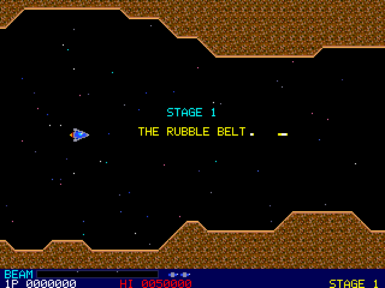
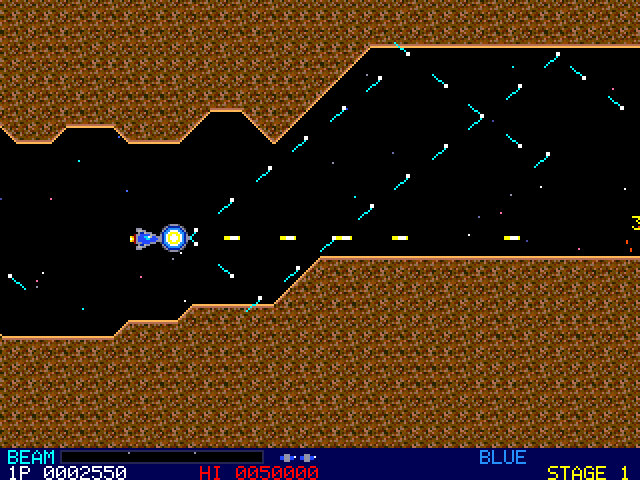
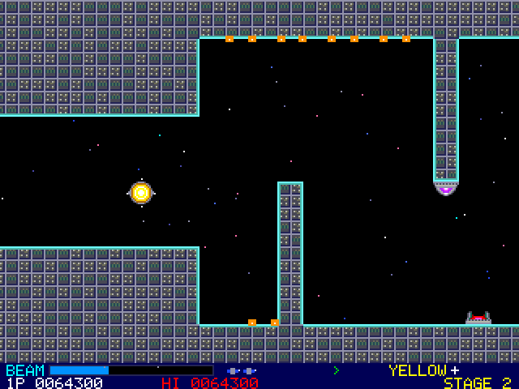
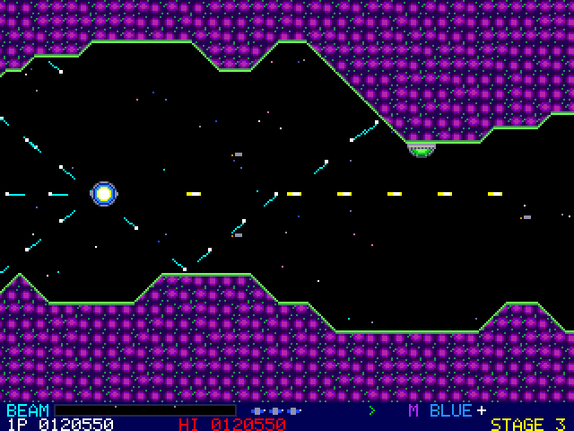
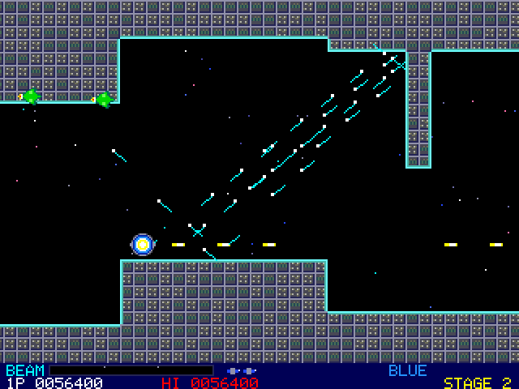
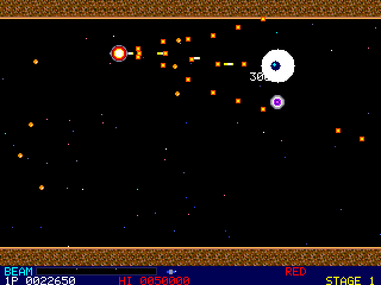
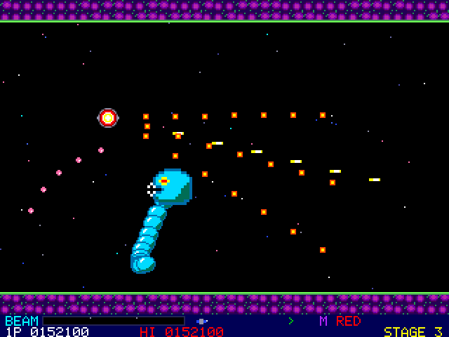
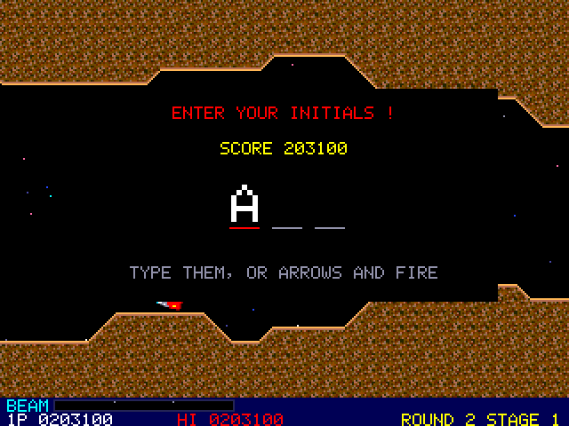
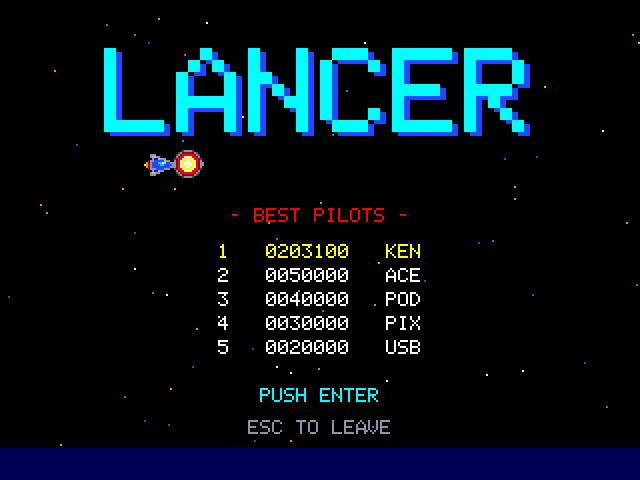

# Pico 2 mini OS Lancer

Lancer is a side-scrolling space shooter. Your ship flies through three
stages of caves and fortresses, against waves of enemies, guns on the
walls and a boss at the end of each stage. You fire a plain shot, or hold
fire to charge the lance, a beam that goes straight through what it
kills. Shoot down a hauler and it leaves a capsule. The first coloured
capsule brings the pod, which locks on to your ship, shields it, and fires
a weapon of its own. You can launch the pod and call it back. The game
runs at 60 frames a second on the HDMI screen and plays its sound and
music over HDMI. All of its art, sound and music were made for this game.

## Starting


Type `lancer` at the shell. The title screen takes turns showing the keys
and the five best scores. **Enter** (or **Fire**, or a gamepad's Start)
starts a game, and **Esc** goes back to the shell.

| Key | What it does |
|-----|--------------|
| Arrows, or W A S D | move the ship (eight ways) |
| Space, Z or Ctrl | fire: tap to shoot, hold to charge the lance |
| X, C or Shift | launch the pod, or call it back |
| P | pause |
| M | sound on or off |
| N | music on or off (the sound effects stay) |
| Esc | end the game (back to the title); on the title, back to the shell |
| F10 | back to the shell from anywhere |

A USB gamepad works too: the stick or D-pad moves the ship, the first and
third buttons fire, the second and fourth work the pod, and Start starts
a game or pauses it.

## Playing



The screen scrolls slowly to the right, and you can fly anywhere on it.
Touching a wall, an enemy or an enemy shot loses your ship. The walls
are as dangerous as the enemies: some stretches narrow down, step up or
down, or have pillars and boulders in the way.

The panel at the bottom shows the beam's charge, your ships in reserve,
your speed-ups (green chevrons), **M** when you have missiles, the pod's
colour (with a small cross at its second level), your score, the high
score and the stage.

You start with three ships. You get an extra ship at 50,000 points and
then one every 100,000. When a ship is lost, the next one starts at the
last restart point of the stage (there are two in each stage, and one at
the boss) without its pod, speed-ups or missiles. A hauler carrying a pod
capsule comes along soon after, so you can pick up a pod again.

## The lance


Tap fire for the plain shot. Hold it and the beam charges: the meter at
the bottom fills and a glow builds at your ship's nose. Let go to fire
the lance. A third of the meter gives a small lance, two thirds a bigger
one, and a full meter (it flashes) the biggest. A lance goes on through
every enemy it kills. The full-size one goes on through enemies it
doesn't kill too, and hits each one once. Walls and armour stop it.

## The pod



Shoot down a **hauler** (the slow purple carrier) and it leaves a
capsule. A **P** capsule changes colour as it drifts: red, blue, yellow.
The first one you pick up brings the pod, which flies in and locks on to
the nose of your ship in that colour. The pod:

- stops enemy shots that hit it (but not a boss's laser),
- hurts any enemy it touches, again and again,
- fires its colour's weapon each time you tap fire.

| Colour | Weapon |
|--------|--------|
| Red | a spread of shots ahead (three, or five at level 2) |
| Blue | lasers on the diagonals that bounce off the walls (and one straight ahead at level 2) |
| Yellow | shots up and down that then run along the floor and the ceiling (and a plain shot at level 2) |

Another P capsule of the same colour raises the pod to level 2 (after
that it is worth 1000 points). One of another colour changes the pod's
colour.


Press **X** (or C, or Shift) to launch the pod. It flies off the way it
faces and then stays on its own, keeping level with your ship, firing
straight ahead (and behind at level 2) when you fire, and still stopping
shots and hurting enemies. Send it into a group of enemies, or park it in
front of a gun. Press X again to call it back: it flies to your ship and
locks on to the side it reaches. You can also fly into a pod that is on
its own to pick it up, on either side. On the back of your ship it fires
its weapon backwards, which helps when enemies come from behind.



The other capsules:

| Capsule | What it does |
|---------|--------------|
| **S** (green) | a faster ship (up to three times) |
| **M** (purple) | two homing missiles with each shot (one pair every two thirds of a second) |



## Enemies

| Enemy | Points | What it does |
|-------|--------|--------------|
| Dart (red) | 100 | flies in waves along a curve; some fire |
| Swooper (green) | 150 | flies in and turns at you; some come from behind and turn back |
| Gun dome | 300 | sits on the floor or the ceiling and fires at you |
| Walker | 400 | walks along the floor or the ceiling and fires from the top of its hops |
| Hauler | 500 | slow; leaves a capsule |
| Mine | 200 | drifts towards you, and bursts into six shots when it is shot |
| Coil | 200 a ball, 500 the head | a chain of balls following its head along a wave; the head fires |
| Spore hatch | 800 | opens now and then to let out spores; armoured while shut |
| Spore | 50 | a small seeker |

## The stages and the bosses



1. **The Rubble Belt**: rock caves with slopes and boulders. Its boss,
   the **Orrery**, is a great eye ringed by eight armour plates that go
   round it. Shoot a way through the plates or send the pod in. It fires
   at you in threes and sends out rings of shots, and when it is badly
   hurt its plates spin faster and it calls in darts.
2. **The Iron Citadel**: a metal fortress of steps and pillars. Its boss,
   the **Bastion**, is a fortress block that rides up and down with four
   guns on its face. Now and then its hatch opens: that is the only time
   it can be hurt. A red dotted line warns that its laser is about to
   fire along that row, so get out of the way. With its guns gone, its
   hatch opens more often and it fires rings.
3. **The Hive**: living walls, narrow and winding. Its boss, the
   **Wyrm**, winds round the arena. Its body is armour and kills on
   touch; only its head and the spiked tail can be hurt. The tail fires
   rings until it is shot off.



A **WARNING** comes up when a boss is near, and the screen stops
scrolling for the fight. Beating a boss is worth 10,000 times the stage
number. After the third stage the game starts over from the first, as
round 2: the enemies fire faster and more often and the bosses take more
hits, and so on each round.




## Game over and high scores

If your score is one of the five best when your last ship is gone, you
enter your initials. Type the three letters, or step through the letters
with the arrows and press Fire for each one. Backspace goes back a
letter.



The five best scores are kept in `/LANCER.HI` on the USB drive, a short
text file (`score NAME` on each line). Delete it to start the table
again. If there is no drive, the scores last until you leave the game.



## Your own sprites

The game's sprites can be changed with the sprite editor:

```
lancer sprites LANCER.SPR
sprite LANCER.SPR
```

`lancer sprites` writes the built-in sprites as a .SPR file with 21
frames of 16x16. The frames are, in order: the ship (two frames, its
flame flickering); the pod (two); the dart (two); the swooper (two); the
gun dome; the walker (two steps); the hauler (two); the mine (two); a
coil ball and a coil head; the spore hatch shut and open; the capsule;
the Orrery's armour plate. The ship faces right and the enemies left.
Draw things that sit on the ground standing on the bottom row; the game
turns them upside down for the ceiling. Draw the pod and the capsule in
red: the game makes the blue, yellow, green and purple ones by changing
the reds. When `/LANCER.SPR` (at the top of the drive) is a 16x16 file
with at least 21 frames, the game uses it in place of its own art.
Rename or delete the file to go back to the built-in art.

## Notes

- While the game runs, the screen is 320x240 with each pixel shown as two
  by two. Each frame is drawn in a second buffer in SRAM and copied to
  the screen during the vertical sync, so nothing flickers. The stage's
  map, the pictures and everything else the game uses live in the free
  part of the framebuffer, so it keeps no memory once you leave.
- The game takes over the sound, so the internet radio stops while you
  play.
- On a PC, `tools/lancertest/uitest.sh [folder]` builds the game and lets
  an autopilot play a whole game through all three bosses. It checks the
  stages' maps, the pod and its weapons, the lance, the bosses and the
  high-score file, then writes the screenshots in this manual, a picture
  of each stage's whole map, and every sound effect and tune to
  `lancer_sounds.wav`.
