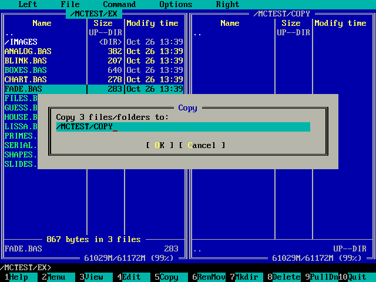
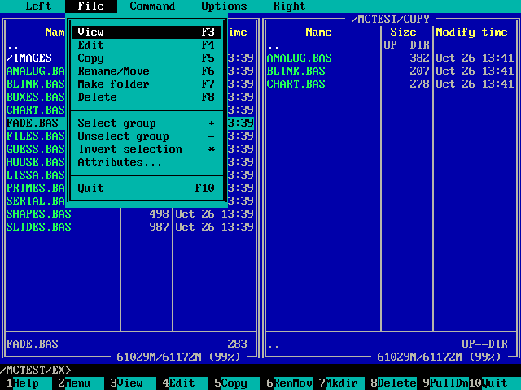
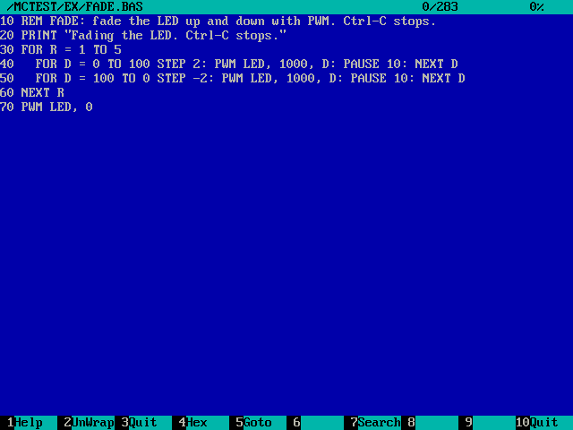

# Pico 2 mini OS File Manager

`mc [left] [right]` is a file manager in the style of Midnight Commander: two panels of files, copying, moving, deleting, viewing and editing, with menus and the mouse.

## The file manager

`mc` shows two panels of files, like Midnight Commander or Norton
Commander, with CP437 line graphics. It works on the USB drive and on
network shares. `mc /EXAMPLES /NET` opens the panels on those folders;
otherwise they come back as they were left (saved in `/MC.INI`).

| Key | Action |
|---|---|
| Up, Down, PgUp, PgDn, Home, End | Move in the panel (Left/Right too in Brief mode) |
| Tab | The other panel |
| Enter | Open a folder; run a `.BAS` in BASIC; show a picture; view other files. With a command typed: run it |
| Insert, Ctrl-T, Space (command line empty) | Mark a file and move down |
| `+` / `-` / `*` (command line empty) | Mark files matching a pattern / unmark / invert |
| F1 | Help |
| F2 | User menu (`/MC.MNU`) |
| F3 | View (text or hex, search) |
| F4 | Edit in the text editor |
| F5 | Copy the marked files (or the current one) to the other panel |
| F6 | Rename or move |
| F7 | Make a folder |
| F8 | Delete (asks; folders with everything in them after a second question) |
| F9 | Menus: Left, File, Command, Options, Right |
| F10 | Quit |
| Esc then 1..9, 0 | F1..F9, F10 (for keyboards without F keys) |
| Ctrl-S | Quick search: type the start of a name (Ctrl-S again: next) |
| Ctrl-O | Show the shell screen (any key returns) |
| Ctrl-U | Swap the panels |
| Ctrl-R | Read the folders again |
| Alt-Enter (or Esc Enter) | Put the current name in the command line |
| Alt-C | Quick cd: type a folder to go to |
| Alt-? | Find file |
| Alt-T | Listing mode: Full, Brief, Long |
| Alt-H | Show or hide hidden and system files |

- **Command line:** anything typed goes to the line at the bottom; Enter runs
  it as a shell command in the active panel's folder, on the shell's screen,
  then the panels come back (Ctrl-O shows what it printed). `cd` there moves
  the panel.
- **Listing modes** (Left/Right menus): Full (name, size, date), Brief (two
  columns of names), Long (the whole width, with attributes), and Info (the
  other panel's current file: size, date, attributes, the drive's free
  space). Sort by name, extension, size, time or not at all, and reverse.
- **Copy and move** show a progress box (the file and the total) and ask
  before overwriting: Yes, No, All, None, Older (only if the existing file is
  older), Abort. A folder can't be copied into itself. Esc or Ctrl-C stops.
- **Command menu:** Find file (a name pattern, optionally text inside the
  files, from a folder down; the results are a list to jump to), Swap
  panels, Compare folders (marks the files that are missing, newer or a
  different size in the other panel), Shell screen, Quick cd, Edit user
  menu.
- **Options menu:** confirm delete, confirm overwrite, confirm exit, show
  hidden files, and Save setup. The panels' folders, modes and sort orders
  and the options are saved in `/MC.INI` when mc ends.
- **File menu:** also Attributes (read-only, hidden, system, archive, on the
  USB drive).
- **User menu (F2):** `/MC.MNU`, lines of `Title|command`, where `%f` is the
  current file, `%n` its name, `%d` the folder and `%o` the other panel's
  folder. If there is none, mc offers to write one with examples.
- **Viewer (F3):** F2 wrap or not, F4 hex or text, F5 go to an offset or a
  percentage, F7 or `/` search (any case), `n` next, F3/F10/Esc/`q` back.
  Files up to 4 MB are read whole; bigger ones show their first 4 MB.
- mc draws on the HDMI screen only (the serial terminal sees the shell
  screen, and its keys work). Starting mc from mc's own command line isn't
  allowed.

  

- **Mouse:** click a file to choose it, double-click to open it, right-click
  to mark it; the wheel scrolls the panel under the pointer. Click the menu
  bar to pull a menu down, and the F-key bar at the bottom to press that
  key. The pointer is a cell in reversed colours. Dialogs use the keyboard.
