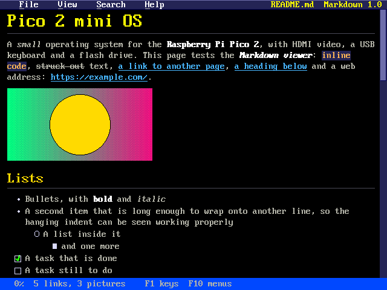
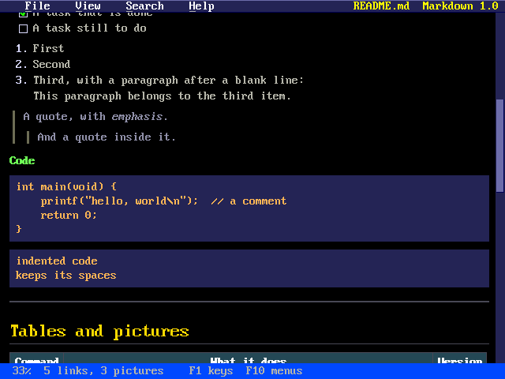
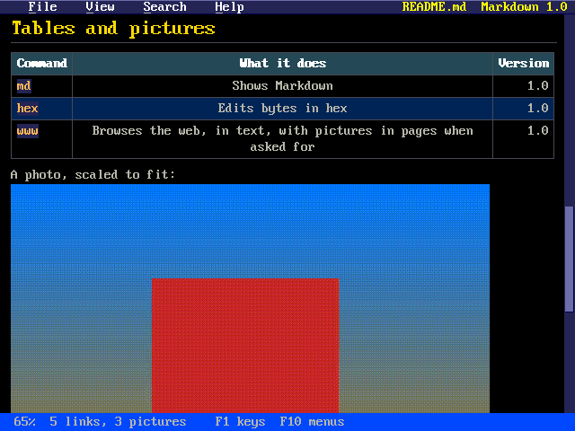
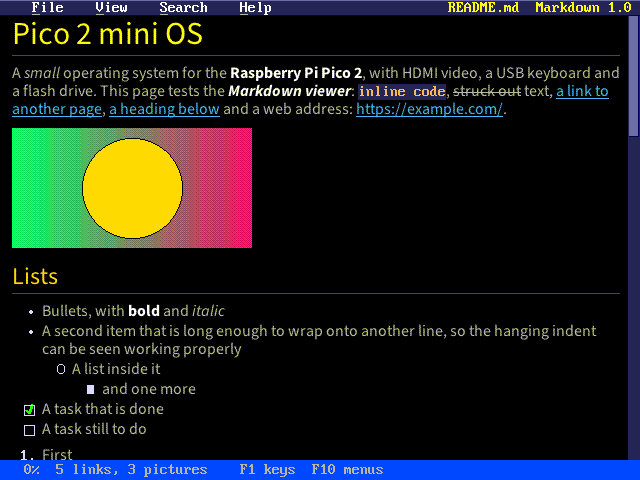
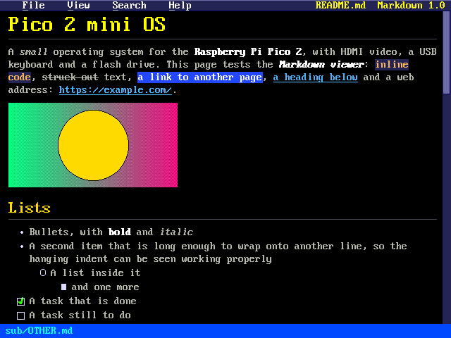
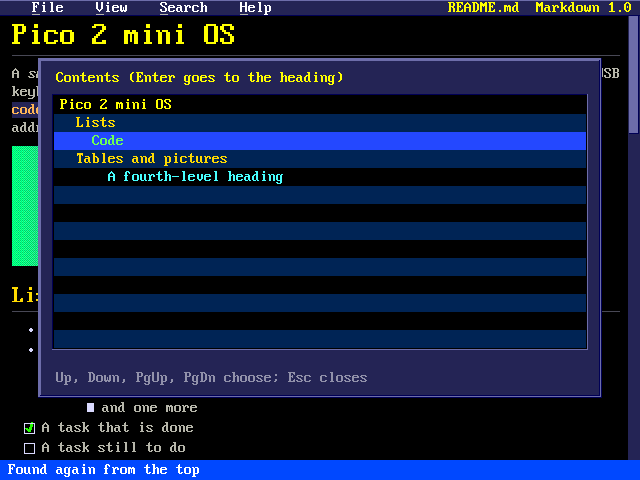
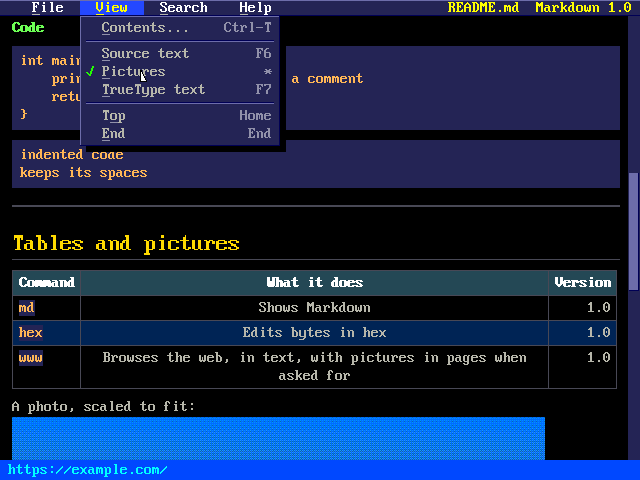

# Pico 2 mini OS Markdown Viewer

`md` shows Markdown files from the drive in graphics: big headings, bold
and italic text, code on a dark band, quotes, lists, task lists, tables,
rules, links you can follow and pictures (PNG, JPEG and BMP) from the
drive in their place. READMEs, notes and the manuals in `docs/` read well
on it.

## The viewer



`md README.md` (or `markdown README.md`) opens a file; `md` alone opens
the file box in the shell's folder, and `md /DOCS` opens it in that
folder. In `mc`, Enter on a `.md` file opens it here. It works with the
keyboard alone; a USB mouse helps.

- **The menu bar** at the top: File, View, Search and Help, as in the
  tracker and the hex editor. Click a title, or press F10 (or F9), or Alt
  and the title's first letter. In a menu, Up and Down choose, Left and
  Right go to the next menu, Enter or the underlined letter runs an item,
  Esc closes it. The file's name and the viewer's version are on the
  right.
- **The page**, 75 characters wide. Up and Down scroll, PgUp, PgDn, Space
  and `b` go a page, Home and End to the top and the end; the wheel
  scrolls too.
- **The scroll bar** on the right: drag the thumb, or click above or below
  it for a page.
- **The status line** at the bottom: how far down the page is, how many
  links and pictures it has, the address of the link under the pointer (or
  the one chosen), or a message.

## What it shows



- **Headings:** `#` (and a line of `===` under the text) in 16x32
  letters with a rule under them, `##` (and `---`) in 12x24, `###` to
  `######` in bold.
- **Text:** `*italic*` and `_italic_` slanted, `**bold**` in thicker,
  white strokes, `~~struck out~~`, `` `code` `` on a dark background.
  Lines join into paragraphs; a line ending in two spaces or `\` breaks
  there. A few HTML tags work too: `<b>`, `<i>`, `<code>`, `<br>`,
  `` and `<a href>`; others are left out. Entities (`&amp;`,
  `&copy;`, `&#233;` ...) and UTF-8 are shown in the 8x16 font's code
  page 437, accents and all where it has them.
- **Lists:** bullets (`-`, `*`, `+`), numbers (`1.` or `1)`), one inside
  another, and task lists (`- [ ]` and `- [x]`, a box and a tick).
- **Quotes** (`>`) with a bar on the left, one inside another.
- **Code** between fences (```` ``` ```` or `~~~`) or indented four
  spaces: as it is, on a dark band, cut where a line is too long.
- **Tables** (GitHub's: a `|---|:---:|---:|` row under the header) with
  their columns' alignment, the header row shaded and every other row
  too. Columns too wide for the page are narrowed and their text wrapped.
- **Rules** (`---`, `***`, `___`).
- **Pictures:** `` and ``
  are drawn in their place, found from the Markdown file's folder (or the
  drive's root, for a name starting with `/`). PNG, baseline JPEG and BMP
  files work; one wider than the page is shrunk to fit, and none is
  taller than 400 pixels. Each is drawn the first time it comes on the
  screen ("Drawing ..." on the status line; a big PNG takes a few
  seconds). Pictures from the web, and ones that can't be shown, are their
  alt text in pink, `[like this]`. `*` (View > Pictures) shows boxes
  instead.



## TrueType text



If there are fonts in `/FONTS` on the drive, `md` draws its text with them:
proportional and anti-aliased, with real bold and italic letters. Code,
code blocks, the source view and list bullets stay in the 8x16 font, so
code still lines up. F7 or `f` (or View > TrueType text) switches between
the fonts and the 8x16 font.

The fonts drawn are:

| Style | File (the default) |
|---|---|
| regular | `/FONTS/SS3.TTF` |
| bold | `/FONTS/SS3-B.TTF` |
| italic | `/FONTS/SS3-I.TTF` |
| bold italic | `/FONTS/SS3-BI.TTF` |

Only the regular font is needed. Without a bold font, bold is drawn as the
regular font twice, one pixel apart. Without an italic font, italic text
is upright. To use other fonts, write `/FONTS/MD.CFG` with lines like these
(a name without a `/` is in `/FONTS`):

```
regular=DejaVuSans.ttf
bold=DejaVuSans-Bold.ttf
italic=/MYFONTS/DejaVuSans-Oblique.ttf
```

Any font the `font` command reads will do: `.ttf`, `.otf` or `.pfn` (see
the *Font Viewer* manual). Body text is drawn at 16 pixels per em,
`##` headings at 24 and `#` headings at 32. Lines keep the 8x16 font's
heights. Each glyph is drawn once and kept in a cache, so scrolling
redraws from the cache. Kerning is not used.

Loading takes longer with big font files. Source Sans 3 cut down to the
characters the viewer can show is about 19 KB per style, against 430 KB for
the whole font. To make such a file on a PC with fontTools, run
`pyftsubset SourceSans3-Regular.ttf --unicodes=U+20-7E,U+A0-FF
--no-hinting --output-file=SS3.TTF`. The fonts are kept in PSRAM, with a
16 KB working area in SRAM, only while `md` is open. If there are no
fonts, or not enough memory, the 8x16 font is used.

## Links



Links are blue and underlined. Tab chooses the next one (Shift-Tab the
one before), starting from the top of the screen, and the page scrolls to
follow; Enter (or Right) follows the one chosen. A click follows a link
at once. What following does depends on where it goes:

- **Another Markdown file** (`[next](CHAPTER2.md)`, `[up](../README.md)`)
  opens here. Backspace (or Left, or `[`) goes back to the file before, at
  the place it was left; `]` goes forward again. A `#name` after the file
  goes to that heading in it.
- **A heading** in this file: `[see below](#tables-and-pictures)`. Its
  name is made as GitHub makes them: the heading's text in lower case,
  spaces as `-`, other signs left out.
- **A picture** (`.png`, `.jpg`, `.bmp`) fills the screen; any key or
  click comes back. A click on a picture in the page does the same.
- **A folder** opens the file box there.
- **A web address** (`http://` or `https://`) asks first, then opens in
  the web browser, `www`; quitting it comes back here.

Reference links work too: `[text][name]`, `[name][]` and `[name]`, with
`[name]: address` anywhere in the file.

## Contents, Find and the source



- **Ctrl-T** (or `t`, View > Contents) lists the headings, indented by
  level, with the one the page is at chosen. Up, Down, PgUp and PgDn
  choose; Enter (or a click) goes there.
- **Ctrl-F** (or `/`) finds text (case doesn't matter) from the top of
  the screen down; it is shown on yellow. F3 (or `n`) finds the next.
- **F6** (or `s`, View > Source text) shows the file as it is, each line
  wrapped; F6 again lays it out once more.
- **F5** (or `r`) reads the file again, keeping the place: handy while
  editing it in `edit` or on a PC.
- **Ctrl-O** (or `o`) opens another file: the file box lists the folder's
  folders and files (Markdown files in blue); Enter or a double click
  opens one, Backspace goes up a folder.



The right mouse button gives a menu of its own: follow the link under
the pointer, Back, Forward, Contents, Find, Source text and Reload.

## Keys

| Key | What it does |
|---|---|
| Up, Down | scroll |
| PgUp, PgDn, Space, b | a page up or down |
| Home, End | the top, the end |
| Tab, Shift-Tab | choose the next or the previous link |
| Enter, Right | follow the link chosen |
| Backspace, Left, `[` | back |
| `]` | forward |
| Ctrl-T, `t` | contents |
| Ctrl-F, `/` | find |
| F3, `n` | find the next |
| F6, `s` | the source text, or the page |
| `*`, `p` | pictures, or boxes |
| F7, `f` | TrueType text, or the 8x16 font |
| F5, `r` | read the file again |
| Ctrl-O, `o` | open a file |
| F1, `?` | the keys |
| F10, F9 | the menus |
| Esc, `q` | quit |

## Limits

- Each frame is drawn 16 rows at a time in a 10 KB strip of SRAM (only
  while `md` is open) and copied onto the screen piece by piece: about
  30 ms a frame with the 8x16 font and 47 ms with TrueType text, against
  120 and 142 ms through a picture in PSRAM. Ctrl-B switches between the
  two, and About gives the times.
- Files up to 8 MB. The text, the page laid out and the pictures drawn
  (up to 3 MB of them; those furthest from the screen are let go first and
  drawn again when they come back) are kept in PSRAM, only while `md` is
  open.
- Pictures from the web are not fetched; GIF, SVG and progressive JPEGs
  are shown as their alt text.
- HTML blocks are shown as their text, with the tags left out; footnotes
  and math are shown as they are written.
- Text is kept as code page 437, in both fonts: characters it lacks (most
  of those outside Western European languages, and emoji) are left out.
