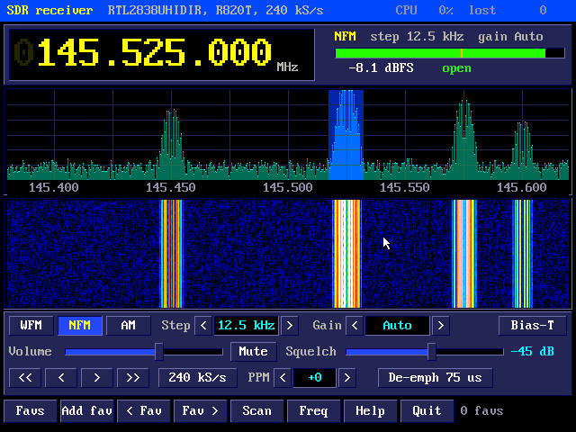
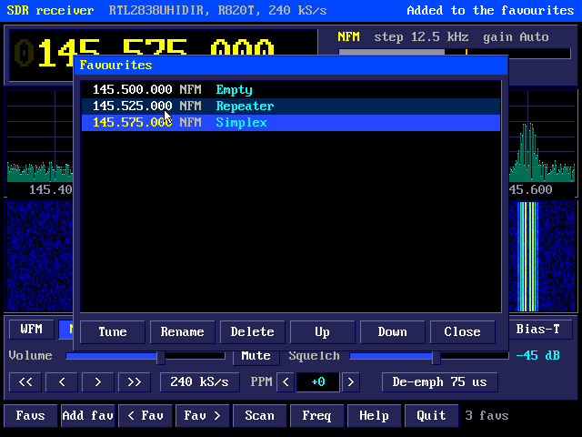
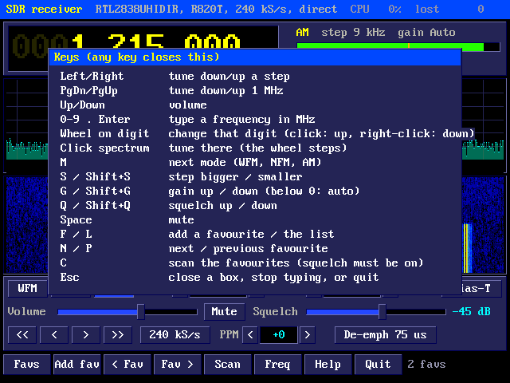
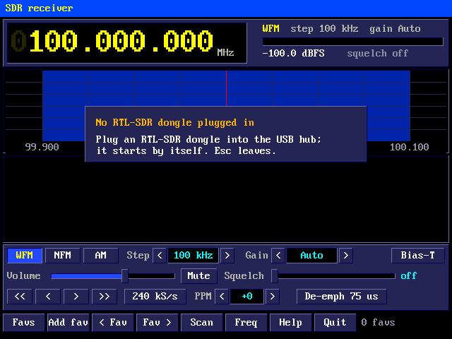

# Pico 2 mini OS SDR Receiver

A radio receiver for an RTL-SDR dongle plugged into the USB hub: it shows
the spectrum and a waterfall of the band around the frequency tuned, and
plays wide FM (broadcast), narrow FM (amateur, PMR, air band repeaters...)
or AM through the HDMI sound, with a squelch, favourites and a scan of
them.

## What it needs

- An **RTL2832U dongle** with a Rafael Micro **R820T, R820T2 or R828D**
  tuner: the RTL-SDR Blog V3 and V4, the Nooelec NESDR range and most
  "RTL2832U + R820T2" DVB-T sticks. Dongles with the older Elonics E4000
  or Fitipower FC0012/FC0013 tuners are recognised but not supported.
- An antenna on it. The telescopic dipole that comes with the Blog
  dongles does for broadcast FM and the 2 m band.
- The USB hub with its own 5 V supply (see Powering USB devices in the
  User's Manual): a dongle draws about 300 mA, more with the bias tee on.
- A USB mouse (the keys do everything too).

Plug the dongle in before or after starting `sdr`: the receiver starts it
when it appears, and waits again if it is unplugged.

### What it can do over the Pico's USB

The RP2350's USB runs at full speed (12 Mbit/s), and each sample from the
dongle is two bytes, so the receiver runs the dongle at **240 kS/s**
(480 KB/s; 288 kS/s can be chosen). That is a window **240 kHz wide**
(288 kHz): enough for one broadcast FM station, in **mono** (its stereo
and RDS signals reach past the edges of the window), or a stretch of
narrow FM or AM channels. Computers run these dongles at 2 MS/s or more
over high-speed USB; the Pico can't.

Frequencies from **0.5 MHz to 1766 MHz**. Below 24 MHz an R820T dongle
(Blog V3) samples its antenna input directly, which works for strong
signals (AM broadcast, shortwave) with a long wire; the **Blog V4** has
an upconverter for HF that the receiver uses below 28.8 MHz.

## The receiver


`sdr` opens it; `sdr 145.5 nfm` opens it on a frequency (MHz) and mode.

From the top:

- **The title strip:** the dongle's name and tuner, the sample rate (and
  "direct" when sampling the antenna directly); on the right, how much of
  the processor the demodulating takes and how many buffers of samples
  were lost (see Troubleshooting), or a message for a few seconds.
- **The frequency** in big digits, MHz.kHz.Hz. The wheel over a digit
  turns that digit up and down; a click on it adds one, a right click
  takes one away.
- Beside it: the **mode**, the **step** and the **gain**; the **signal
  meter** (the channel's level in dB below full scale, green while the
  squelch is open, with the squelch level marked in orange), and whether
  the squelch is open or shut. SCAN or MUTE shows there too.
- **The spectrum** of the window the dongle sends, with the frequency
  scale under it. The channel's band is shaded and the frequency tuned is
  the red line. Click anywhere to tune there (rounded to the step); the
  wheel over it tunes a step at a time. The scale follows the noise
  floor, so the bottom of the spectrum is always just under the noise.
- **The waterfall:** the spectrum going back about six seconds, newest at
  the top: dark blue is noise, then cyan, yellow, red and white as the
  signals get stronger. Clicks and the wheel work on it as on the
  spectrum.
- **The controls:** the modes (WFM, NFM, AM); the step and gain (the
  arrows, a click on the value, or the wheel over them); Bias-T;
  the volume and squelch sliders and Mute; `<<` `<` `>` `>>` (down a MHz,
  down a step, up a step, up a MHz); the sample rate; the crystal
  correction (PPM); and the wide FM de-emphasis.
- **The buttons along the bottom**, as in the sprite editor: Favs, Add
  fav, `< Fav` and `Fav >`, Scan, Freq (type a frequency), Help (the keys)
  and Quit; then how many favourites there are.



### Modes

| Mode | For | Channel |
|---|---|---|
| WFM | broadcast FM (88-108 MHz) | the whole window; mono, 15 kHz audio, de-emphasis 75 us (the Americas) or 50 us (Europe) |
| NFM | narrow FM: amateur, PMR446, business radio, marine... | 15 kHz wide (12.5 and 25 kHz channels) |
| AM | AM broadcast, the air band (118-137 MHz), CB | 10 kHz wide |

In NFM and AM the channel can be anywhere in the window: tuning moves it
there without retuning the dongle, until it would go more than about
75 kHz from the middle (the window's edges are less clean), when the
dongle is tuned again so the channel is in the middle. In WFM the dongle is always tuned to the
station (it fills the window).

### Tuning

- Left and Right, `<` and `>`, or the wheel on the spectrum: a step down
  or up (to the nearest multiple of the step: from 145.512 a 12.5 kHz
  step up goes to 145.525).
- PgDn and PgUp, `<<` and `>>`: a megahertz.
- The wheel on a digit: that digit.
- A click on the spectrum or waterfall.
- Typing: the digits and a point start typing a frequency in MHz (it
  shows in place of the frequency, in cyan); Enter tunes there, Esc
  doesn't. Freq starts it with the mouse.

Steps: 100 Hz, 1, 5, 6.25, 9, 10, 12.5, 25, 50, 100 and 200 kHz, and
1 MHz. Broadcast FM is on 100 kHz (200 kHz in the Americas), the 2 m
band on 12.5 or 25 kHz, AM broadcast on 9 kHz (10 kHz in the Americas),
the air band on 25 kHz (8.33 kHz channels are 25 kHz apart in threes).

### Gain

**Auto** lets the tuner set its own gain (its AGC), which suits most
signals. Otherwise the tuner's 29 steps, 0 to 49.6 dB. More gain brings
weak signals up, until strong ones overload the dongle: then false
signals appear all over the spectrum, and less gain clears them. Below
24 MHz on an R820T dongle (direct sampling) there is no tuner gain.

### Squelch

The squelch keeps the sound off until the channel's level rises above
the squelch level, and closes it again 2 dB below. Drag the slider (or
Q and Shift+Q) to just above the noise: the meter shows the level with
nothing there, and the orange mark where the squelch is. All the way to
the left it is off. The scan needs it.

### Favourites

**Add fav** (F) keeps the frequency and mode, and asks for a name (Enter
keeps it, Esc doesn't). **Favs** (L) lists them in frequency order:
click one and **Tune** (or double click it, or Enter); **Rename**,
**Delete** (or the Delete key), **Up** and **Down** to change their order,
**Close** (Esc). `< Fav` and `Fav >` (P and N) tune to the previous and
next ones. Up to 40.



### Scan

**Scan** (C) goes round the favourites, listening to each for 0.15 s, and
stops where the squelch opens; once the signal goes it waits 2 seconds
and then goes on. Scan or C again stops it. It needs two favourites or
more and the squelch on.

### Other settings

- **Rate:** 240 or 288 kS/s. 288 shows a little more of the band, at 20%
  more USB traffic.
- **PPM:** the dongle's crystal is a few parts per million out (the Blog
  dongles less than 2; cheap ones up to 100). If stations show a little
  to one side of where they should be, tune to one whose frequency is
  known exactly and change the correction until it sits on the red line.
  At 100 MHz, 10 ppm is 1 kHz.
- **De-emph:** wide FM's de-emphasis, 75 us in the Americas and South
  Korea, 50 us elsewhere.
- **Bias-T:** puts 4.5 V up the antenna cable, for an LNA or active
  antenna that wants it (the Blog V3 and V4, and some Nooelec dongles,
  have one). Leave it off otherwise: some antennas short the cable for
  DC.

Everything is kept in `/SDR.INI` on the drive when the receiver closes
(and when the favourites change).

### Keys



| Key | Does |
|---|---|
| Left / Right | down / up a step |
| PgDn / PgUp | down / up 1 MHz |
| Up / Down | volume |
| 0-9 and . | type a frequency in MHz (Enter tunes, Esc doesn't, Backspace) |
| M | the next mode |
| S / Shift+S | a bigger / smaller step |
| G / Shift+G | more / less gain (below 0 dB: Auto) |
| Q / Shift+Q | squelch up / down |
| Space | mute |
| F / L | add a favourite / the list |
| N / P | the next / previous favourite |
| C | scan the favourites |
| F1, H or ? | the keys |
| Esc | close a box, stop typing, or leave |

The receiver stops when it closes (the sound comes from its
demodulating).

## From the shell

```
sdr                       the receiver, where it was last
sdr 98.1                  on 98.1 MHz
sdr 145.5 nfm             on 145.500 MHz, narrow FM (wfm, nfm, am)
sdr info                  the dongle: its USB IDs and strings, its tuner
```

`sdr info` is a quick check that the dongle is seen and its tuner
recognised:

```
USB 0bda:2838, 64-byte packets: RTLSDRBlog Blog V4
tuner R828D (RTL-SDR Blog V4); 0.5-1766 MHz, HF through its upconverter
```

## Troubleshooting



- **"No RTL-SDR dongle plugged in"**: the dongle hasn't been found on the
  hub. When one is, the shell prints a line like `[USB: RTL-SDR dongle
  0bda:2838, bulk endpoint 81, 64-byte packets]`. Dongles from other
  makers with IDs the driver doesn't know yet aren't taken: note its IDs
  so they can be added.
- **"Its E4000 tuner isn't supported"** (or FC0012, FC0013): an old
  dongle; only the R820T family is.
- **No sound but a signal on the spectrum:** the squelch is shut (the
  meter is grey), the volume is down, Mute is on, or the mode is wrong
  (wide FM sounds like silence or rushing in NFM, and NFM is quiet in
  WFM).
- **"lost" counts up** in the title strip: buffers of samples came while
  all eight were waiting, so the sound has gaps. It happens for a moment
  when the screen is drawn again; if it keeps counting, the demodulating
  is too slow (the CPU figure beside it) or USB is busy (copying files at
  the same time).
- **The CPU figure** is the share of core 0 the demodulating takes.
- **Stations are mirrored** (a station above the middle shows below it,
  and tuning to it finds nothing): the dongle's spectrum inversion
  setting is the wrong way round for it; report the dongle.

## How it works

The RTL2832U was made for DVB-T television. In its "SDR mode" its ADC
samples the tuner's output (a low IF of about 2 MHz), mixes it down to
zero, filters and resamples it, and sends the 8-bit I and Q samples over
USB. The R820T tuner before it mixes the antenna's frequency down to that
IF, with a 350 kHz filter (its narrowest) that keeps out what the low
sample rate would otherwise fold into the window.

**USB.** TinyUSB runs the USB host on core 1; a small class driver
(`src/sdr/rtl_usb.c`) claims the dongle's first interface and its bulk
endpoint (64-byte packets at full speed). The RP2350's host runs bulk
transfers on the same hardware endpoint as control transfers (the patch
in `src/usb_patch` that made the flash drive faster), so the dongle's
setup and tuning requests, from core 0, go between its 2 KB sample
transfers; while tuning, the stream is held so the requests run back to
back. The samples come into a ring of eight 2 KB buffers in the apps'
SRAM area (`app_overlay.h`), freed when the receiver closes.

**The dongle** (`src/sdr/rtl2832.c`): the RTL2832U's registers and the
tuner's, over its I2C bus, set up as the open-source rtl-sdr driver does
(osmocom's librtlsdr and the RTL-SDR Blog's version, which document how
these chips work); the Blog V4 is recognised from its USB strings.

**Demodulating** (`src/sdr/sdr_dsp.c`, on core 0, in floating point):

- **WFM:** the phase change from each sample to the next (the FM
  discriminator) at 240 kS/s, then a 128-tap low-pass filter at 15.5 kHz
  that also takes out the 19 kHz stereo pilot, kept at every fifth sample
  for 48 kHz, and the de-emphasis.
- **NFM and AM:** the channel is shifted to zero (a rotating phasor), a
  64-tap filter keeps it and every fifth (sixth at 288 kS/s) sample is
  kept for 48 kHz, then FM's discriminator and a 3 kHz low-pass, or AM's
  envelope divided by its own average (that is the AGC, and takes away
  the carrier).
- **The squelch** compares the channel's average power with its level.
- **The spectrum:** a 1024-point FFT with a Hann window, 20 times a
  second, smoothed; each of the 624 columns shows the strongest of the
  points under it. The waterfall is drawn in the framebuffer (moved down a
  row each time) and kept in PSRAM for redrawing.

**The sound** goes into a ring in PSRAM that core 1's HDMI sound plays
at 48 kHz. The dongle's crystal and the Pico's don't agree exactly, so
when the ring fills past three quarters a sample is dropped now and
then; if it runs dry, playing waits until 50 ms have come again.

The PC test `tools/sdrtest/uitest.sh` runs the demodulators on made-up
signals (FM and AM stations carrying a 1 kHz tone, beside other
stations, with noise) and checks the tone comes out clean, then runs the
receiver with a pretend dongle and makes these screenshots.
