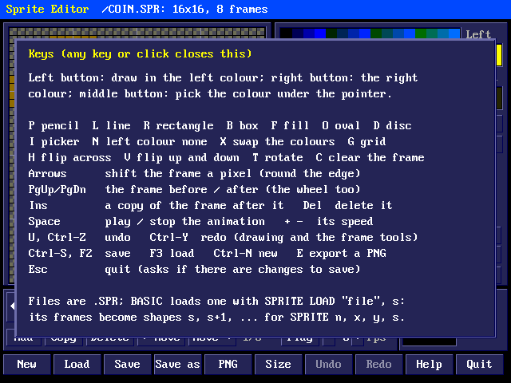
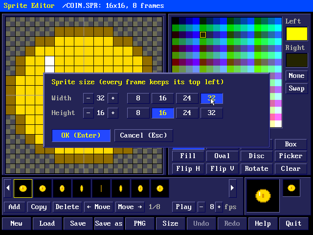
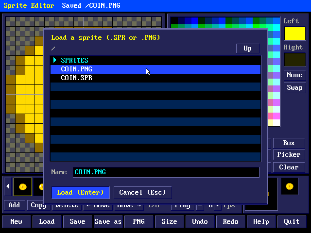
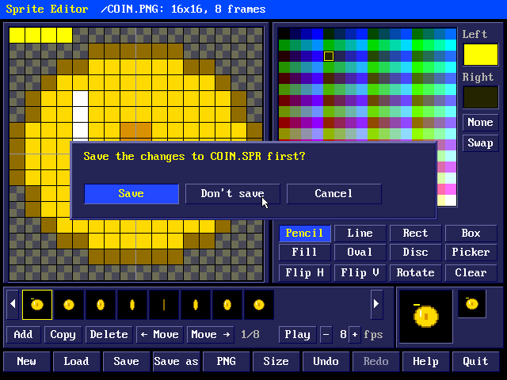

# Pico 2 mini OS Sprite Editor

A sprite editor for the screen's own colours: RGB332 sprites from 1x1 to
32x32 pixels, drawn with the mouse in all 256 colours and "none"
(see-through), with up to 64 animation frames. Sprites are saved as .SPR
files, which BASIC's `SPRITE LOAD` turns into shapes for `SPRITE`, and can
be exported as PNGs.

## The editor


`sprite` (or `spredit`) opens the editor on a new 16x16 sprite; `sprite
COIN.SPR` opens that file (or starts a new one by that name). It needs a
USB mouse; the keys do the rest.

- **The sprite**, magnified as much as fits (40 screen pixels a sprite
  pixel at 8x8, 10 at 32x32), with a grid (G) whose lines every eighth
  pixel are lighter. See-through pixels show as grey checks. The **left
  button** draws in the left colour, the **right button** in the right
  colour (none at first, so it rubs out), and the **middle button** picks
  up the colour under the pointer as the left colour.
- **The palette:** all 256 colours, in order: `&H00` at the top left,
  `&H0F` at the end of the top row, `&HFF` at the bottom right. Within a
  colour byte the top three bits are red, the next three green and the
  last two blue (R7 G7 B3 is white). A left click makes a colour the left
  colour (marked in white), a right click the right colour (marked in
  yellow); the wheel over the palette steps the left colour. **None**
  makes the left colour see-through (a right click: the right colour), and
  **Swap** swaps them.
- **The line under the palette** says what is under the pointer: the
  pixel's position and colour on the sprite, or the colour in the palette
  (its value as `&H` hex and decimal, and its red, green and blue).
- **The tools:** Pencil; Line; Rect (an outline) and Box (filled); Fill
  (the area of one colour, through its four neighbours); Oval and Disc
  (filled), fitting the rectangle dragged; and Picker. Lines and shapes
  follow the pointer until the button comes up.
- **The frame tools:** Flip H (left to right), Flip V (top to bottom),
  Rotate (a quarter turn clockwise; square sprites) and Clear.
- **The frames:** thumbnails at their real size, the frame being drawn
  outlined in yellow. Click one to draw on it; a right click deletes it.
  **Add** puts an empty frame after it, **Copy** a copy of it; **Delete**
  asks first unless it is empty; **Move** swaps it with its neighbour. The
  arrows at the ends page through more than eleven frames.
- **The preview:** the frame twice and once its real size. **Play** (or
  Space, or a click on the preview) animates the frames at 1 to 30 frames
  a second (- and +).
- **The file buttons:** New, Load, Save, Save as, PNG (export), Size,
  Undo, Redo, Help (the keys) and Quit.

The title strip shows the file (with `*` when it has changes not saved),
the size, the frame and the tool, and messages for a few seconds.

### Keys



Help (or F1) shows them in the editor too.

| Key | Does |
|---|---|
| P L R B F O D I | Pencil, Line, Rect, Box, Fill, Oval, Disc, Picker |
| N | the left colour none (see-through) |
| X | swap the left and right colours |
| G | the grid on or off |
| H / V | flip left to right / top to bottom |
| T | rotate a quarter turn |
| C | clear the frame |
| arrows | shift the frame a pixel (what goes off one edge comes in at the other) |
| PgUp / PgDn (and , .), the wheel | the frame before / after |
| Home / End | the first / last frame |
| Ins | a copy of the frame, after it |
| Del | delete the frame (asks) |
| Space | play / stop the animation |
| + / - | its speed |
| U or Ctrl-Z / Ctrl-Y | undo / redo |
| Ctrl-S or F2 | save |
| F3 or Ctrl-O | load |
| Ctrl-N | new |
| E | export a PNG |
| F1 | the keys |
| Esc | quit (asks first if there are changes to save) |

Undo goes back 32 steps of drawing and of the frame tools (flips,
rotations, shifts, clearing); adding, deleting and moving frames and
changing the size can't be undone.

### Size



Size sets the width and height, each 1 to 32 (- and +, or 8, 16, 24 or
32; with the keyboard, Left/Right and Up/Down). Every frame keeps its top
left: making a sprite smaller cuts off its right and bottom.

### Loading and saving



Load, Save as and PNG open a file box on the file's folder (or the
shell's): folders first, then the files of the kind wanted (.SPR and .PNG
for Load, .SPR for Save as, .PNG for PNG). Click a folder to go into it,
Up (or Backspace) to go back; click a file to choose it
(twice to load it), or type a name. Enter loads or saves; a name without
an extension gets .SPR (or .PNG). Saving over another file asks first.



New, Load and Quit ask about changes not saved: **Save** saves them first
(asking for a name if the sprite has none), **Don't save** goes on
without them.

### PNGs

**PNG** writes the frames side by side as one PNG with transparency (a
16x16 sprite of 8 frames makes a 128x16 picture), for other programs or
the web. **Load** reads PNGs too: if one is as tall as the sprite and a
whole number of its widths across, it gives frames of the sprite's size;
else, if it is up to 32 pixels tall and a whole number of its heights
across, square frames; else one frame of its top left 32x32. Colours are
rounded to the nearest RGB332 ones, and pixels less than half opaque are
see-through. Save then writes it as a .SPR of the same name.

## In BASIC

`SPRITE LOAD "file"[, s]` keeps the frames of a .SPR file as shapes `s`,
`s`+1, ... (0 if `s` is left out), in their own colours whatever the
SCREEN mode or PALETTE, with their see-through pixels see-through. Then
`SPRITE n, x, y, s` shows sprite `n` as shape `s`, and changing the shape
each frame animates it:

    10 SCREEN 13: SPRITE LOAD "COIN.SPR", 0
    20 FOR F=0 TO 1000: SPRITE 1, 150, 90, F MOD 8
    30 SPRITE UPDATE: PAUSE 60: NEXT

A sprite pixel is a pixel of the mode, so in SCREEN 13 (320x200) a sprite
looks twice as big as in the editor's preview at its real size. The
example `EXAMPLES/COINS.BAS` bounces sixteen spinning coins from
`EXAMPLES/COIN.SPR`, the coin in the pictures here. The *BASIC* manual
describes the sprite statements.

## From the shell

```
sprite                      the editor, on a new sprite
sprite COIN.SPR             the editor, on that file
sprite info COIN.SPR        COIN.SPR: 16x16, 8 frames
sprite png COIN.SPR [out]   COIN.PNG: its frames side by side
```

## The .SPR file

| Offset | Bytes | |
|---|---|---|
| 0 | 4 | `SPR1` |
| 4 | 1 | width, 1-32 |
| 5 | 1 | height, 1-32 |
| 6 | 1 | frames, 1-64 |
| 7 | 1 | 0 |
| 8 | | each frame: width x height colour bytes (RGB332, the rows from the top), then (width x height + 7) / 8 bytes, a bit for each pixel in the same order (the first in bit 7): 1 drawn, 0 see-through |

A see-through pixel's colour byte is 0. A 16x16 sprite of 8 frames is
2,312 bytes.

## How it works

The editor keeps its frames (64 of 32x32, with a byte a pixel for the
colour and one for drawn or not), 32 steps of undo and 32 of redo, and a
picture of the whole screen in PSRAM while it runs, and nothing at all
once it ends. Buttons and boxes are drawn into the picture in PSRAM and
copied to the screen; drawing on the sprite goes straight onto the screen,
redrawing only the magnified pixels that changed (each remembers what it
shows), and the thumbnail and preview follow at most ten times a second,
so the pencil keeps up with the mouse. The mouse arrow is laid over the
picture by the video output, so drawing under it leaves no trace.

The PNG is written with deflate's stored (uncompressed) blocks, which
need no compressor: 64 frames of 32x32 make a PNG of about 256 KB. PNGs
are read with LodePNG, as the picture viewer does.

`tools/spritetest/uitest.sh` builds the editor on a PC and draws the coin
with a simulated mouse, checking the tools, undo, the frame tools, the
file boxes, saving and loading, and the PNG both ways; it writes the
pictures in this manual and COIN.SPR.
