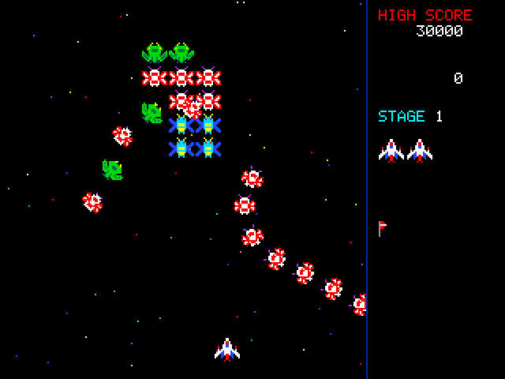
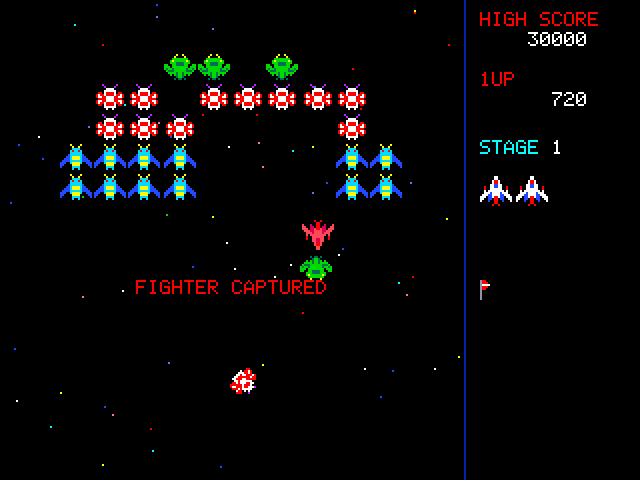
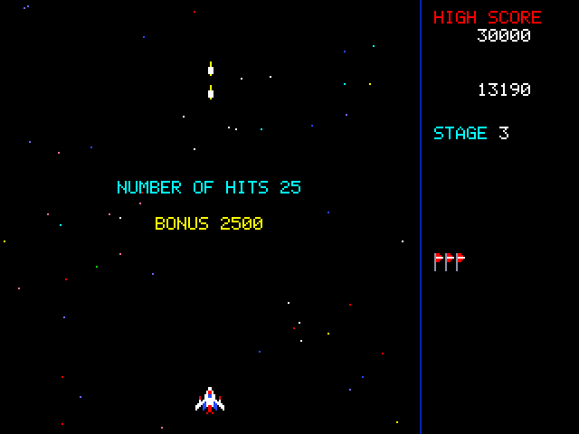
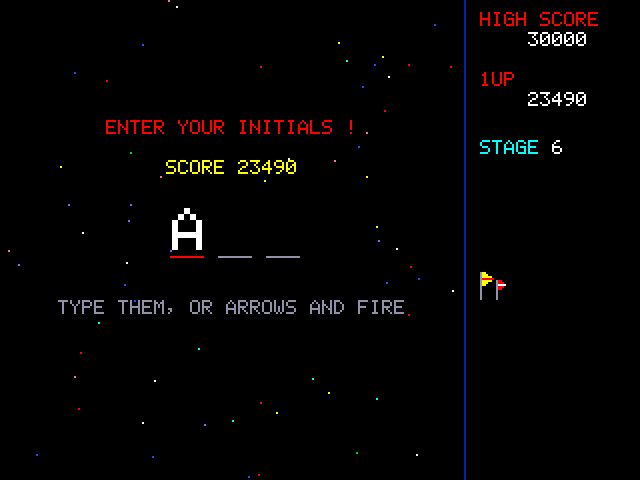

# Pico 2 mini OS Swarm

Swarm is an arcade space shooter. Aliens fly in to a formation, then dive
at your fighter. Their flagships can capture your fighter with a tractor
beam, and if you shoot that flagship you get the fighter back, docked
beside yours as a twin fighter. The game runs at 60 frames a second on
the HDMI screen and plays its sound effects over HDMI. All of its art,
sound and music were made for this game.

## Starting


Type `swarm` at the shell. The title screen takes turns showing what each
alien is worth and the five best scores. **Enter** (or **Fire**, or a
gamepad's Start) starts a game, and **Esc** goes back to the shell.

| Key | What it does |
|-----|--------------|
| Left / Right arrow, or A / D | move the fighter |
| Space, Z, X or Ctrl | fire (hold it to keep firing) |
| P | pause |
| M | sound on or off |
| Esc | end the game (back to the title); on the title, back to the shell |
| F10 | back to the shell from anywhere |

A USB gamepad works too: the stick or D-pad moves the fighter, the first
four buttons fire, and Start starts a game or pauses it.

## Playing



Each stage starts with 40 aliens flying in, in five waves of eight. They
come in along curves and take their places in a formation: four green
flagships at the top, sixteen moths, then twenty drones. The formation
sways while they arrive. Once everyone is in place it breathes in and out,
and the aliens start to dive at you. A diving alien swings out of the
formation in a half loop, then heads down at your fighter and fires. If it
misses, it comes back in from the top. Shooting aliens while they dive is
worth twice as much as shooting them in the formation. You can only have
two shots on the screen at once, so a shot that misses costs you time.

A flagship takes two hits. After the first hit it turns purple. A
flagship often brings one or two moths along as escorts. If you shoot the
escorts first, the flagship is worth 800 with one escort gone and 1600
with both.

The panel on the right shows the high score, your score, the stage, your
fighters in reserve and a flag for each stage. Bigger flags stand for 5,
10, 20, 30 and 50 stages.

You start with three fighters. You get an extra fighter at 20,000 points,
another at 70,000, and then one every 70,000 after that. The game gets
harder with each stage: the aliens dive more often, more of them dive at
once, they fly faster and they fire more. From the fourth stage on they
also fire while flying in.

## The tractor beam


Sometimes a flagship dives alone, stops above your fighter and sends down
a tractor beam. If your fighter is under the beam, it is pulled up and
carried off. The fighter then rides on top of the flagship (in red), and
you lose that fighter.



To get the fighter back, wait for that flagship to dive and shoot it
while it is diving. The captured fighter is freed and docks beside yours,
and you then fly a **twin fighter**. A twin fires two shots at once, but
it is twice as wide, so it is easier to hit. If one half is hit, you
carry on with the other half. A flagship won't use its beam while you fly
a twin.


Be careful: if you shoot the flagship while it sits in the formation, the
captured fighter turns against you. It becomes an alien worth 500 in the
formation and 1000 diving. Shooting a captured fighter also destroys it
(1000 points).

## Challenging stages


Stage 3, and every fourth stage after it (7, 11, 15 and so on), is a
challenging stage. Forty aliens fly patterns across the screen in five
groups. They don't fire and don't dive, and each group flies off again.
Each one you hit is worth 100. Hit all 40 for a perfect stage and a
special bonus of 10,000.



## Game over and high scores

When your last fighter is gone, the game shows your results: shots fired,
hits, and the hit-miss ratio. If your score is one of the five best, you
enter your initials. Type the three letters, or step through the letters
with the arrows and press Fire for each one. Backspace goes back a letter.



The five best scores are kept in `/SWARM.HI` on the USB drive, a short
text file (`score NAME` on each line). Delete it to start the table
again. If there is no drive, the scores last until you leave the game.

## Your own sprites

The game's sprites can be changed with the sprite editor:

```
swarm sprites SWARM.SPR
sprite SWARM.SPR
```

`swarm sprites` writes the built-in sprites as a .SPR file with 11 frames
of 16x16. The frames are, in order: the fighter; the drone (two wing
frames); the moth (two); the flagship (two); the dart and the disc, which
fly in challenging stages (two each). Draw the sprites facing up, as they
sit in the formation. The game turns them itself (16 directions) and
makes the red captured fighter and the purple hit flagship from your
colours. When `/SWARM.SPR` (at the top of the drive) is a 16x16 file with
at least 11 frames, the game uses it in place of its own art. Rename or
delete the file to go back to the built-in art.

## Notes

- While the game runs, the screen is 320x240 with each pixel shown as two
  by two. Each frame is drawn in a second buffer in SRAM and copied to
  the screen during the vertical sync, so nothing flickers. Everything the
  game uses lives in the free part of the framebuffer, so it keeps no
  memory once you leave.
- The game takes over the sound, so the internet radio stops while you
  play.
- On a PC, `tools/swarmtest/uitest.sh [folder]` builds the game and lets
  an autopilot play a whole game. It checks the stages, the beam, the
  rescue, a challenging stage and the high-score file, then writes the
  screenshots in this manual and every sound effect and tune to
  `swarm_sounds.wav`.
