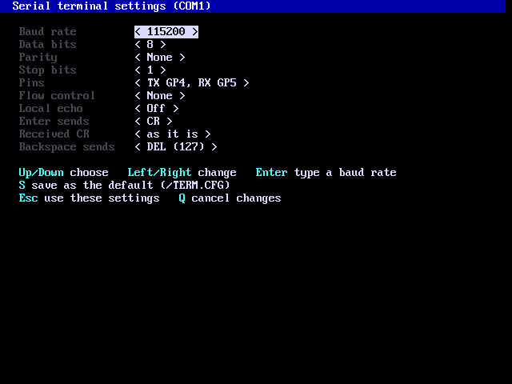
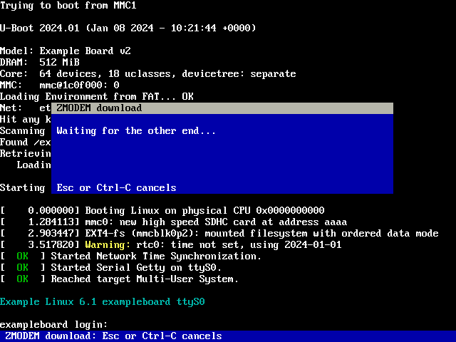

# Pico 2 mini OS Serial Terminal

`term [baud] [format]` (or `serial`) is a terminal on the COM1 serial port, with a settings page, logging and file transfer by XMODEM, YMODEM and ZMODEM.

## The terminal

`term` (or `serial`) is a terminal on COM1, the serial port BASIC also
uses: UART1, TX on GP4 and RX on GP5 unless the settings say otherwise
(3.3 V levels; connect the far end's RX to TX, TX to RX, and ground). The
debug port on GP0/GP1 is never used.

    term                  the saved settings (115200 8N1 at first)
    term 9600             another speed this time
    term 9600 7E1         speed and format

What arrives goes through the console's VT100/ANSI handling, so colours
and cursor movement from the far end work. As in the text editor, row 1 is
a menu bar, rows 2-29 are the terminal (set the far end to 28 rows, e.g.
`stty rows 28`; its cursor moves and screen clears stay inside them) and
row 30 is a status line with the port settings and key hints. What arrives
also goes to the debug serial port when the serial console is on (`sercon`).

**Menus:** click **File** (Send text file, Log to file, Exit),
**Transfer** (Upload, Download), **Settings** (Port settings, Local echo,
Send BREAK, Clear screen) or **Help** (Keys) on the menu bar, or press F9
(or Ctrl-A M). Left / Right go to the next menu (or move the pointer onto
its title), Up / Down and Enter choose, Esc closes; you can also press on a
title, move onto an item and let go. The right mouse button opens a menu
with all of these. Each item shows its key. While a menu is open, what
arrives waits and then shows when it closes.

Above: a board's boot messages arriving on COM1 at 115200 baud, colours
and all. (The sample session is made up; any device with a serial console
looks much the same.)

| Key | Action |
|---|---|
| F1, or Ctrl-A S | Settings page |
| F10, or Ctrl-A X | Leave the terminal |
| F9, or Ctrl-A M | The menus |
| Ctrl-A B | Send a BREAK (250 ms) |
| Ctrl-A C | Clear the screen |
| Ctrl-A E | Local echo on / off |
| Ctrl-A L | Log what arrives to a file (default `TERM.LOG`, added to); again to stop |
| Ctrl-A F | Send a file as it is (Esc stops) |
| Ctrl-A U | Upload: send files with XMODEM, XMODEM-1K, YMODEM or ZMODEM |
| Ctrl-A D | Download: receive files with XMODEM, YMODEM or ZMODEM |
| Ctrl-A H | Key help page |
| Ctrl-A Ctrl-A | Send Ctrl-A |

Other keys go to the far end; arrows, Home, End, Delete and function keys
as VT100 sequences.

The settings page (Up/Down choose, Left/Right change):

| Setting | Choices |
|---|---|
| Baud rate | 300 to 921600 from a list, or Enter to type any rate from 50 to 4000000 |
| Data bits | 5, 6, 7, 8 |
| Parity | None, Even, Odd |
| Stop bits | 1, 2 |
| Pins | TX/RX on GP4/GP5, GP8/GP9, GP20/GP21 or GP24/GP25 |
| Flow control | None, or RTS/CTS on the next two pins (CTS GP6 / RTS GP7 for GP4/GP5, and so on) |
| Local echo | Off, On |
| Enter sends | CR, LF, or CR LF |
| Received CR | as it is, or with a line feed added |
| Backspace sends | DEL (127) or BS (8) |

`S` saves the settings as the default in `/TERM.CFG`, Esc uses them and goes
back, and `Q` cancels the changes. Changing the port settings reopens the
port.

### File transfer: XMODEM, YMODEM, ZMODEM

Ctrl-A U sends files and Ctrl-A D receives them; a key picks the protocol.
A window shows the file, bytes and percentage, speed, retries and files
done; Esc or Ctrl-C cancels (the other end is told, with CAN characters).

Above: Ctrl-A D, then Z: the ZMODEM window waiting for the far end to
start sending (`sz file` there). Once a file starts, the window shows its
name, bytes, speed and retries.

| Protocol | Sending | Receiving |
|---|---|---|
| XMODEM | one file, 128-byte blocks, CRC-16 or checksum (the receiver chooses) | one file; you type the name to save it as. Its size is rounded up to 128 bytes, padded with Ctrl-Z, as XMODEM has no sizes |
| XMODEM-1K (K) | one file, 1024-byte blocks | (the same as XMODEM) |
| YMODEM | several files with names and sizes | the sender's names; exact sizes |
| ZMODEM | several files, streaming | the sender's names; carries on with a partial file when the sender asks (`sz -r`) |

- Files to send: type one or more names separated by spaces; `*` and `?`
  work in the last part, e.g. `EXAMPLES/*.BAS` (up to 32 files).
- Received files go in the current folder. A name that is taken gets `-1`,
  `-2` ... before the extension, so nothing is overwritten.
- A ZMODEM download starts by itself when the far end runs `sz file`: the
  terminal sees the start of ZMODEM and opens the window.
- ZMODEM uploads first send `rz` and Enter, which starts the receiver on a
  Unix shell.
- A broken XMODEM or YMODEM download is deleted; a broken ZMODEM one is kept
  so that `sz -r` can finish it.
- The receiver asks a ZMODEM sender to wait for an ACK every 4 KB, so a slow
  drive never loses data; RTS/CTS flow control also works.
