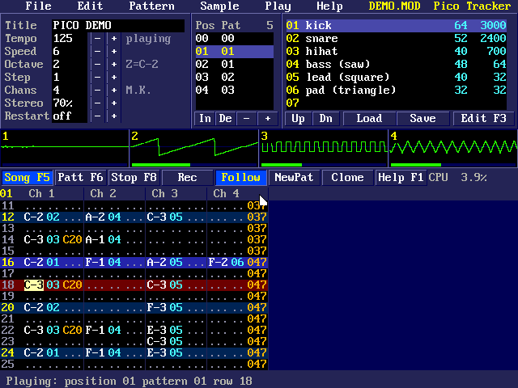
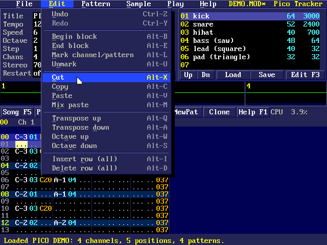
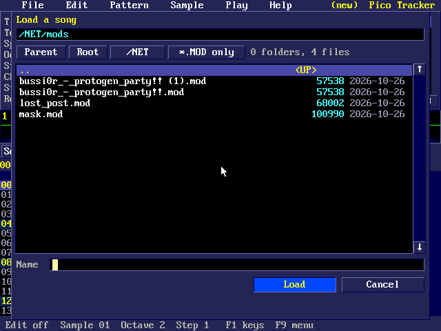
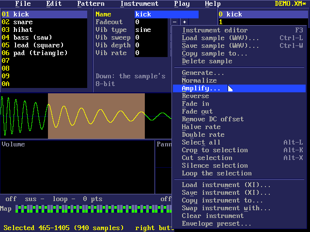
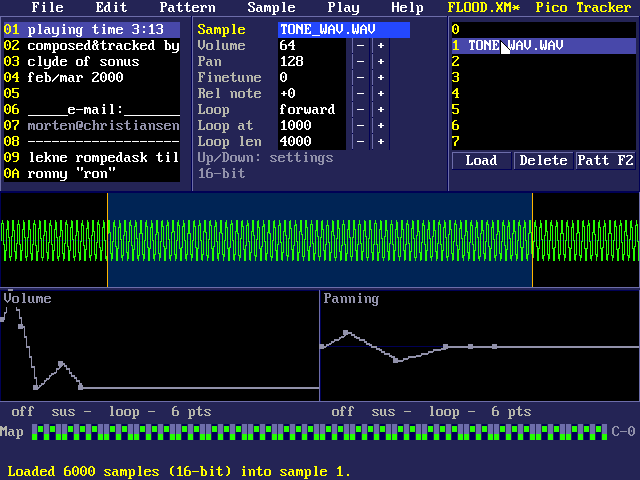
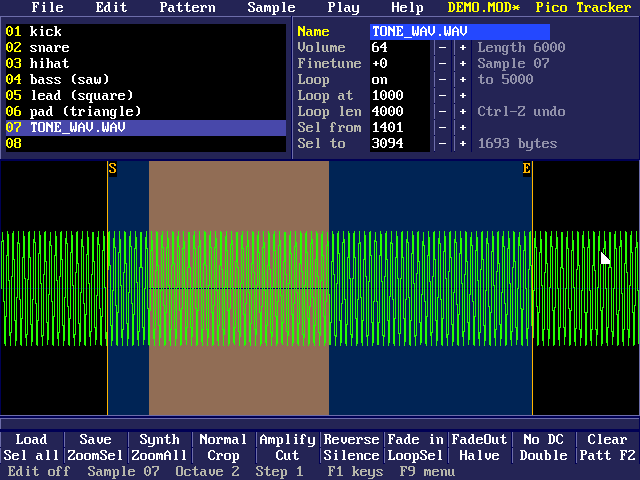

# Pico 2 mini OS MOD Tracker

`tracker [file]` (or `mod`) is a ProTracker style editor for MOD songs (4, 6 or 8 channels), which also loads, edits and saves FastTracker 2 XM songs. `modplay file` plays a MOD or XM song without the editor.

## The tracker

`tracker` (or `mod`) edits and plays ProTracker `.MOD` songs on the
640 x 480 graphics screen: `tracker /MUSIC/SONG.MOD` opens one, `tracker`
alone starts a new song. No songs come with the source: use your own, or
make a short demo song with `python3 tools/make_demo_mod.py` (it writes
`examples/DEMO.MOD`; copy it to `/EXAMPLES` on the drive). `modplay
file.mod` just plays one.

- **Songs:** 4, 6 or 8 channels (M.K., M!K!, FLT4, 4CHN, 6CHN, 8CHN, FLT8,
  OCTA), 31 samples, and old 15-sample Soundtracker files. Saving gives back
  the same bytes as were loaded (a 15-sample song is saved in the 31-sample
  layout). Up to 100 patterns and 128 positions. Songs load and save on the
  drive and on network shares (see the OS manual), through a file picker.
- **Playback** runs on core 1 at 48 kHz into the HDMI sound, as ProTracker
  plays: every effect 0-F and E0-EE (EF, invert loop, is ignored), with
  linear interpolation, Amiga panning (left, right, right, left) and a
  stereo separation setting. The song keeps playing while you edit.
- **Pattern screen (F2):** song settings (title, tempo, speed, octave, edit
  step, channels, stereo, restart), the order list, the sample list, a scope
  and level meter for each channel, the transport buttons, and the pattern
  (note, sample, effect for each channel). The row playing is red; with
  Follow on, the view moves with the song.
- **Sample screen (F3):** the sample's name, volume, finetune and loop, its
  waveform with the loop (orange S and E marks) and a selection, and tools:
  load (WAV 8/16/24/32-bit or float, stereo mixed to mono; IFF 8SVX; or raw
  8-bit), save as WAV (8-bit, with the loop), synthesize (sine, square, saw,
  triangle, noise), normalize, amplify, reverse, fade in/out, remove DC,
  clear, crop, cut, silence, loop the selection, halve or double the rate,
  copy to another sample, rename. A MOD sample holds at most 131070 bytes:
  longer files are cut.
- **Undo:** Ctrl-Z undoes and Ctrl-Y redoes, many steps back (up to 64
  steps, 3 MB of copies): notes and blocks in the pattern, the order list and
  song settings, sample and instrument settings, envelopes, the note map and
  the sample tools. Also in the Edit menu, greyed when there is nothing.
- **Menus:** F9 (or a click on the menu bar): File, Edit, Pattern, Sample
  (Instrument for XM songs), Play, Help, drawn in the tracker's own style:
  a raised bar, drop-downs with a shadow, shortcuts on the right, ticks on
  settings that are on, greyed items that can't be used now, and an
  underlined letter for each item (press it to choose it). The mouse
  highlights what it is over; press on a title and let go on an item, or
  click; Left/Right go to the next menu. The **right button** opens the Edit
  menu (pattern screen) or the Sample/Instrument tools (F3) where you click.
  Questions, names and numbers are asked in dialogs of the same style.
  Menus and dialogs are drawn off screen and put up in one go, and the
  mouse arrow is drawn by the video output itself, so nothing flickers as
  the mouse moves over them.

- **Loading and saving** (songs and samples) use a disk panel in the
  tracker's style: the folder, its folders and files with sizes and dates,
  a scroll bar, Parent / Root / each mounted share (`/NET`), a filter
  (`*.MOD` or all files), a name field and Load/Save. Arrows, PgUp/PgDn,
  Home/End move; Enter opens a folder or takes the file (or the name typed,
  which may be a path like `/NET/mods`); Backspace with the name empty goes
  up; Tab switches the filter; Esc cancels. With the mouse: click,
  double-click, the wheel, the scroll bar's arrows, track and thumb. Saving
  over a file asks first.

**XM songs** (FastTracker 2) load into the tracker too, and Ctrl-N offers
a new XM song (8 channels). The screen is the same, with XM's fields: note,
instrument, volume column and effect in each channel (six channels show at
once; the view follows the cursor, and the arrow buttons by the channel
headings scroll it), 2 to 32 channels, patterns of 1 to 256 rows (the Rows
setting), and the instrument list. The level meters show every channel
(click one to mute it, right-click to solo it). Notes go up to octave 7 (F11
and F12 change the octave); `1` or the key left of it writes a key off
(`===`). In the volume column `0`-`4` start a volume (00-40) and `-` `+` `d`
`u` `s` `v` `p` `l` `r` `m` its commands (slide down/up, fine down/up,
vibrato speed/depth, pan, pan slide left/right, tone portamento); effects
are typed as FT2 shows them (0-9, A-Z). Blocks, transpose, rows, new and
cloned patterns, play, follow and record work as for MODs. Saving writes an
XM (a file loaded and saved unchanged comes back byte for byte). F3 is
the instrument screen for XM songs.

**MOD to XM:** File > Convert to XM, or Save As with a `.XM` name, makes the
MOD into an XM that plays the same (checked against libopenmpt): Amiga
frequencies, ProTracker's C-1..B-3 as FT2's C-3..B-5, one instrument per
sample with its sound and loop, finetunes in FT2's steps (and the small
difference between the Amiga's and FT2's base pitch), arpeggios in FT2's
order, the Amiga's left-right-right-left panning (at the Stereo setting) as
panning commands in the volume column, and the other effects as they were.

**The XM instrument screen** (F3; F2 goes back): the instruments on the
left (`-` and `=` choose; one past the last makes a new one), the chosen
instrument's settings (name, fadeout, auto-vibrato type, sweep, depth, rate)
and its samples (up to 16; `[` and `]` choose), the chosen sample's settings
(name, volume, pan, finetune, relative note, loop off/forward/ping-pong,
loop start and length) and its waveform with the loop (drag its orange
ends). Up/Down go through the settings, Left/Right (PgUp/PgDn: 16 times as
far) change them, Enter types them. **Load** (or Ctrl-L) reads a WAV (8 to
32-bit or float, stereo mixed) into the chosen sample as 16-bit, with its
loop; **Delete** removes a sample. The volume and panning **envelopes**: click
an empty place to add a point, drag points, right-click one to delete it (12
at most); their on/off, sustain point and loop (from-to) are settings too
(Left/Right step through the points). The **note map** below them is a
96-key piano coloured by sample: click or drag across it to give those notes
the chosen sample. The piano keys play the instrument.

Drag across the waveform to **select** part of it (Alt-L all, Alt-U none).
The **Instrument menu** (or the right button on this screen) has the sample
tools, on 16-bit sound: generate (sine, square, saw, triangle, noise, in tune
at C-4), normalize, amplify, reverse, fade in/out, remove DC, halve or
double the rate (the relative note follows, so it sounds the same), select
all, crop (Alt-K), cut (Alt-X), silence, loop the selection, copy the sample
into another instrument, delete it; **save the sample** as a 16-bit WAV at
the rate C-4 plays it, with its loop (and loading a WAV sets the relative
note and finetune from its rate). For the instrument: load and save **.XI**
files (FT2's instrument files, with all their samples), copy it to another
number, swap it with another, clear it, and **envelope presets** (piano,
organ, pad, pluck, tremolo; pan sweep, autopan). Everything here can be
undone.

- Leaving with unsaved changes asks whether to save them. F1 shows all the
  keys.

| Key | Action |
|---|---|
| F1 / F2 / F3 | Help / pattern screen / sample screen |
| F4 | Keyboard to the pattern, the order list, or the song settings |
| F5 / F6 / F7 / F8 | Play the song / loop the pattern / play from the cursor / stop |
| Space | Stop if playing, otherwise record (edit) mode on or off |
| Z S X D C V G B H N J M , L . ; / | Piano keys: the base octave (C D E F G A B C D E) |
| Q 2 W 3 E R 5 T 6 Y 7 U I 9 O 0 P | Piano keys, an octave up |
| F11 / F12, `[` / `]`, `-` / `=` | Octave down/up, edit step down/up, sample down/up |
| `<` / `>` | Previous / next song position |
| Arrows, Tab, PgUp/PgDn, Home/End | Move (Tab: next channel; 16 rows; first/last row) |
| 0-9, A-F | In the sample, effect and parameter columns: type the digit (record on) |
| Del, Ins, Backspace, Enter | Clear the field; insert or delete a row in the channel; play the row |
| Alt-B, Alt-E, Alt-L, Alt-U | Begin / end block, mark channel (twice: pattern), unmark |
| Alt-C, Alt-X, Alt-V, Alt-M | Copy, cut, paste, mix paste (only fills empty fields) |
| Alt-Q / Alt-A, Alt-W / Alt-S | Transpose a semitone up/down, an octave up/down (block or cursor) |
| Alt-I / Alt-D | Insert / delete a row in all channels |
| Alt-N / Alt-K / Alt-R | New pattern, clone the pattern, clear the pattern |
| Alt-F / Alt-G | Write the speed / tempo as an Fxx effect at the cursor |
| Ctrl-S / Ctrl-O / Ctrl-N | Save, load, new |
| Ctrl-T / Ctrl-L / Ctrl-U | Mute the channel, solo it, unmute all |
| Ctrl-F | Follow the song on or off |
| Ctrl-Q, Esc | Quit |

On the sample screen Up/Down choose a setting, Left/Right (PgUp/PgDn: 16
times as far) change it and Enter types it; the piano keys play the sample;
Alt-L selects all, Alt-U unselects, Alt-Z zooms to the selection, Alt-O
zooms out, Alt-+ / Alt-- zoom, Alt-, / Alt-. scroll, Alt-X cuts and Alt-K
crops; Ctrl-L loads and Ctrl-W saves a sample.

**With a mouse:** click the buttons, fields (and their - and + buttons),
samples, positions and pattern cells; drag in the pattern to mark a block;
drag on the waveform to select, or drag its S and E marks to move the loop;
drag the bar under it to scroll. The wheel moves the pattern, changes the
value under the pointer, or zooms the waveform. Click a scope or a channel
heading to mute it; right-click a scope to solo it; right-click elsewhere
for the menus. Double-click a sample to edit it, or a pattern cell to switch
record mode.

The status bar shows the mixer's share of core 1 ("CPU", about 4% for four
channels) and `!` if the sound ever skipped.

## Playing songs: modplay

`modplay file` plays a MOD or XM (FastTracker 2) song from the drive or a share once through the HDMI sound; any key stops it. BASIC's `MUSIC` statement uses the same player.
