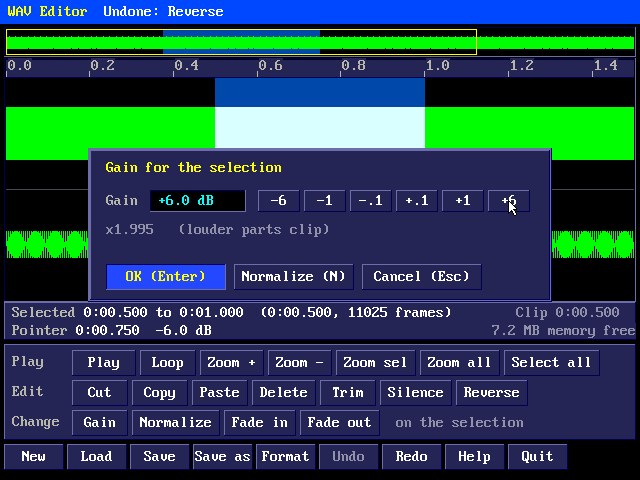
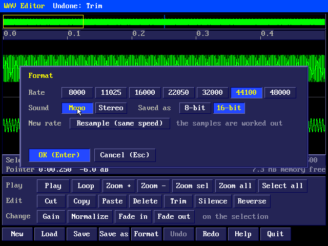
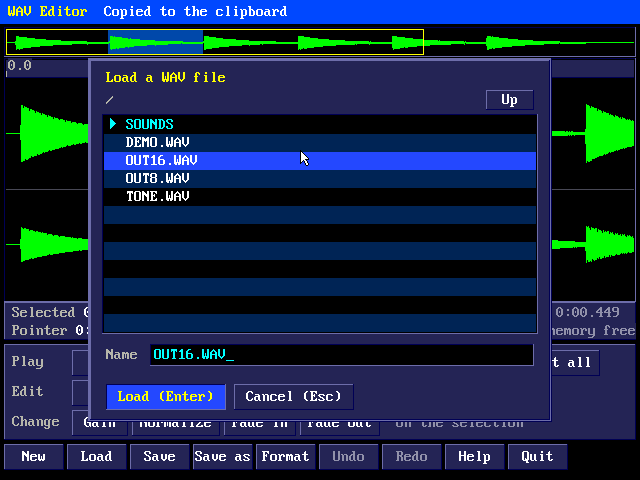
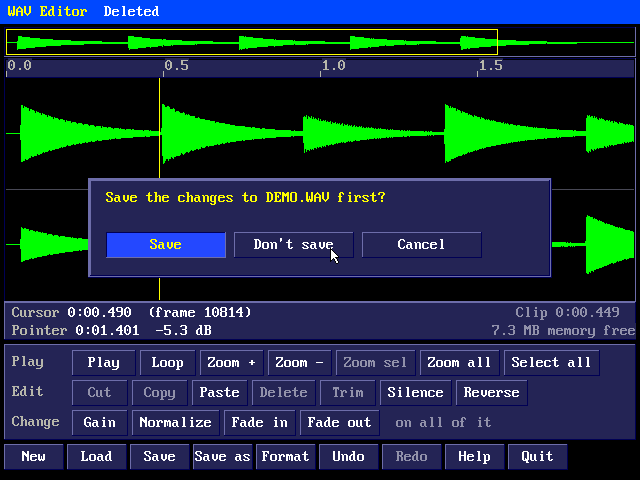
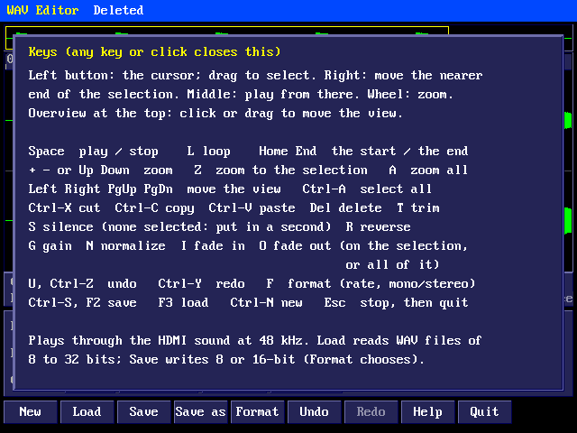

# Pico 2 mini OS WAV Editor

A sound editor for WAV files, worked with the mouse: see the whole sound
and zoom into it, select part of it, cut, copy, paste, delete and trim,
change its level (gain, normalize, fades), reverse it or make it silent,
change its rate or make it mono or stereo, undo and redo, and hear it
through the HDMI sound as you go.

## The editor


`wav` (or `wavedit`) opens the editor on an empty sound (44100 Hz, mono,
16-bit); `wav DRUMS.WAV` opens that file (or starts a new one by that
name). It needs a USB mouse; the keys do the rest.

From the top:

- **The title strip:** the file (with `*` when it has changes not saved),
  its rate, bits, mono or stereo, and its length; messages for a few
  seconds.
- **The overview:** the whole sound, with the selection shaded and the
  part shown in the waveform outlined in yellow. Click or drag on it to
  move the view there; the wheel over it scrolls.
- **The time ruler**, in seconds (minutes:seconds when zoomed out).
- **The waveform:** one lane, or two for stereo (left above, right
  below). Zoomed out, each column of the screen shows the lowest and
  highest sample under it; zoomed right in (16 screen pixels a frame),
  the line between the samples. The selection is shaded blue with the
  sound in it drawn white; the cursor (where a paste goes when nothing is
  selected) is a yellow line, and the play position an orange one.
- **Two lines** about the selection (its start, end, length in time and
  in frames) or the cursor, the clipboard's length, the time and level
  (dB below full scale) under the pointer, and the memory free.
- **The buttons:** Play (Stop while playing), Loop, Zoom + and -, Zoom
  sel (the selection fills the view), Zoom all and Select all; Cut, Copy,
  Paste, Delete, Trim, Silence and Reverse; Gain, Normalize, Fade in and
  Fade out. Buttons that can't do anything now are greyed.
- **The file buttons** along the bottom, as in the sprite editor: New,
  Load, Save, Save as, Format, Undo, Redo, Help (the keys) and Quit.

### The mouse

| | Does |
|---|---|
| Left button on the waveform | puts the cursor there; drag to select (past either end, the view follows) |
| Double click | selects all of it |
| Right button | moves the nearer end of the selection there (drag to keep moving it) |
| Middle button | plays from there |
| Wheel on the waveform | zooms in and out around the pointer |
| Click or drag on the overview | moves the view there; the wheel there scrolls |

### Playing

**Play** (or Space) plays the selection, or with none selected from the
cursor to the end; Space or **Stop** stops it, and so does Esc. With
**Loop** on (L), the selection plays round and round (with none, the
whole sound from the start each time). The view follows the play
position a page at a time. The sound goes out through the HDMI sound at
48 kHz, whatever the file's rate (it is worked out between the samples),
at half its level so that loud sounds don't clip on the way.

### Editing

| Button | Key | Does |
|---|---|---|
| Cut | Ctrl-X | the selection to the clipboard, and out of the sound |
| Copy | Ctrl-C | the selection to the clipboard |
| Paste | Ctrl-V | the clipboard in at the cursor, in place of the selection if there is one; the pasted part is left selected |
| Delete | Del, Backspace | the selection out of the sound |
| Trim | T | keeps only the selection |
| Silence | S | makes the selection silent; with none selected, puts a second of silence in at the cursor |
| Reverse | R | backwards |

The clipboard stays while the editor runs, so it can go from one file to
another (Load in between). Pasted mono sound becomes the same on both
sides of a stereo one; stereo pasted into mono is mixed. The clipboard's
samples are pasted as they are, so a clip from a file of another rate
plays faster or slower there (change the rate of one first with Format).

### Changing the level

These work on the selection, or on all of the sound if nothing is
selected (the panel says which).

| Button | Key | Does |
|---|---|---|
| Gain | G | louder or quieter by the dB chosen in the gain box |
| Normalize | N | the loudest sample made full scale, the rest in step |
| Fade in | I | from silence at the start to as it was at the end, in a straight line |
| Fade out | O | from as it was to silence at the end |



The gain box goes from -48 to +48 dB: -6, -1, -.1, +.1, +1 and +6 (or
Left/Right a dB, Up/Down a tenth, PgUp/PgDn 6 dB, or the wheel), and
shows what that multiplies by. +6 dB is about twice as loud, -6 dB half.
Samples that would go past full scale are held at it (they clip), so
Normalize is the way to make something as loud as it can be without
clipping. **Normalize** in the box (N) normalizes instead.

### Undo

Undo (U or Ctrl-Z) and Redo (Ctrl-Y) go back and forward 32 steps:
every edit, effect and format change. Each step keeps a copy of the
sound it changed (a format change keeps the whole sound as it was), so
undo uses memory: when the memory runs short, the oldest steps are
forgotten to make room, and a change too big to keep a copy of is done
all the same, saying "too big to keep for undo". Loading or New forgets
them all.

### The view

| Key | Does |
|---|---|
| + / - or Up / Down | zoom in / out (around the selection or cursor) |
| Z | zoom to the selection |
| A | zoom all (the whole sound) |
| Left / Right | move the view an eighth of the way |
| PgUp / PgDn | a page |
| Home / End | the cursor to the start / the end, and the view with it |
| Ctrl-A | select all |

### Format



**Format** (F) changes the rate (8000, 11025, 16000, 22050, 32000, 44100
or 48000 Hz; Left/Right), mono or stereo (M, S), and whether Save writes
8 or 16-bit samples (8, 1). A new rate is either:

- **Resample (same speed)**: the sound is worked out again for the new
  rate, so it sounds the same (higher rates in a straight line between
  the samples; lower ones averaging the samples each new one covers, which
  keeps out most of the harshness of just dropping them); or
- **Relabel (speed changes)** (R): the samples are kept and only the rate
  changes, so the sound plays faster and higher (or slower and lower).

Stereo made mono mixes the two sides; mono made stereo puts the same on
both. Format changes can be undone.

### Loading and saving



Load and Save as open a file box on the file's folder (or the shell's):
folders first, then the .WAV files. Click a folder to go into it, Up (or
Backspace) to go back; click a file to choose it (twice to load it), or
type a name. Enter loads or saves; a name without an extension gets
.WAV. Saving over another file asks first.

Load reads PCM WAV files of 8, 16, 24 or 32 bits and 32-bit float, mono
or stereo, at any rate from 1000 to 192000 Hz; of a file with more
channels, the first two are kept. The editor keeps 16-bit samples, so
24-bit, 32-bit and float files are kept to 16 bits (the message says
so). Save writes a plain PCM WAV: 16-bit, or 8-bit if the file was 8-bit
or Format says so, at the sound's rate.



New, Load and Quit ask about changes not saved: **Save** saves them first
(asking for a name if the sound has none), **Don't save** goes on
without them.

### Keys



Help (or F1) shows them in the editor too.

| Key | Does |
|---|---|
| Space | play / stop |
| L | loop on or off |
| Ctrl-X, Ctrl-C, Ctrl-V | cut, copy, paste |
| Del or Backspace | delete the selection |
| T | trim to the selection |
| S | silence (with none selected: put in a second) |
| R | reverse |
| G | gain |
| N | normalize |
| I / O | fade in / fade out |
| + - Up Down, Z, A | zoom in / out, to the selection, all |
| Left Right PgUp PgDn | move the view |
| Home / End | the start / the end |
| Ctrl-A | select all |
| U or Ctrl-Z / Ctrl-Y | undo / redo |
| F | format |
| Ctrl-S or F2 | save |
| F3 or Ctrl-O | load |
| Ctrl-N | new |
| F1 | the keys |
| Esc | stop playing; when not playing, quit (asks first if there are changes to save) |

## How long a sound can be

The sound is kept in PSRAM as 16-bit samples, so it can be as long as
the memory free allows (the second line shows it; about 7 MB with
nothing else running):

| Sound | A second takes | 7 MB holds about |
|---|---|---|
| 8000 Hz mono | 16 KB | 7 minutes |
| 22050 Hz mono | 44 KB | 2.7 minutes |
| 22050 Hz stereo | 88 KB | 80 seconds |
| 44100 Hz stereo | 176 KB | 40 seconds |

Undo needs room too: an effect on all of a sound keeps a copy of all of
it. With a long sound, select the part to change, or expect the oldest
undo steps to be forgotten. A file too long to load says how much memory
it needs.

## From the shell

```
wav                         the editor, on an empty sound
wav DRUMS.WAV               the editor, on that file
wav info DRUMS.WAV          DRUMS.WAV: 22050 Hz, 16-bit, 2 channels, 0:02.000 (44100 frames)
```

## How it works

The editor keeps the sound, the clipboard, the undo steps, a summary of
the sound (the lowest and highest sample of every 512 frames, for the
overview and for drawing it zoomed out quickly) and a picture of the
whole screen in PSRAM while it runs, and nothing at all once it ends.

This board's PSRAM has had a few cells that forget after a minute or
more untouched. So, as the text editor does with its text, every 8 KB of
the sound, the clipboard and the undo steps has a checksum (kept in the
Pico's own memory while the editor runs), and every 15 seconds each
block is read from the chip, checked and written back, which renews it.
If a block has changed by itself, the title strip says **MEMORY ERROR**
in red, and Save won't write over the file it came from: Save as a new
file, and compare.

Playing runs on core 1 in the sound mixer, at 48 kHz: each output sample
is worked out in a straight line between the two samples of the sound
around it. The waveform's columns are worked out when the view changes;
dragging a selection redraws only the waveform, straight onto the
screen, and the play position moves by redrawing the two columns it
leaves and enters.

`tools/wavtest/uitest.sh` builds the editor on a PC and works it with a
simulated mouse and keys, checking loading, selecting, cut, copy, paste,
delete, trim, every effect and their undo and redo, format changes,
saving 8 and 16-bit files and reading them back, playing, the checksums
catching a changed bit, and running out of memory (under ASan); it
writes the pictures in this manual.
