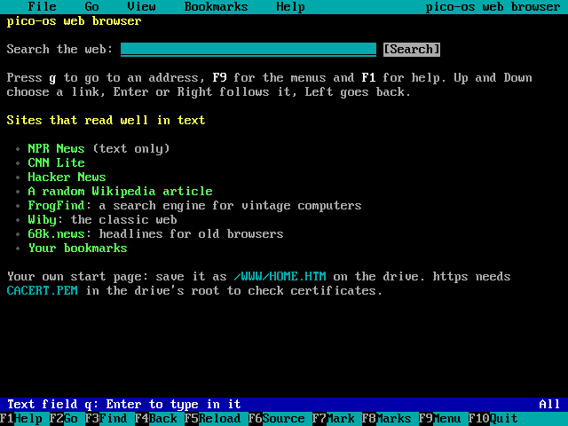
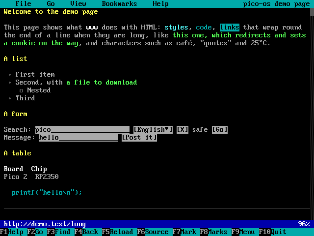
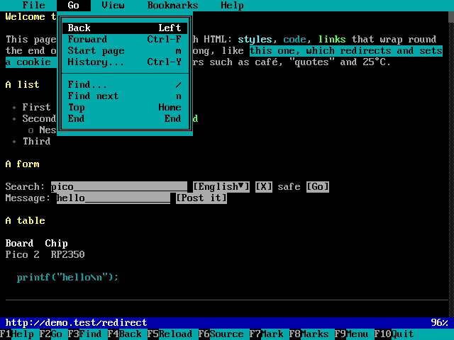
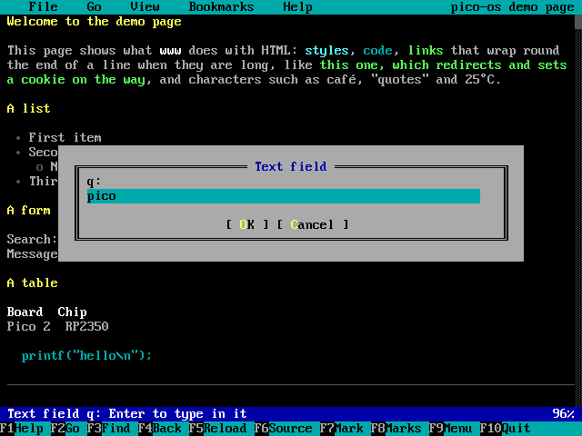
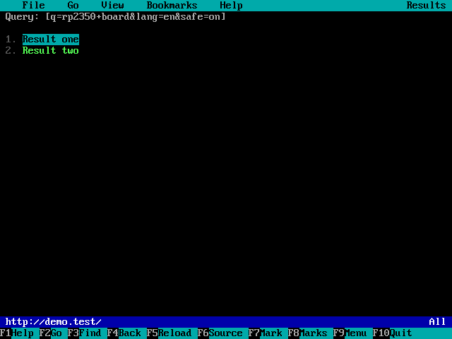
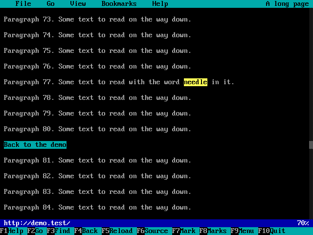
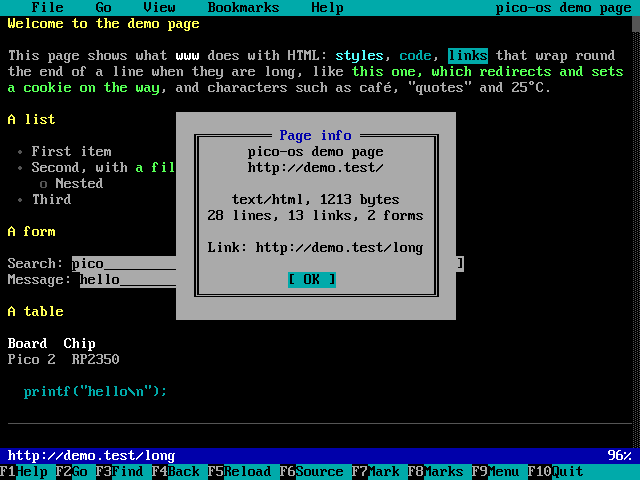

# Pico 2 mini OS Web Browser

`www` (or `lynx`) is a text web browser in the manner of lynx: it loads
pages over http and https (the same network and TLS code as `wget`) and
shows them as text on the 80x30 screen, with their links and simple
forms. There are no pictures, scripts or styles; most news, reference
and search pages read well. It needs WiFi (`wifi connect`), and for https
the certificate file `CACERT.PEM` in the drive's root (as for `wget`).

## Starting

- `www` opens the start page: `/WWW/HOME.HTM` on the drive if there is
  one, else a built-in page with a search box and some sites that work
  well in text.
- `www text.npr.org` (or `www https://text.npr.org/`) opens that address.
  Without `http://` or `https://`, https is used.
- `www /DOCS/PAGE.HTM` opens a page on the drive (also `file:///...`).
- `www raspberry pi pico` searches the web for those words (DuckDuckGo's
  HTML page).

## The screen

- **The menu bar** at the top: File, Go, View, Bookmarks and Help, as in
  mc and the tracker. F9 (or Alt and a title's first letter, or a click)
  opens it. The page's title is on the right.
- **The page**, 78 characters wide. Headings are yellow, bold text white,
  italics light cyan, code cyan, a picture's alt text magenta in
  `[brackets]`. **Links are green**; the link chosen is black on cyan.
  Form fields are grey, with `____` for the room in a text field, `[X]`
  for a checkbox, `(*)` for a radio button and `[choice▼]` for a list.
- **The scroll bar** on the right (when the page is longer than the
  screen): click it to jump there.
- **The status line** says where the chosen link goes (or what the form
  field is), and how far down the page is shown. While a page loads it
  shows the progress: looking up the name, connecting, the TLS handshake,
  the kilobytes so far. Esc stops loading and shows what arrived.
- **The key bar** at the bottom: click a key to press it.

## Keys

| Key | |
|---|---|
| Up, Down, Tab | The previous or next link. When the next one isn't on the screen, the page scrolls half a screen. |
| Enter, Right | Follow the link, or work the form field (below). |
| Left, Backspace, F4 | Back. Ctrl-F goes forward again. |
| PgDn, Space / PgUp, b | A screen down / up. |
| Home / End | The top / the end of the page. |
| g | Go to an address (or type words to search for them). |
| G, F2 | Edit this page's address and go there. |
| o | Open a file on the drive. |
| /, F3 | Find text on the page (any case); **n** finds it again (from the top after the end). |
| \\, F6 | The page's source (the HTML as it came), and back. |
| r, F5 | Load the page again. |
| m | The start page. |
| a, F7 / v, F8 | Bookmark this page / show the bookmarks. |
| d | Download the chosen link's file to the drive. |
| s / p | Save the page's source / save it as text (as shown). |
| = | About the page and the chosen link. |
| Ctrl-Y | The history: pick a page to go back (or forward) to. |
| h, F1 | Help (the keys). |
| q, F10 | Quit. |

The mouse: click a link to follow it, right-click to go back; the wheel
scrolls; click the menu bar, the key bar or the scroll bar.

## Forms

Search boxes and simple forms work. Choose a field with Up and Down, then
Enter:

- **A text field** (or a password, or a text area) opens a box to type in
  (Ctrl-U clears it). In a form with only one text field, such as a
  search box, Enter in the box sends the form at once.
- **A checkbox** is ticked or cleared; **a radio button** is chosen (the
  others of its group are cleared).
- **A list** opens the choices to pick from.
- **A button** (`[Search]`, `[Go]`) sends the form, by GET or POST as the
  page asks.

Cookies a site sets are kept (in PSRAM) until the browser closes, so logins
and sites that need a cookie work while it is open.

## Finding text

`/` asks for the text; the page scrolls to it and it is shown in yellow
(and a link on that line is chosen). `n` finds the next one.

## Bookmarks, saving and downloading

- **a** adds the page to `/WWW/BOOKMARK.HTM` (an HTML page of links: edit
  it with `edit` if you like); **v** opens it.
- **d** downloads the chosen link to the drive (it asks for the name).
  Following a link to something that isn't a page (a ZIP, a picture, a
  program) asks the same. Files up to 4 MB go through PSRAM; for bigger
  ones use `wget`.
- **s** saves the page's HTML, **p** the page as text (CRLF lines, as on
  the screen).
- `/WWW/HOME.HTM` on the drive replaces the start page: any HTML page, for
  example your bookmarks copied there.

## What it does and doesn't do

- HTML is read in one pass: paragraphs, headings, lists (numbered and
  nested), definition lists, quotes, `<pre>` text, rules, tables (each row
  on a line, the cells side by side), links, anchors (`#name`), frames and
  meta refreshes (as links), forms, entities and UTF-8 or Latin-1 text.
  Characters the screen's font (code page 437) lacks are shown as the
  nearest one (accents dropped, curly quotes straight) or `?`.
- Not done: pictures, JavaScript, CSS, layout tables side by side, text
  areas of more than one line, file uploads, compressed replies (the
  browser doesn't ask for them), HTTP/2.
- Pages up to 4 MB are loaded; bigger ones are cut there.
- https: the certificate is checked against `CACERT.PEM` (see the *Network
  Tools* manual). If it can't be checked, the browser asks whether to load
  the page anyway (Yes, No, or Always for this session); View > Check
  certificates turns checking off and on.
- It identifies itself as lynx, so sites send their simple pages.

## Memory

Everything the browser keeps is in PSRAM, and only while it is open: the
pages it has shown (up to 3 MB of them, so Back doesn't load them again;
older ones are loaded again when needed), each page laid out, the
history (40 pages), the cookies. While a page loads, the network uses the
same SRAM as `wget` (a 16 KB receive buffer, and about 40 KB more for
https).

## Testing on a PC

`tools/wwwtest/uitest.sh /absolute/out/folder` builds the browser for a
PC with its real screen, menus, dialogs and fetcher against a pretend web
server, drives it with keys and the mouse (pages, links, a redirect that
sets a cookie, the forms by GET and POST, find, the source, a download,
bookmarks, the history, help), checks what the screen shows, and writes
the screenshots in this manual (`www_*.png`). It also lays out thousands
of random and cut-off pages and checks URLs are resolved as browsers do,
all under AddressSanitizer.
